# Arquitectura y diseño del producto

**Proyecto:** Huertos Medicinales Comunitarios  
**Equipo:** techmOS  
**Integrantes:** Mauricio López · Dhalin Avila · Oscar Gualotuña · Christian Yanchatipan · Jean Espinosa · Gabriel Vinueza  
**Entrega:** Versión 1 del producto · primer incremento (HU-001 a HU-020)  
**Versión documental:** 1.0  
**Fecha de edición:** 12 de noviembre de 2026  
**Rama de referencia:** `develop`  
**Institución:** Escuela Politécnica Nacional · Ingeniería de Software · Calidad de Software (ISWD652) · GR2SW · Período 2026-B

La arquitectura de la iteración 1 define las piezas y decisiones técnicas que permiten implementar el alcance acordado en las 20 historias de usuario. Este documento presenta el enfoque elegido, las decisiones principales, las vistas de contexto, contenedores y componentes, y las decisiones transversales de seguridad, calidad y despliegue. El detalle de las historias y sus criterios de aceptación se encuentra en los documentos de requisitos y pruebas; los diagramas de clases y de base de datos corresponden a la parte de diseño.

## 1. Enfoque arquitectónico

La decisión principal para la versión 1 es construir un **monolito modular**: una aplicación backend de Spring Boot organizada por funciones del producto. Los paquetes `acceso`, `huertos`, `plantas`, `cultivos`, `fotos`, `actividades`, `luna`, `retos`, `consulta` y `comun` permiten localizar las responsabilidades de cada función dentro de la misma aplicación. Esta organización responde al tiempo de la iteración y al trabajo del equipo.

El usuario interactúa desde una interfaz React en el navegador. La interfaz solicita información y envía operaciones a la API REST del backend; PostgreSQL conserva los datos. Esa comunicación entre navegador y servidor puede describirse como **cliente-servidor**, pero no cambia el enfoque principal de monolito modular. Spring Boot entrega también los archivos compilados de React, de modo que la interfaz y la API se ofrecen desde un mismo origen. La base de datos se configura como una pieza separada.

La separación por funciones no implica que cada paquete sea una aplicación autónoma ni que esté completamente aislado. En la implementación, algunos servicios consultan repositorios de otras funciones. Las vistas siguientes muestran las piezas y relaciones principales del sistema. La corrección integrada en `develop` incorpora un catálogo institucional de plantas dentro del paquete `plantas`, sin cambiar este enfoque arquitectónico.

## 2. Decisiones de arquitectura

Se conserva la numeración `AD-01` a `AD-11` del diseño original para relacionar cada decisión con las referencias del proyecto. La tabla reúne la decisión, su motivo y la alternativa considerada. El contenido se ajusta a lo implementado en la primera iteración.

| ID | Decisión | Motivo | Alternativa descartada |
|---|---|---|---|
| AD-01 | Monolito modular organizado por funciones. | Permite integrar el trabajo en una aplicación y localizar las responsabilidades de cada función. | Microservicios: añaden despliegues y comunicación por red para este primer incremento. |
| AD-02 | Backend Spring Boot y frontend React; Spring Boot entrega la interfaz compilada. | La interfaz y la API se ofrecen desde un mismo origen. | Desplegar frontend y backend por separado. |
| AD-03 | Sesión de servidor con cookie y protección CSRF. | Permite controlar el acceso a gestión y cerrar la sesión en el servidor. | JWT para la sesión del navegador. |
| AD-04 | Escena 3D generada a partir de zonas y cultivos guardados como datos. | La representación virtual usa la información del huerto. | Mantener un modelo 3D independiente por huerto. |
| AD-05 | Fotografías almacenadas en PostgreSQL. | La fotografía y la siembra pueden guardarse o revertirse en una misma transacción. | Almacenamiento de objetos separado. |
| AD-06 | Cálculo lunar mediante interfaces sustituibles y reloj inyectado. | Permite utilizar efemérides reales y escenarios de prueba controlados. | Consultar un servicio externo de efemérides para cada cálculo. |
| AD-07 | Condición lunar e insignia calculadas al consultarlas. | Reflejan la versión vigente de las siembras. | Guardar resultados derivados y actualizarlos después de cada cambio. |
| AD-08 | Correcciones de siembra registradas como nuevas versiones. | Conservan el historial y la evidencia de los registros anteriores. | Sobrescribir la siembra y mantener un registro de cambios separado. |
| AD-09 | Autorización y validaciones en el servidor con mensajes identificables. | Las reglas se aplican también cuando una solicitud llega directamente a la API. | Validar únicamente en la interfaz. |
| AD-10 | Instantes de actividad con zona horaria definida por huerto. | La interpretación de la fecha local y de la fase lunar depende de la ubicación. | Guardar solo horas locales sin referencia de zona. |
| AD-11 | Referencias por identificador entre entidades de distintas funciones y composición de consultas públicas. | Reduce el acoplamiento del modelo de datos; las dependencias entre servicios se documentan según la implementación. | Crear relaciones directas entre todas las entidades de paquetes distintos. |

La incorporación del catálogo MSP precisa la aplicación de AD-09: el servidor valida que la ficha seleccionada exista y esté activa, y no admite que el líder modifique libremente su contenido educativo. El líder sí puede aportar una fotografía del ejemplar de su huerto. La carga inicial del catálogo se realiza mediante una migración de base de datos; no se añadió un servicio externo ni un editor institucional en esta iteración.

## 3. Vista de contexto (C4, nivel 1)

La vista de contexto muestra quién utiliza el producto y qué servicio externo interviene en la experiencia pública. El visitante consulta los huertos sin iniciar sesión. El líder inicia sesión para mantener la información de su huerto y registrar siembras. El mapa obtiene sus teselas de OpenStreetMap; los datos de huertos y cultivos provienen de la aplicación.

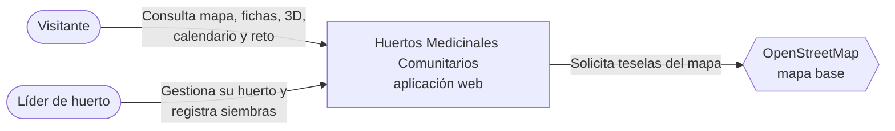

**Figura 1.** Contexto de la aplicación en la primera iteración.

La aplicación no se conecta con sistemas del MSP en esta versión. El catálogo inicial se carga con información trazada a sus lineamientos y queda almacenado en PostgreSQL. El alta administrativa de líderes no forma parte de la aplicación de esta iteración; las cuentas incluidas para la demostración son ficticias. OpenStreetMap aporta únicamente el mapa base; la información que aparece sobre él se mantiene en el producto.

## 4. Vista de contenedores (C4, nivel 2)

En esta vista, *contenedor* significa una pieza ejecutable o almacén de datos dentro del sistema, no necesariamente un contenedor Docker. La interfaz React se ejecuta en el navegador. Spring Boot expone la API REST y entrega los archivos compilados de la interfaz. PostgreSQL conserva los registros. El frontend y la API se ofrecen desde un mismo origen en la aplicación integrada.

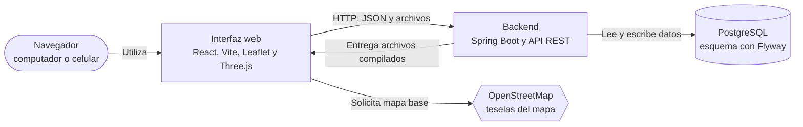

**Figura 2.** Contenedores lógicos del producto. La interfaz y el backend se entregan juntos; la base PostgreSQL se configura por separado.

| Contenedor | Tecnología principal | Responsabilidad |
|---|---|---|
| Interfaz web | React, Vite, React Router, Leaflet y React Three Fiber | Presenta las pantallas públicas y de gestión, el mapa, la escena 3D y el calendario; envía solicitudes a la API. |
| Backend | Spring Boot con Java | Atiende la API, gestiona sesiones y autorizaciones, aplica reglas de negocio, calcula información lunar y entrega la interfaz compilada. |
| Base de datos | PostgreSQL y Flyway | Conserva huertos, catálogo institucional, plantas vinculadas al catálogo, cultivos, fotografías y actividades con sus versiones; Flyway aplica las migraciones del esquema. |

La interfaz no decide si un usuario está autorizado a modificar un huerto. Puede guiar la interacción, pero la comprobación se realiza en el backend. Esta separación mantiene las reglas del producto en el servidor aun cuando una solicitud se envíe directamente a la API.

## 5. Vista de componentes del backend (C4, nivel 3)

El backend es una sola aplicación organizada en diez paquetes funcionales. La vista identifica qué responsabilidad concentra cada paquete y cómo participan en los flujos principales. Los nombres corresponden a la organización del código, no a diez servicios desplegados por separado.

### 5.1. Paquetes y responsabilidades

| Paquete | Responsabilidad principal |
|---|---|
| `comun` | Define los códigos y textos de error de la API, convierte las excepciones en respuestas HTTP, configura el reloj usado para comprobar fechas y permite abrir las rutas de la interfaz React desde Spring Boot. |
| `acceso` | Inicio y cierre de sesión, configuración de seguridad y autorización para operar sobre el huerto asignado. |
| `huertos` | Datos de comunidades, huertos y zonas; actualización y publicación de la información del huerto. |
| `plantas` | Consulta del catálogo institucional, selección de fichas para el huerto y gestión de sus fotografías; el contenido educativo de la ficha no se edita libremente desde la aplicación. |
| `cultivos` | Ubicación de una planta en una zona del huerto y estado de ese cultivo. |
| `fotos` | Validación, almacenamiento y entrega de fotografías según el acceso permitido. |
| `actividades` | Registro de siembras, reintentos, correcciones, bitácora e historial de versiones. |
| `luna` | Fases lunares, condición de una siembra y calendario de actividades por fase. |
| `retos` | Evaluación de la insignia *Documentación lunar* a partir de las siembras vigentes. |
| `consulta` | Composición de la información pública de huertos, plantas, cultivos y zonas para el visitante. |

### 5.2. Colaboración entre funciones

El siguiente diagrama corresponde a la vista de componentes del backend (nivel 3 de C4), la última vista C4 incluida en este documento. Resume las colaboraciones principales entre paquetes funcionales. Las flechas representan esa colaboración; no pretenden enumerar todas las importaciones entre clases Java.

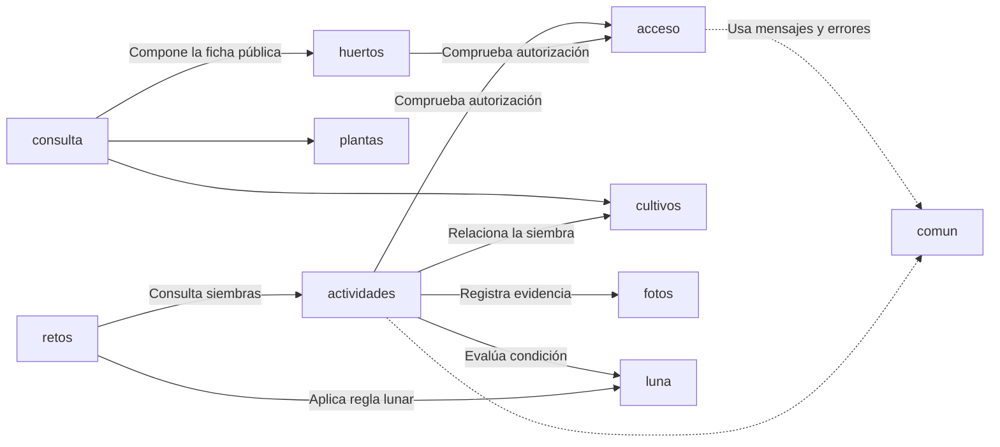

**Figura 3.** Colaboraciones principales del backend en la primera iteración. Las flechas salen del paquete que solicita una función hacia el que la proporciona.

En una consulta pública, `consulta` reúne información de `huertos`, `plantas` y `cultivos` y forma una respuesta para el visitante. En el registro de una siembra, `actividades` comprueba la autorización mediante `acceso`, relaciona el cultivo, guarda la fotografía con apoyo de `fotos` y utiliza `luna` para determinar la condición de la fecha registrada. `retos` consulta las siembras vigentes y aplica la regla de la insignia.

Dentro de `plantas`, `CatalogoMsp` consulta las fichas institucionales almacenadas en la base. Al seleccionar una ficha, el servidor vincula su código y su procedencia con la planta del huerto; la fotografía propia se gestiona por separado. Esta colaboración permanece dentro del monolito y, por ello, no se representa como otro contenedor en la Figura 2.

### 5.3. Organización interna de una solicitud

Una solicitud HTTP llega a un controlador. El controlador recibe los datos y delega la operación a un servicio. El servicio coordina autorización, reglas de negocio y persistencia mediante repositorios o consultas específicas a PostgreSQL. Las respuestas de la API se construyen con los datos que necesita cada pantalla. Este recorrido describe la forma general del backend; no exige que cada paquete tenga exactamente las mismas clases o capas.

## 6. Seguridad y acceso

La consulta de huertos publicados, calendario, catálogo y reto está disponible sin iniciar sesión. Las operaciones de gestión requieren una sesión de líder. La configuración de seguridad distingue las rutas públicas de las rutas de gestión, y los servicios comprueban que el líder pueda modificar el huerto relacionado con cada solicitud. La interfaz muestra las acciones disponibles, pero la autorización se decide en el servidor. Las cuentas ficticias de demostración permiten comprobar los permisos del producto, sin representar el alta administrativa de líderes.

El inicio de sesión utiliza una sesión mantenida por Spring Boot. La cookie de sesión se configura como `HttpOnly` y `SameSite=Lax`; en la imagen preparada para HTTPS también se habilita `Secure`. Para las operaciones que modifican datos, el navegador lee el token de la cookie `XSRF-TOKEN` y lo envía en la cabecera `X-XSRF-TOKEN`. Las contraseñas se verifican mediante BCrypt. Estas medidas corresponden a la decisión AD-03.

El acceso a una fotografía se comprueba antes de devolver su contenido. La consulta pública puede obtener fotografías asociadas a plantas o a versiones vigentes de siembras de huertos publicados; el líder puede consultar las evidencias de su huerto. La validación del archivo comprueba su tamaño y contenido antes de guardarlo. La respuesta de la API utiliza mensajes identificables para informar errores de negocio sin depender de las validaciones de la pantalla.

## 7. Persistencia, tiempo y cálculo lunar

PostgreSQL conserva la información del huerto, el catálogo institucional y las fotografías. Flyway aplica los cambios de esquema versionados con el código. La migración `V4__catalogo_institucional_msp.sql` incorpora cuatro fichas iniciales trazadas a los lineamientos del MSP y vincula las plantas de demostración que coinciden con ellas. Conserva los identificadores y las relaciones de cultivos, fotografías, siembras e historial; los textos educativos anteriores de las plantas coincidentes se sustituyen por los datos institucionales. Los registros sin correspondencia permanecen privados hasta su conciliación.

Cuando se registra una siembra, la fotografía, la actividad y su primera versión se guardan en una transacción. Una corrección agrega otra versión en lugar de reemplazar la anterior. Las claves de envío permiten reconocer los reintentos y evitar que una misma operación cree dos siembras. Estas decisiones desarrollan AD-05 y AD-08.

Las fechas de las actividades se guardan como instantes, mientras cada huerto conserva su zona horaria para interpretar la fecha local introducida por el líder. Así se puede comparar correctamente el momento de la siembra con los eventos de fase lunar. El cálculo astronómico se obtiene mediante una fuente de eventos separada de la lógica que clasifica la fase. En las pruebas se sustituye la calculadora por un calendario controlado y se fija el reloj; en el uso normal se emplean efemérides calculadas con Commons SunCalc. Estas fases alimentan el calendario lunar que consulta el usuario. La condición lunar y la insignia se obtienen al consultar las siembras vigentes, sin guardarlas como datos independientes.

## 8. Atributos de calidad y comprobación

Se toma **ISO/IEC 25010:2023** como referencia para seleccionar atributos de calidad relacionados con el uso y la operación del producto. En esta primera iteración se incorporan decisiones iniciales para atenderlos y se comprueban algunos comportamientos concretos. La tabla distingue esas bases implementadas de las verificaciones que todavía faltan; no representa una evaluación completa de cada atributo.

| Atributo | Base aplicada en la versión 1 | Comprobación y límite |
|---|---|---|
| Seguridad | Sesión de servidor, protección CSRF y autorización por huerto en los servicios. | P-003 y P-005 comprueban restricciones de acceso; P-063 conserva la comprobación del entorno HTTPS de entrega como parcial. Estas pruebas no constituyen una certificación general de seguridad. |
| Fiabilidad | Siembra y fotografía en una transacción; claves de envío e historial por versiones. | Los casos P-033, P-037 y P-065 comprueban reenvíos y fallos de guardado. La recuperación completa ante pérdida de infraestructura sigue pendiente de una prueba de operación. |
| Adecuación funcional | API y reglas de negocio vinculadas con las historias de la iteración. | La trazabilidad relaciona historias, criterios y casos de prueba. Los resultados específicos deben leerse en el documento de pruebas; la arquitectura por sí sola no demuestra las 20 historias. |
| Mantenibilidad | Paquetes por función, migraciones versionadas y cálculo lunar sustituible en pruebas. | La estructura se observa en el código y existen pruebas unitarias y de integración. No hay una medición formal de mantenibilidad. |
| Capacidad de interacción | Interfaz adaptable y lista de zonas y cultivos cuando la escena 3D no puede utilizarse. | P-028 comprueba la alternativa ante un fallo de la escena. P-027, la evaluación en Android físico con un huerto aprobado, sigue pendiente. |
| Eficiencia de desempeño | Escena 3D cargada cuando se necesita y validación del tamaño de las fotografías antes de leerlas por completo. | Son medidas implementadas para limitar trabajo y datos. Las mediciones formales P-066 y P-067 siguen pendientes. |
| Flexibilidad | Interfaz y backend preparados en una imagen Docker; PostgreSQL configurado por separado. | La imagen se construyó satisfactoriamente en el CI de `develop`. No se registra todavía una comprobación de la aplicación en un alojamiento externo. |

Estas decisiones sientan una base para la calidad del producto. En las siguientes versiones se podrán ampliar las pruebas con usuarios y dispositivos reales, medir el rendimiento, verificar la recuperación de datos y comprobar la ejecución en otros entornos. Esas actividades permitirán aplicar y evaluar los atributos con mayor profundidad, según el crecimiento del producto y las prioridades que se acuerden con el cliente.

## 9. Herramientas y tecnologías de desarrollo

Las tecnologías se eligieron para implementar la solución integrada y comprobar sus funciones. Las versiones indicadas son las declaradas en los archivos de configuración del proyecto; las versiones efectivamente instaladas dependen de la resolución del gestor de dependencias y del entorno de ejecución.

| Área | Herramienta o tecnología | Uso en la arquitectura |
|---|---|---|
| Backend | Java 21 y Spring Boot 4.1.2 | API REST, seguridad, servicios de negocio y entrega de la interfaz compilada. |
| Base de datos | PostgreSQL 17, Spring Data JPA y consultas JDBC | Persistencia transaccional de huertos, catálogo institucional, fotografías y actividades. |
| Migraciones | Flyway | Al iniciar el backend, aplica en orden los archivos SQL versionados pendientes (`V1` a `V4`) para crear o modificar la base de datos y cargar el catálogo inicial. Registra los cambios ya aplicados y evita repetirlos en cada arranque. |
| Frontend | React 19, TypeScript, Vite y React Router | Pantallas públicas y de gestión en el navegador. |
| Mapa | Leaflet, React Leaflet y OpenStreetMap | Ubicación y consulta de huertos publicados. |
| Escena 3D | Three.js y React Three Fiber | Three.js dibuja la escena 3D mediante WebGL en el navegador; React Three Fiber permite construirla con componentes React. La representación se genera a partir de las zonas y cultivos registrados. |
| Calendario lunar | Commons SunCalc 3.11 | Biblioteca Java integrada al backend que calcula localmente los instantes de las fases lunares utilizados por el calendario. No consulta una API web externa. |
| Pruebas | JUnit, Spring Boot Test, Testcontainers, Playwright y JaCoCo | Pruebas de lógica, API y navegador; cobertura del backend. |
| Empaquetado | Docker y Docker Compose | Construcción de la aplicación integrada y ejecución local con PostgreSQL. |

## 10. Despliegue y entornos

El `Dockerfile` construye primero la interfaz con Node, después la incorpora a los recursos estáticos del backend y empaqueta el JAR de Spring Boot. La imagen de ejecución contiene el JRE y el JAR, sin necesitar un servidor adicional para el frontend. PostgreSQL funciona como una pieza separada y se configura mediante `DB_URL`, `DB_USER` y `DB_PASSWORD`. Flyway aplica las migraciones al arrancar la aplicación.

| Entorno | Organización |
|---|---|
| Desarrollo local | Docker Compose inicia PostgreSQL. El backend y Vite pueden ejecutarse por separado para trabajar en el código. |
| Demostración local | Docker Compose puede construir e iniciar la imagen de la aplicación junto con PostgreSQL. El navegador accede a la interfaz y a la API desde el mismo origen. |
| Pruebas automatizadas | Las pruebas de integración utilizan una base PostgreSQL aislada; las pruebas de navegador emplean un perfil y datos controlados. |
| Alojamiento externo | La misma imagen está preparada para conectarse a una base PostgreSQL configurada en el servicio de alojamiento. Su ejecución externa debe verificarse y registrarse por separado. |

El CI del commit integrado en `develop` completó las pruebas del backend, la compilación del frontend, los recorridos de navegador y la construcción de la imagen Docker. Este resultado comprueba la construcción automatizada, pero no equivale a un despliegue público operativo. El estado de la ejecución en otros entornos corresponde al informe de pruebas y operación de la entrega.

## 11. Diseño del producto

<!-- Espacio para integrar el diagrama de clases, el modelo de base de datos y el resto del diseño. -->
### 11.1. Alcance y convenciones de las vistas

El diseño describe las funciones entregadas de I1: acceso del líder, datos y publicación del huerto, consulta pública y representación 3D, selección de plantas institucionales, cultivos por zona, registro y corrección de siembras con fotografía, evaluación lunar, calendario y una insignia comunitaria.

Las vistas se separan para que la estructura de clases, los datos físicos y el orden de una solicitud tengan un significado preciso:

| Vista | Qué representa |
|---|---|
| Clases de dominio | Atributos declarados de las entidades Java y relaciones de sus datos. |
| Clases de colaboración | Operaciones declaradas de los servicios, interfaces, repositorios seleccionados y utilidades. Las flechas muestran únicamente las colaboraciones dibujadas. |
| Modelo físico | Diez tablas de negocio tras aplicar V1 a V4; Flyway mantiene además su tabla técnica de historial. |
| API y contratos | Rutas HTTP existentes, tipo de solicitud, resultado y nivel de acceso. |
| Secuencias | Orden relevante de autorización, validación, bloqueo, persistencia y composición del resultado. |
| Interfaz web | Pantallas y archivos que consumen la API y generan la escena. |

En los diagramas de clases, `+` significa público, `~` acceso de paquete y `$` operación estática. Los nombres con guion bajo, como `CatalogoMsp_Ficha`, son identificadores gráficos de tipos anidados; su nombre Java es `CatalogoMsp.Ficha`. Los métodos de los servicios se extraen de sus declaraciones; se omiten constructores, métodos privados y accesores generados por Lombok. Las dependencias completas por constructor se registran en §11.5.

Las relaciones de dominio y del modelo físico expresan referencias entre registros. Una flecha por `huertoId`, `fotoId` o `actividadId` no supone que exista un atributo Java con un objeto de la entidad relacionada. `Huerto.comunidad` sí es una relación JPA de tipo `Comunidad`.

### 11.2. Reglas que condicionan el diseño

| Concepto | Comportamiento implementado |
|---|---|
| Autoridad del líder | La comunidad elige al líder y el MSP lo autoriza. La aplicación comprueba la sesión y su asignación en `huerto.lider_id`; no tramita esa autorización institucional. |
| Información medicinal | El catálogo inicial proviene de referencias de los lineamientos MSP. El líder selecciona una ficha y aporta su foto. El formulario y la API no admiten edición libre de nombres, usos ni contenido educativo. |
| Planta y cultivo | `Planta` es la ficha incorporada a un huerto; `Cultivo` vincula esa planta con una zona y conserva su propio estado. |
| Zona | `Zona.tipo` es `String`; SQL permite CULTIVO, CAMINO, CERCA y BODEGA. Solo CULTIVO admite nuevos cultivos mediante el servicio. |
| Publicación | Requiere nombre y coordenadas válidas. No exige tener una zona o un cultivo mínimo. |
| Coordenadas | El servidor y el esquema validan rangos globales de latitud y longitud. El mapa se centra en Ecuador; no hay una geocerca nacional implementada. |
| Evidencia | Una planta puede no tener foto; cada versión de siembra tiene foto obligatoria. Una corrección sin foto nueva conserva la vigente. |
| Tiempo | La hora local introducida se interpreta en la zona del huerto y se conserva como `Instant`. `registradaEn` y `fechaHecho` son momentos distintos. |
| Calendario lunar | Orienta la planificación de las plantaciones mediante fechas, fases y actividades. Su fase diaria se evalúa a las 12:00 de America/Guayaquil. |
| Siembra realizada | Se evalúa a su instante real. Creciente o llena produce CONFORME; oscura o menguante, NO_CONFORME; ausencia de fase, PENDIENTE. La condición no bloquea el registro del hecho. |
| Historial | Corregir crea una versión nueva; no modifica ni elimina versiones anteriores. Solo permite corregir fecha y/o foto con motivo; conserva técnica y descripción. |
| Insignia | Se deriva de al menos una siembra vigente, institucional y de un huerto publicado de la comunidad, con foto y condición conforme. No existe tabla de insignias. |

Las zonas y su geometría se preparan como datos para esta iteración; no existe un editor de construcción 3D. BODEGA representa una parte física en la escena y no implementa inventario. La información del catálogo no contiene dosificaciones ni indicaciones terapéuticas. El rol gubernamental, el trámite de autorización, el inventario y el ciclo completo de labores pertenecen a la evolución del proyecto.

### 11.3. Clases del dominio

#### 11.3.1. Comunidad, huerto y ficha de planta

Se muestran todos los atributos de las entidades incluidas. Los métodos de acceso generados por Lombok no se enumeran.


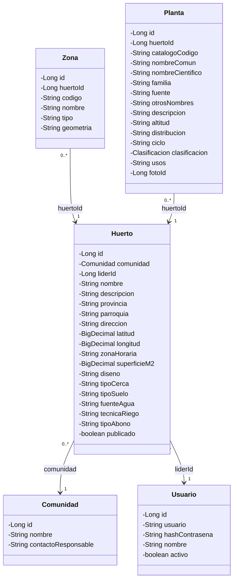


`Huerto.zona()` transforma `zonaHoraria`, que es un `String`, en un `ZoneId`. `Huerto.tieneCoordenadas()` comprueba la presencia de latitud y longitud. En esta iteración cada huerto tiene un líder asignado; el esquema no impone una restricción que limite un usuario a un único huerto.

#### 11.3.2. Cultivo, fotografía y versiones de actividad


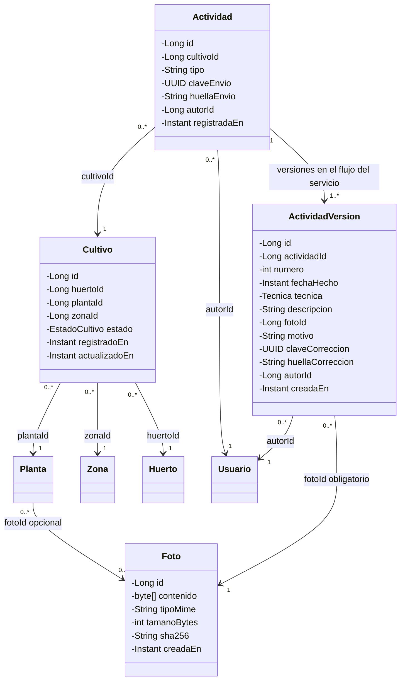


`Actividad` conserva la identidad y la clave del envío original; `ActividadVersion` conserva los datos del hecho en cada versión. La versión vigente es la de mayor `numero`. La multiplicidad `1..*` representa el resultado del registro atómico realizado por el servicio: SQL, por sí solo, permite que una actividad no tenga todavía versiones. Las fotos pueden ser referenciadas por varias filas; no se declara una relación uno a uno con foto.

Las operaciones de dominio de acceso de paquete que construyen o cambian esos objetos son:

```java
static Actividad siembra(Long cultivoId, UUID claveEnvio, String huellaEnvio, Long autorId, Instant ahora);
static ActividadVersion primera(Long actividadId, Instant fechaHecho, Tecnica tecnica, String descripcion,
                               Long fotoId, Long autorId, Instant ahora);
static ActividadVersion correccion(ActividadVersion vigente, Instant fechaHecho, Long fotoId, String motivo,
                                  UUID clave, String huella, Long autorId, Instant ahora);
void cambiarEstado(EstadoCultivo nuevo, Instant ahora); // Cultivo
```

Las firmas anteriores resumen operaciones existentes, no constituyen código adicional que deba agregarse. `ActividadVersion` se declara `@Immutable` y SQL impide UPDATE y DELETE mediante un disparador. No persiste `versionBase`, `faseLunar` ni `condicion`: el primero es un dato de solicitud y los dos últimos se obtienen al construir las vistas.

#### 11.3.3. Valores del modelo

| Tipo o atributo | Valores reales |
|---|---|
| `Clasificacion` | CALIENTE, FRIA. Puede faltar el dato institucional. |
| `EstadoCultivo` | SEMBRADO, EN_CRECIMIENTO, COSECHADO, PERDIDO. |
| `Tecnica` | SEMILLAS, ESTACAS, ESQUEJES, PLANTULAS. |
| `FaseLunar` | LUNA_OSCURA, LUNA_CRECIENTE, LUNA_LLENA, LUNA_MENGUANTE. |
| `FasePrincipal` | LUNA_NUEVA, CUARTO_CRECIENTE, LUNA_LLENA, CUARTO_MENGUANTE. |
| `CondicionLunar.Resultado` | CONFORME, NO_CONFORME, PENDIENTE. |
| `Zona.tipo` | CULTIVO, CAMINO, CERCA, BODEGA; atributo String, sin enum TipoZona. |
| `Planta.ciclo` | String; SQL permite CORTO, LARGO o ausencia. Las fichas iniciales actuales no aportan este dato. |
| `Actividad.tipo` | String SIEMBRA en esta versión. |

El cambio de estado valida que el valor pertenezca a `EstadoCultivo` y actualiza el instante del cultivo. No implementa un grafo de transiciones que obligue a pasar secuencialmente por los estados, ni añade PLANIFICADO o DESCANSANDO.

### 11.4. Catálogo MSP y separación de responsabilidades

`CatalogoMsp` es un servicio de consulta con `JdbcClient`, no una entidad JPA. Lee la tabla `catalogo_planta_msp` y devuelve el record anidado siguiente:


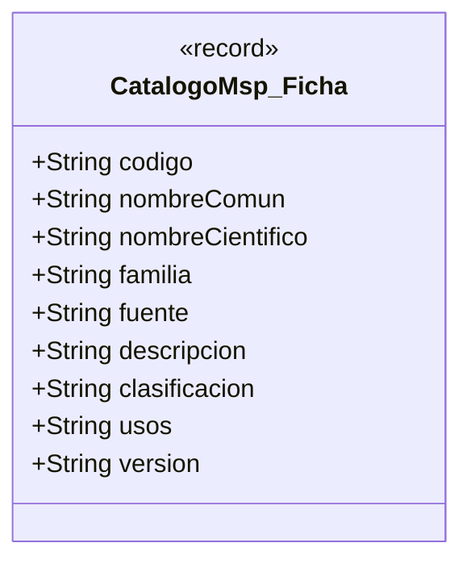


El record tiene nueve componentes; la tabla añade `activo`, utilizado para seleccionar fichas disponibles. `Planta.catalogoCodigo` es una referencia nullable a ese catálogo. Se mantiene nullable para conservar registros anteriores sin coincidencia; la gestión puede identificarlos como no institucionales, mientras la consulta pública los excluye.

Al registrar, `ServicioPlantas` obtiene la ficha activa, copia sus campos canónicos y guarda el código y la foto opcional. En `fuente` agrega la versión de la ficha. Al modificar, mantiene el mismo código institucional, vuelve a aplicar los datos canónicos y permite sustituir la foto. La presencia de campos en `Planta`, como `altitud` o `distribucion`, no significa que el líder pueda editarlos ni que las fichas iniciales los tengan: el servicio los limpia al aplicar el catálogo actual.

`PlantaController` solo permite los parámetros de formulario `catalogoCodigo`, `foto` y `_csrf`; rechaza campos educativos adicionales con MSG-28. No existe un endpoint para editar el catálogo, ni una consulta HTTP independiente de ficha por código; `CatalogoMsp.ficha` es una operación interna.

| Código institucional | Identificación inicial y procedencia |
|---|---|
| MSP-MANZANILLA | Manzanilla; anexos 3 y 5, páginas impresas 66 y 74; CALIENTE. |
| MSP-TORONJIL | Toronjil; anexos 3 y 5, páginas impresas 66 y 74; CALIENTE. |
| MSP-RUDA | Ruda; anexo 5, página impresa 74; CALIENTE. |
| MSP-HIERBA-LUISA | Hierba luisa, Cymbopogon citratus, Poaceae; anexo 2.1, página impresa 63; clasificación no aportada en esta ficha. |

La carga de cuatro fichas no representa la digitalización completa de los anexos del MSP. Los nombres científicos y familias sin soporte en la selección de fuentes se conservan nulos, al igual que los usos no incorporados. La publicación de una ficha por el líder no equivale a validar contenido clínico.

### 11.5. Servicios y colaboraciones efectivas

#### 11.5.1. Acceso, gestión del huerto y consulta pública


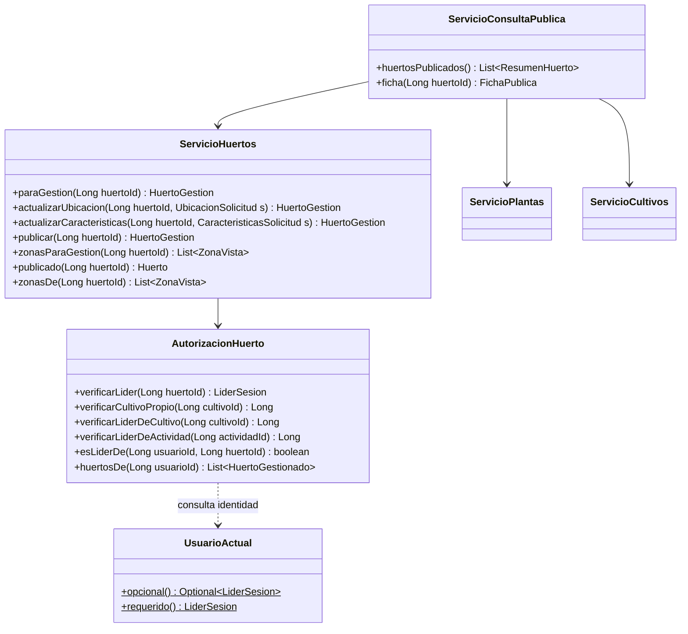


`AutorizacionHuerto` verifica la pertenencia mediante JDBC. No inyecta los repositorios del dominio. La ficha pública omite el contacto privado del responsable y solo incorpora fichas institucionales; sus cultivos se filtran para corresponder a las plantas publicables. Un huerto inexistente y uno no publicado tienen la misma respuesta pública MSG-14.

#### 11.5.2. Plantas, cultivos y fotografías


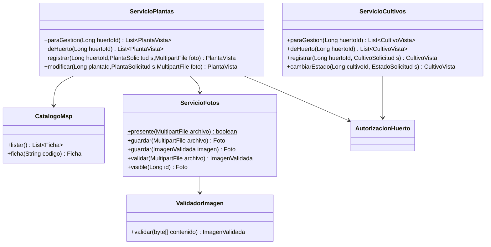


`ServicioCultivos.registrar` comprueba primero la pertenencia de la zona, su tipo CULTIVO y la planta del mismo huerto con código institucional. La restricción de mismo huerto también se aplica en SQL mediante claves foráneas compuestas. La restricción de tipo CULTIVO corresponde al servicio; no hay una FK que imponga ese tipo.

`ServicioFotos` recibe el archivo multipart y limita su tamaño antes de leerlo completo. `ValidadorImagen` recibe los bytes, identifica JPEG o PNG por contenido, comprueba el límite de 5 MiB (5 242 880 bytes) y devuelve la imagen validada con su huella SHA-256. La visibilidad pública requiere una asociación institucional publicable; para la evidencia de siembra exige además la versión vigente. El líder conserva acceso a la evidencia histórica de su propio huerto.

#### 11.5.3. Actividades y reto


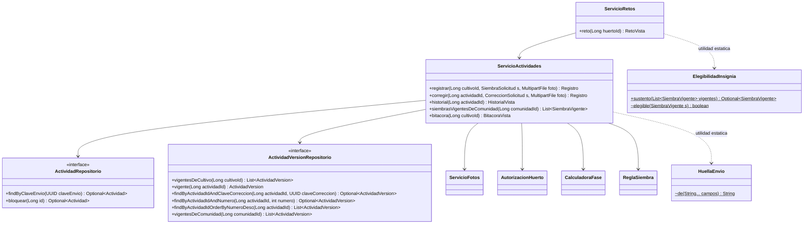


`Registro` y `SiembraVigente` son records anidados en `ServicioActividades`. El controlador convierte `Registro.creada` en HTTP 201 o 200 y entrega exclusivamente su `SiembraVista`. La huella se calcula con `HuellaEnvio.de(String... campos)`; esta utilidad tiene acceso de paquete y no es un componente inyectado.

`ActividadVersionRepositorio.vigentesDeComunidad` devuelve `List<ActividadVersion>`. El servicio completa cultivo, huerto, zona y condición para construir `List<SiembraVigente>`. `ElegibilidadInsignia.sustento` elige la siembra elegible más reciente por fecha del hecho y, ante empate, por identidad de actividad. `RetoVista` contiene la insignia y su sustento, o insignia nula y MSG-18; no tiene un atributo `conforme`.

#### 11.5.4. Dependencias por constructor

La tabla enumera los campos `private final` de los colaboradores del negocio y de sus controladores. Los tipos del framework, como `Clock` y `JdbcClient`, son dependencias reales. Las llamadas a utilidades estáticas se describen aparte y no se convierten en campos inyectados.


| Clase | Dependencias declaradas |
| --- | --- |
| [AutorizacionHuerto](https://github.com/OscarGualo/ProyectoPlantasMedicinales/blob/ca3062c80736bbe63d915cc89d8a1d9648099469/backend/src/main/java/ec/epn/huertos/acceso/AutorizacionHuerto.java) | `JdbcClient jdbc` |
| [ServicioHuertos](https://github.com/OscarGualo/ProyectoPlantasMedicinales/blob/ca3062c80736bbe63d915cc89d8a1d9648099469/backend/src/main/java/ec/epn/huertos/huertos/ServicioHuertos.java) | `HuertoRepositorio huertos`, `ZonaRepositorio zonas`, `AutorizacionHuerto autorizacion` |
| [ServicioConsultaPublica](https://github.com/OscarGualo/ProyectoPlantasMedicinales/blob/ca3062c80736bbe63d915cc89d8a1d9648099469/backend/src/main/java/ec/epn/huertos/consulta/ServicioConsultaPublica.java) | `ServicioHuertos huertos`, `ServicioPlantas plantas`, `ServicioCultivos cultivos`, `JdbcClient jdbc` |
| [CatalogoMsp](https://github.com/OscarGualo/ProyectoPlantasMedicinales/blob/ca3062c80736bbe63d915cc89d8a1d9648099469/backend/src/main/java/ec/epn/huertos/plantas/CatalogoMsp.java) | `JdbcClient jdbc` |
| [ServicioPlantas](https://github.com/OscarGualo/ProyectoPlantasMedicinales/blob/ca3062c80736bbe63d915cc89d8a1d9648099469/backend/src/main/java/ec/epn/huertos/plantas/ServicioPlantas.java) | `PlantaRepositorio plantas`, `ServicioFotos fotos`, `AutorizacionHuerto autorizacion`, `CatalogoMsp catalogo` |
| [ServicioCultivos](https://github.com/OscarGualo/ProyectoPlantasMedicinales/blob/ca3062c80736bbe63d915cc89d8a1d9648099469/backend/src/main/java/ec/epn/huertos/cultivos/ServicioCultivos.java) | `CultivoRepositorio cultivos`, `PlantaRepositorio plantas`, `ZonaRepositorio zonas`, `AutorizacionHuerto autorizacion`, `Clock reloj` |
| [ServicioFotos](https://github.com/OscarGualo/ProyectoPlantasMedicinales/blob/ca3062c80736bbe63d915cc89d8a1d9648099469/backend/src/main/java/ec/epn/huertos/fotos/ServicioFotos.java) | `FotoRepositorio fotos`, `ValidadorImagen validador`, `JdbcClient jdbc`, `Clock reloj` |
| [ServicioActividades](https://github.com/OscarGualo/ProyectoPlantasMedicinales/blob/ca3062c80736bbe63d915cc89d8a1d9648099469/backend/src/main/java/ec/epn/huertos/actividades/ServicioActividades.java) | `ActividadRepositorio actividades`, `ActividadVersionRepositorio versiones`, `CultivoRepositorio cultivos`, `HuertoRepositorio huertos`, `UsuarioRepositorio usuarios`, `ServicioFotos fotos`, `AutorizacionHuerto autorizacion`, `CalculadoraFase calculadoraFase`, `ReglaSiembra reglaSiembra`, `Clock reloj`, `JdbcClient jdbc` |
| [ServicioFaseLunar](https://github.com/OscarGualo/ProyectoPlantasMedicinales/blob/ca3062c80736bbe63d915cc89d8a1d9648099469/backend/src/main/java/ec/epn/huertos/luna/ServicioFaseLunar.java) | `FuenteFaseLunar fuente` |
| [ServicioCalendario](https://github.com/OscarGualo/ProyectoPlantasMedicinales/blob/ca3062c80736bbe63d915cc89d8a1d9648099469/backend/src/main/java/ec/epn/huertos/luna/ServicioCalendario.java) | `CalculadoraFase calculadora`, `FuenteFaseLunar fuente`, `ActividadesPorFase actividades`, `Clock reloj` |
| [ServicioRetos](https://github.com/OscarGualo/ProyectoPlantasMedicinales/blob/ca3062c80736bbe63d915cc89d8a1d9648099469/backend/src/main/java/ec/epn/huertos/retos/ServicioRetos.java) | `HuertoRepositorio huertos`, `ServicioActividades actividades` |
| [SesionController](https://github.com/OscarGualo/ProyectoPlantasMedicinales/blob/ca3062c80736bbe63d915cc89d8a1d9648099469/backend/src/main/java/ec/epn/huertos/acceso/SesionController.java) | `AuthenticationManager autenticacion`, `SecurityContextRepository contextos`, `AutorizacionHuerto autorizacion`, `CookieCsrfTokenRepository tokens` |
| [SiembraController](https://github.com/OscarGualo/ProyectoPlantasMedicinales/blob/ca3062c80736bbe63d915cc89d8a1d9648099469/backend/src/main/java/ec/epn/huertos/actividades/SiembraController.java) | `ServicioActividades servicio` |
| [RestauracionE2eController](https://github.com/OscarGualo/ProyectoPlantasMedicinales/blob/ca3062c80736bbe63d915cc89d8a1d9648099469/backend/src/main/java/ec/epn/huertos/comun/RestauracionE2eController.java) | `DataSource dataSource` |
| [ConsultaPublicaController](https://github.com/OscarGualo/ProyectoPlantasMedicinales/blob/ca3062c80736bbe63d915cc89d8a1d9648099469/backend/src/main/java/ec/epn/huertos/consulta/ConsultaPublicaController.java) | `ServicioConsultaPublica servicio` |
| [CultivoController](https://github.com/OscarGualo/ProyectoPlantasMedicinales/blob/ca3062c80736bbe63d915cc89d8a1d9648099469/backend/src/main/java/ec/epn/huertos/cultivos/CultivoController.java) | `ServicioCultivos servicio` |
| [FotoController](https://github.com/OscarGualo/ProyectoPlantasMedicinales/blob/ca3062c80736bbe63d915cc89d8a1d9648099469/backend/src/main/java/ec/epn/huertos/fotos/FotoController.java) | `ServicioFotos servicio` |
| [HuertoGestionController](https://github.com/OscarGualo/ProyectoPlantasMedicinales/blob/ca3062c80736bbe63d915cc89d8a1d9648099469/backend/src/main/java/ec/epn/huertos/huertos/HuertoGestionController.java) | `ServicioHuertos servicio` |
| [CalendarioController](https://github.com/OscarGualo/ProyectoPlantasMedicinales/blob/ca3062c80736bbe63d915cc89d8a1d9648099469/backend/src/main/java/ec/epn/huertos/luna/CalendarioController.java) | `ServicioCalendario servicio` |
| [PlantaController](https://github.com/OscarGualo/ProyectoPlantasMedicinales/blob/ca3062c80736bbe63d915cc89d8a1d9648099469/backend/src/main/java/ec/epn/huertos/plantas/PlantaController.java) | `ServicioPlantas servicio`, `CatalogoMsp catalogo` |
| [RetoController](https://github.com/OscarGualo/ProyectoPlantasMedicinales/blob/ca3062c80736bbe63d915cc89d8a1d9648099469/backend/src/main/java/ec/epn/huertos/retos/RetoController.java) | `ServicioRetos servicio` |


### 11.6. Estrategia de cálculo y calendario lunar


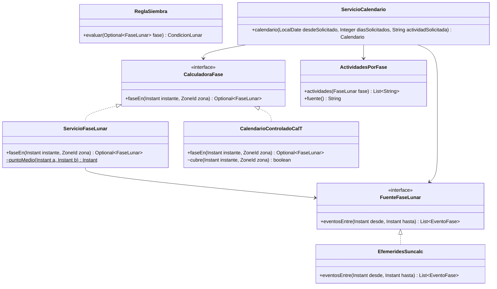


`CalculadoraFase` es el contrato sustituible del patrón Strategy. En uso normal se inyecta `ServicioFaseLunar`, que obtiene eventos de `FuenteFaseLunar` mediante Commons SunCalc y clasifica el instante usando puntos medios entre eventos principales. Cada intervalo incluye su inicio y excluye su final. La clasificación es una convención aplicada por el software; la biblioteca astronómica no certifica su aceptación cultural por cada comunidad.

La fase real depende del instante absoluto. La zona interviene al convertir la fecha local introducida; no modifica un mismo instante astronómico. El calendario general utiliza el mediodía continental para asignar una fase por fecha, mientras la siembra se evalúa a su hora real en la zona del huerto. Por ello una fase diaria no garantiza el mismo resultado para todas las horas de ese día.

`ServicioCalendario` ofrece 30 días por defecto y acepta de 1 a 60 días por solicitud dentro de los 12 meses anteriores o posteriores a la fecha del reloj. La consulta informa el rango disponible, las fases principales con sus instantes, las actividades por fase y los días resaltados por el filtro. Planificar con ese calendario no crea un registro de actividad.

| Actividad del filtro (`ActividadAgricola`) | Fases recomendadas por la regla implementada |
|---|---|
| PREPARACION_TIERRA, ELABORACION_ABONO, DESHIERBE, CONTROL_PLAGAS | LUNA_OSCURA. |
| SIEMBRA | LUNA_CRECIENTE, LUNA_LLENA. |
| TRASPLANTE | LUNA_CRECIENTE. |
| COSECHA_HOJAS_FLORES_FRUTOS | LUNA_CRECIENTE, LUNA_LLENA. |
| BANOS_RITUALES | LUNA_LLENA. |
| COSECHA_SEMILLAS_RAICES | LUNA_MENGUANTE. |

Estas actividades constituyen opciones orientativas del calendario; el registro de hechos de I1 implementa únicamente SIEMBRA.

**CAL-T y pruebas.** `CalendarioControladoCalT` define 10/10/2026 creciente, 11/10 menguante, 12/10 sin dato, 13/10 llena y 14/10 oscura. Los valores abarcan el día local completo. No son efemérides reales ni se usan en producción. Con el perfil e2e, `ConfigCalTE2e.calTSobreReal` crea una implementación compuesta de `CalculadoraFase`: utiliza CAL-T solo del 10 al 14 de octubre y delega al cálculo real fuera del rango. El día 12 permite comprobar PENDIENTE.

### 11.7. Modelo físico de datos

#### 11.7.1. Entidades y relaciones tras V4

Los atributos corresponden a columnas del esquema. El diagrama omite longitudes y valores por defecto para mantener su legibilidad; el diccionario posterior los conserva. Los sufijos PK y FK indican claves. Las dos FK de planta y zona del cultivo también incluyen `huerto_id`, como se detalla en las restricciones.


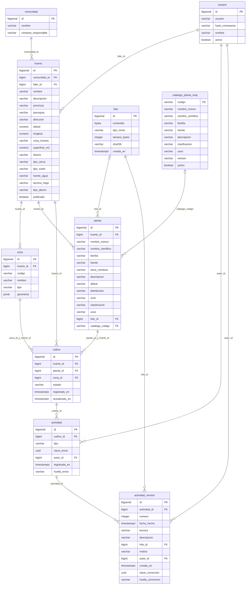


La relación física permite cero versiones por actividad si se opera por SQL directo; el flujo de registro del servicio crea obligatoriamente la primera en la misma transacción. Las FK no definen borrado en cascada. `catalogo_codigo` nullable conserva las plantas anteriores sin conciliación.

#### 11.7.2. Diccionario de columnas

Las condiciones de esta tabla describen cada columna; las restricciones compuestas y el disparador se detallan después. Las columnas `BIGSERIAL PRIMARY KEY` son no nulas aunque no repitan las palabras NOT NULL.


**`usuario`**


| Columna | Tipo SQL | Condición de columna |
| --- | --- | --- |
| `id` | `BIGSERIAL` | PRIMARY KEY |
| `usuario` | `VARCHAR(60)` | NOT NULL UNIQUE |
| `hash_contrasena` | `VARCHAR(100)` | NOT NULL |
| `nombre` | `VARCHAR(120)` | Nullable; sin valor por defecto declarado. |
| `activo` | `BOOLEAN` | NOT NULL DEFAULT TRUE |


**`comunidad`**


| Columna | Tipo SQL | Condición de columna |
| --- | --- | --- |
| `id` | `BIGSERIAL` | PRIMARY KEY |
| `nombre` | `VARCHAR(150)` | NOT NULL |
| `contacto_responsable` | `VARCHAR(200)` | Nullable; sin valor por defecto declarado. |


**`huerto`**


| Columna | Tipo SQL | Condición de columna |
| --- | --- | --- |
| `id` | `BIGSERIAL` | PRIMARY KEY |
| `comunidad_id` | `BIGINT` | NOT NULL REFERENCES comunidad (id) |
| `lider_id` | `BIGINT` | NOT NULL REFERENCES usuario (id) |
| `nombre` | `VARCHAR(150)` | Nullable; sin valor por defecto declarado. |
| `descripcion` | `VARCHAR(2000)` | Nullable; sin valor por defecto declarado. |
| `provincia` | `VARCHAR(60)` | Nullable; sin valor por defecto declarado. |
| `parroquia` | `VARCHAR(120)` | Nullable; sin valor por defecto declarado. |
| `direccion` | `VARCHAR(250)` | Nullable; sin valor por defecto declarado. |
| `latitud` | `NUMERIC(9, 6)` | Nullable; sin valor por defecto declarado. |
| `longitud` | `NUMERIC(9, 6)` | Nullable; sin valor por defecto declarado. |
| `zona_horaria` | `VARCHAR(40)` | NOT NULL DEFAULT 'America/Guayaquil' |
| `superficie_m2` | `NUMERIC(10, 2)` | Nullable; sin valor por defecto declarado. |
| `diseno` | `VARCHAR(80)` | Nullable; sin valor por defecto declarado. |
| `tipo_cerca` | `VARCHAR(80)` | Nullable; sin valor por defecto declarado. |
| `tipo_suelo` | `VARCHAR(80)` | Nullable; sin valor por defecto declarado. |
| `fuente_agua` | `VARCHAR(80)` | Nullable; sin valor por defecto declarado. |
| `tecnica_riego` | `VARCHAR(80)` | Nullable; sin valor por defecto declarado. |
| `tipo_abono` | `VARCHAR(80)` | Nullable; sin valor por defecto declarado. |
| `publicado` | `BOOLEAN` | NOT NULL DEFAULT FALSE |


**`zona`**


| Columna | Tipo SQL | Condición de columna |
| --- | --- | --- |
| `id` | `BIGSERIAL` | PRIMARY KEY |
| `huerto_id` | `BIGINT` | NOT NULL REFERENCES huerto (id) |
| `codigo` | `VARCHAR(20)` | NOT NULL |
| `nombre` | `VARCHAR(120)` | Nullable; sin valor por defecto declarado. |
| `tipo` | `VARCHAR(20)` | NOT NULL |
| `geometria` | `JSONB` | NOT NULL |


**`foto`**


| Columna | Tipo SQL | Condición de columna |
| --- | --- | --- |
| `id` | `BIGSERIAL` | PRIMARY KEY |
| `contenido` | `BYTEA` | NOT NULL |
| `tipo_mime` | `VARCHAR(20)` | NOT NULL |
| `tamano_bytes` | `INTEGER` | NOT NULL |
| `sha256` | `VARCHAR(64)` | NOT NULL |
| `creada_en` | `TIMESTAMPTZ` | NOT NULL DEFAULT now() |


**`planta`**


| Columna | Tipo SQL | Condición de columna |
| --- | --- | --- |
| `id` | `BIGSERIAL` | PRIMARY KEY |
| `huerto_id` | `BIGINT` | NOT NULL REFERENCES huerto (id) |
| `nombre_comun` | `VARCHAR(120)` | NOT NULL |
| `nombre_cientifico` | `VARCHAR(150)` | Nullable; sin valor por defecto declarado. |
| `familia` | `VARCHAR(120)` | Nullable; sin valor por defecto declarado. |
| `fuente` | `VARCHAR(300)` | NOT NULL |
| `otros_nombres` | `VARCHAR(300)` | Nullable; sin valor por defecto declarado. |
| `descripcion` | `VARCHAR(2000)` | Nullable; sin valor por defecto declarado. |
| `altitud` | `VARCHAR(120)` | Nullable; sin valor por defecto declarado. |
| `distribucion` | `VARCHAR(500)` | Nullable; sin valor por defecto declarado. |
| `ciclo` | `VARCHAR(10)` | Nullable; sin valor por defecto declarado. |
| `clasificacion` | `VARCHAR(10)` | Nullable; sin valor por defecto declarado. |
| `usos` | `VARCHAR(2000)` | Nullable; sin valor por defecto declarado. |
| `foto_id` | `BIGINT` | REFERENCES foto (id) |
| `catalogo_codigo` | `VARCHAR(40)` | REFERENCES catalogo_planta_msp(codigo) |


**`cultivo`**


| Columna | Tipo SQL | Condición de columna |
| --- | --- | --- |
| `id` | `BIGSERIAL` | PRIMARY KEY |
| `huerto_id` | `BIGINT` | NOT NULL REFERENCES huerto (id) |
| `planta_id` | `BIGINT` | NOT NULL |
| `zona_id` | `BIGINT` | NOT NULL |
| `estado` | `VARCHAR(20)` | NOT NULL DEFAULT 'SEMBRADO' |
| `registrado_en` | `TIMESTAMPTZ` | NOT NULL |
| `actualizado_en` | `TIMESTAMPTZ` | NOT NULL |


**`actividad`**


| Columna | Tipo SQL | Condición de columna |
| --- | --- | --- |
| `id` | `BIGSERIAL` | PRIMARY KEY |
| `cultivo_id` | `BIGINT` | NOT NULL REFERENCES cultivo (id) |
| `tipo` | `VARCHAR(20)` | NOT NULL DEFAULT 'SIEMBRA' |
| `clave_envio` | `UUID` | NOT NULL |
| `autor_id` | `BIGINT` | NOT NULL REFERENCES usuario (id) |
| `registrada_en` | `TIMESTAMPTZ` | NOT NULL |
| `huella_envio` | `VARCHAR(64)` | Nullable; sin valor por defecto declarado. |


**`actividad_version`**


| Columna | Tipo SQL | Condición de columna |
| --- | --- | --- |
| `id` | `BIGSERIAL` | PRIMARY KEY |
| `actividad_id` | `BIGINT` | NOT NULL REFERENCES actividad (id) |
| `numero` | `INTEGER` | NOT NULL |
| `fecha_hecho` | `TIMESTAMPTZ` | NOT NULL |
| `tecnica` | `VARCHAR(20)` | NOT NULL |
| `descripcion` | `VARCHAR(2000)` | Nullable; sin valor por defecto declarado. |
| `foto_id` | `BIGINT` | NOT NULL REFERENCES foto (id) |
| `motivo` | `VARCHAR(500)` | Nullable; sin valor por defecto declarado. |
| `autor_id` | `BIGINT` | NOT NULL REFERENCES usuario (id) |
| `creada_en` | `TIMESTAMPTZ` | NOT NULL |
| `clave_correccion` | `UUID` | Nullable; sin valor por defecto declarado. |
| `huella_correccion` | `VARCHAR(64)` | Nullable; sin valor por defecto declarado. |


**`catalogo_planta_msp`**


| Columna | Tipo SQL | Condición de columna |
| --- | --- | --- |
| `codigo` | `VARCHAR(40)` | PRIMARY KEY |
| `nombre_comun` | `VARCHAR(120)` | NOT NULL |
| `nombre_cientifico` | `VARCHAR(150)` | Nullable; sin valor por defecto declarado. |
| `familia` | `VARCHAR(120)` | Nullable; sin valor por defecto declarado. |
| `fuente` | `VARCHAR(300)` | NOT NULL |
| `descripcion` | `VARCHAR(2000)` | Nullable; sin valor por defecto declarado. |
| `clasificacion` | `VARCHAR(10)` | CHECK (clasificacion IN ('CALIENTE','FRIA')) |
| `usos` | `VARCHAR(2000)` | Nullable; sin valor por defecto declarado. |
| `version` | `VARCHAR(60)` | NOT NULL |
| `activo` | `BOOLEAN` | NOT NULL DEFAULT TRUE |


#### 11.7.3. Integridad y migraciones

| Migración | Efecto sobre la versión entregada |
|---|---|
| `V1__esquema.sql` | Crea nueve tablas de negocio, restricciones, índices y bloqueo de modificación o borrado de versiones. |
| `V2__demo.sql` | Carga datos de demostración; no sustituye un alta institucional de usuarios. |
| `V3__integridad_envios.sql` | Añade `actividad.huella_envio`, `actividad_version.clave_correccion` y `huella_correccion`, con unicidad compuesta y coherencia de la pareja clave/huella. |
| `V4__catalogo_institucional_msp.sql` | Crea la décima tabla de negocio y cuatro fichas, añade `planta.catalogo_codigo`, permite identificación científica y familia nulas y concilia plantas por coincidencia de nombre. |

| Restricción | Garantía real |
|---|---|
| `actividad_clave_envio_unica` | La clave de envío inicial es única globalmente en actividad. |
| `actividad_version_numero_unico` | Unicidad de `(actividad_id, numero)`. |
| `actividad_version_clave_correccion_unica` | Unicidad de `(actividad_id, clave_correccion)`; no es unicidad global de la clave de corrección. |
| `actividad_version_correccion_completa` | Clave y huella son ambas nulas, o ambas no nulas y pertenecen a una versión posterior a la inicial. Preserva filas anteriores a V3. |
| `cultivo_planta_mismo_huerto` | FK `(planta_id, huerto_id)` a planta. |
| `cultivo_zona_mismo_huerto` | FK `(zona_id, huerto_id)` a zona. |
| `zona_codigo_unico` | Código de zona único dentro del huerto. |
| `huerto_publicado_con_ubicacion` | Un huerto publicado conserva nombre no nulo y ambas coordenadas; el servicio comprueba además nombre no vacío. |
| `actividad_version_motivo` | Una versión distinta de la inicial necesita motivo no vacío. |
| `actividad_version_solo_insercion` | Disparador que ejecuta `impedir_cambio_version()` e impide UPDATE y DELETE sobre versiones. |

La migración V4 conserva identificadores y referencias existentes. Para las plantas que coinciden con el catálogo sustituye los datos educativos por los canónicos y limpia otros nombres, altitud, distribución y ciclo. Las plantas no conciliadas permanecen almacenadas; la capa pública las excluye. Esta distinción permite conservar el historial sin presentar como institucional una ficha anterior sin trazabilidad.

### 11.8. Controladores y API

La ruta se interpreta junto con el verbo HTTP. Los controladores delegan al servicio indicado; la sesión y CSRF se aplican en la cadena de seguridad, y los servicios comprueban la pertenencia al huerto. La tabla describe la API de uso normal; el anexo A localiza también el controlador exclusivo del perfil de pruebas.


| Verbo y ruta | Controlador.operación | Entrada | Respuesta exitosa | HTTP | Acceso |
| --- | --- | --- | --- | --- | --- |
| `GET /api/sesion` | `SesionController.actual` | Sin cuerpo | `Sesion` | 200; puede ser anónima | Público |
| `POST /api/sesion` | `SesionController.iniciar` | JSON Credenciales | `Sesion` | 200 | Público; CSRF |
| `DELETE /api/sesion` | `SesionController.cerrar` | Sin cuerpo | `Sin cuerpo` | 204 | CSRF |
| `GET /api/publico/huertos` | `ConsultaPublicaController.huertos` | Sin cuerpo | `List<ResumenHuerto>` | 200 | Público |
| `GET /api/publico/huertos/{id}` | `ConsultaPublicaController.ficha` | Sin cuerpo | `FichaPublica` | 200 | Público |
| `GET /api/publico/catalogo-plantas` | `PlantaController.catalogo` | Sin cuerpo | `List<CatalogoMsp.Ficha>` | 200 | Público |
| `GET /api/publico/calendario-lunar` | `CalendarioController.calendario` | Query desde, dias, actividad | `ServicioCalendario.Calendario` | 200 | Público |
| `GET /api/publico/huertos/{id}/reto` | `RetoController.reto` | Sin cuerpo | `RetoVista` | 200 | Público |
| `GET /api/fotos/{id}` | `FotoController.foto` | Sin cuerpo | `Bytes con tipo MIME` | 200 | Visibilidad comprobada en servicio |
| `GET /api/huertos/{id}` | `HuertoGestionController.obtener` | Sin cuerpo | `HuertoGestion` | 200 | Líder del huerto |
| `GET /api/huertos/{id}/zonas` | `HuertoGestionController.zonas` | Sin cuerpo | `List<ZonaVista>` | 200 | Líder del huerto |
| `PUT /api/huertos/{id}/ubicacion` | `HuertoGestionController.ubicacion` | JSON UbicacionSolicitud | `HuertoGestion` | 200 | Líder; CSRF |
| `PUT /api/huertos/{id}/caracteristicas` | `HuertoGestionController.caracteristicas` | JSON CaracteristicasSolicitud | `HuertoGestion` | 200 | Líder; CSRF |
| `POST /api/huertos/{id}/publicacion` | `HuertoGestionController.publicar` | Sin cuerpo | `HuertoGestion` | 200 | Líder; CSRF |
| `GET /api/huertos/{huertoId}/plantas` | `PlantaController.listar` | Sin cuerpo | `List<PlantaVista>` | 200 | Líder del huerto |
| `POST /api/huertos/{huertoId}/plantas` | `PlantaController.registrar` | Multipart PlantaSolicitud y foto opcional | `PlantaVista` | 201 | Líder; CSRF |
| `PUT /api/plantas/{id}` | `PlantaController.modificar` | Multipart PlantaSolicitud y foto opcional | `PlantaVista` | 200 | Líder; CSRF |
| `GET /api/huertos/{huertoId}/cultivos` | `CultivoController.listar` | Sin cuerpo | `List<CultivoVista>` | 200 | Líder del huerto |
| `POST /api/huertos/{huertoId}/cultivos` | `CultivoController.registrar` | JSON CultivoSolicitud | `CultivoVista` | 201 | Líder; CSRF |
| `PATCH /api/cultivos/{id}/estado` | `CultivoController.cambiarEstado` | JSON EstadoSolicitud | `CultivoVista` | 200 | Líder; CSRF |
| `POST /api/cultivos/{id}/siembras` | `SiembraController.registrar` | Multipart SiembraSolicitud y foto obligatoria | `SiembraVista` | 201 nuevo; 200 reintento | Líder; CSRF |
| `GET /api/cultivos/{id}/bitacora` | `SiembraController.bitacora` | Sin cuerpo | `BitacoraVista` | 200 | Líder del huerto |
| `POST /api/siembras/{id}/correcciones` | `SiembraController.corregir` | Multipart CorreccionSolicitud y foto opcional | `SiembraVista` | 201 nueva versión; 200 reintento | Líder; CSRF |
| `GET /api/siembras/{id}/historial` | `SiembraController.historial` | Sin cuerpo | `HistorialVista` | 200 | Líder del huerto |


Los métodos HTTP de los controladores tienen acceso de paquete en Java; ello no impide que Spring los publique según sus anotaciones. `PlantaController.registrar` y `modificar` reciben además `HttpServletRequest` para rechazar parámetros educativos no permitidos. Los métodos de siembra devuelven `ResponseEntity<SiembraVista>` y los de foto `ResponseEntity<byte[]>`.

El cierre de sesión usa DELETE y confirma el resultado mediante la respuesta 204 del servidor. La interfaz espera ese resultado antes de mostrar estado anónimo; ante interrupción conserva el estado y permite reintentar. No existe una pantalla modal obligatoria de confirmación ni una ruta POST de salida.

#### 11.8.1. Solicitudes de escritura

Estos son los componentes de los records de solicitud. La foto es una parte multipart adicional, no un componente de esos records.


| Record Java | Componentes |
| --- | --- |
| `SesionController.Credenciales` | `String usuario`; `String contrasena` |
| `HuertoDtos.UbicacionSolicitud` | `String provincia`; `String parroquia`; `String direccion`; `BigDecimal latitud`; `BigDecimal longitud` |
| `HuertoDtos.CaracteristicasSolicitud` | `String nombre`; `String descripcion`; `String diseno`; `String tipoCerca`; `BigDecimal superficieM2`; `String tipoSuelo`; `String fuenteAgua`; `String tecnicaRiego`; `String tipoAbono` |
| `PlantaDtos.PlantaSolicitud` | `String catalogoCodigo` |
| `ServicioCultivos.CultivoSolicitud` | `Long plantaId`; `Long zonaId` |
| `ServicioCultivos.EstadoSolicitud` | `String estado` |
| `SiembraDtos.SiembraSolicitud` | `String fechaHecho`; `String tecnica`; `String descripcion`; `String claveEnvio` |
| `SiembraDtos.CorreccionSolicitud` | `String fechaHecho`; `String motivo`; `Integer versionBase`; `String claveEnvio` |


`fechaHecho` expresa la hora local del huerto, habitualmente `yyyy-MM-ddTHH:mm`, no una fecha UTC enviada sin contexto. Al corregir, `versionBase` es obligatoria, `motivo` es obligatorio y fecha y foto son opcionales; las omisiones conservan los datos vigentes. El campo de solicitud `claveEnvio` se persiste como `claveCorreccion` en la nueva versión. Técnica y descripción no forman parte de esa solicitud de corrección.

Las validaciones del negocio se aplican de forma programática en los servicios; no se describe un circuito de anotaciones Bean Validation que estos DTO no tienen. Las respuestas de negocio utilizan `{codigo, mensaje, campo}` cuando corresponde. El catálogo MSG convive con códigos técnicos, por ejemplo SOLICITUD_INVALIDA y ERROR_INTERNO, definidos en `ManejadorErrores`.

### 11.9. Secuencias del producto

Las secuencias detallan las decisiones que afectan a la integridad de los registros. Los participantes PostgreSQL y API representan la infraestructura y el controlador correspondiente; no son clases adicionales.

#### 11.9.1. Registrar una siembra

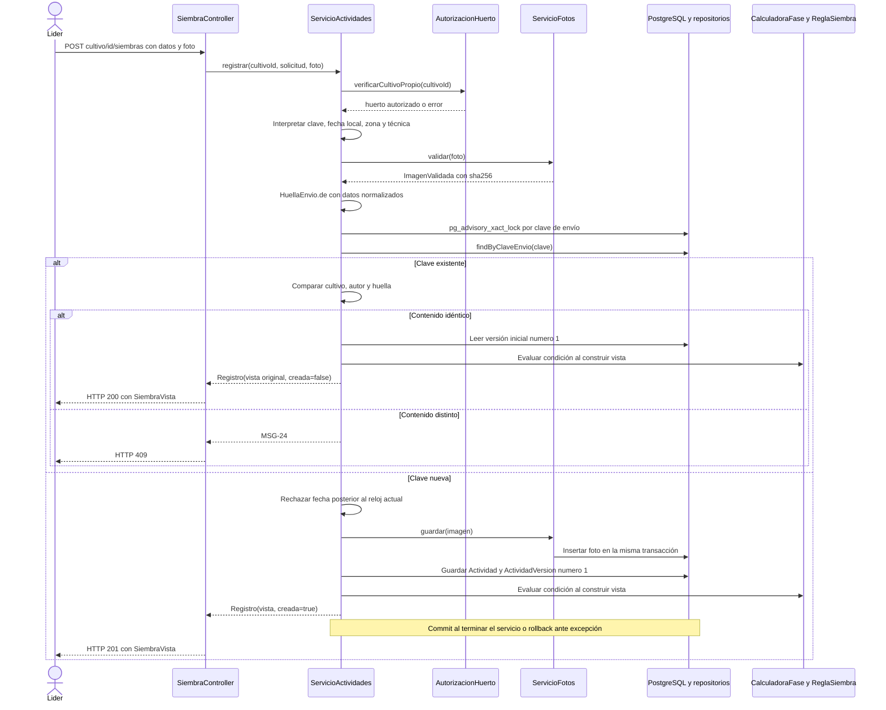

El bloqueo transaccional por clave precede a la búsqueda y serializa incluso una clave cuya fila aún no existe. Un reintento idéntico recupera la versión inicial, aunque después se hayan agregado correcciones; la consulta de bitácora obtiene la vigente. La comprobación de fecha futura se hace para un envío nuevo después de resolver si era un reintento confirmado.

Los fallos de almacenamiento de foto se expresan mediante MSG-11 y los errores de acceso a datos capturados al guardar actividad o versión mediante MSG-27. Ambos revierten la transacción. Los restantes errores no controlados utilizan el manejador general; no se atribuye MSG-27 a cualquier fallo posible de infraestructura. La fase y la condición se componen para la respuesta, no como columnas nuevas.

#### 11.9.2. Corregir una siembra

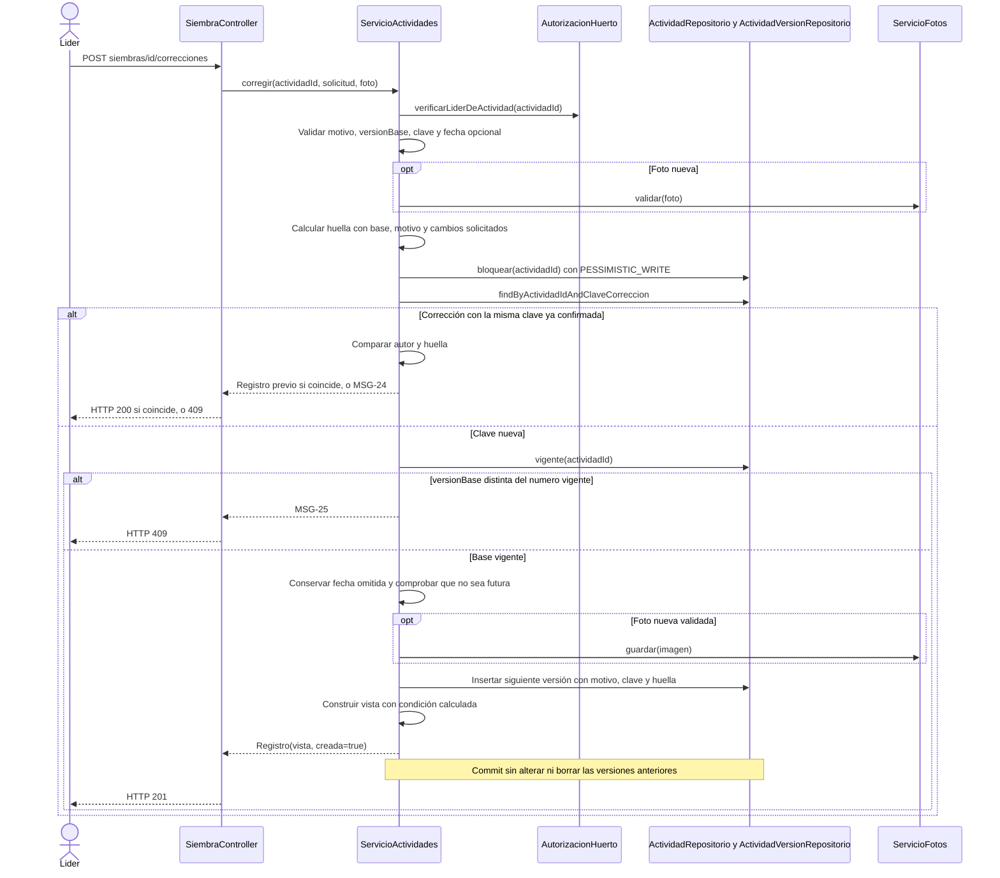

El orden es relevante: una clave de corrección confirmada se recupera antes de comparar `versionBase` con la vigente. Así un reintento de la misma corrección no se rechaza como conflicto por haber incrementado ya la versión. Una clave confirmada con contenido distinto se rechaza, y una corrección nueva con una base superada recibe MSG-25. Una corrección sin foto nueva reutiliza el `fotoId` vigente, que sigue siendo obligatorio.

#### 11.9.3. Consultar el reto comunitario

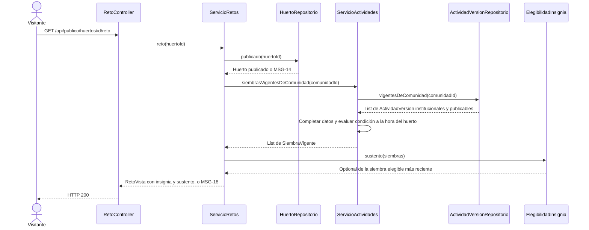

Una corrección cambia la condición y, por tanto, el posible sustento en la siguiente consulta. No se ejecuta una actualización separada de insignias ni se acumulan puntos. La insignia reconoce documentación conforme con la regla lunar implementada; no certifica un resultado médico o agronómico.

### 11.10. Mensajes y respuestas

La siguiente tabla conserva el texto y el estado de `Mensaje.java`. Los marcadores entre llaves se sustituyen con argumentos. Los mensajes con HTTP 200 son avisos o resultados del producto: no todos representan una excepción HTTP ni se emiten necesariamente desde un controlador Java.


| Código | HTTP | Texto vigente |
| --- | --- | --- |
| MSG-01 | 401 | Usuario o contraseña incorrectos. |
| MSG-02 | 401 | Tu sesión ha finalizado. Inicia sesión para continuar. |
| MSG-03 | 403 | No tienes permiso para modificar la información de este huerto. |
| MSG-04 | 400 | Completa el campo obligatorio: {campo}. |
| MSG-05 | 400 | La superficie debe ser un número mayor o igual a 0. |
| MSG-06 | 400 | Las coordenadas no son válidas: la latitud debe estar entre -90 y 90 y la longitud entre -180 y 180. |
| MSG-07 | 400 | La imagen debe estar en formato JPEG o PNG y pesar como máximo 5 MB. |
| MSG-08 | 400 | La fecha y hora de la actividad no pueden ser posteriores al momento actual. |
| MSG-09 | 400 | La zona seleccionada no pertenece a este huerto. |
| MSG-10 | 400 | Selecciona un estado válido: sembrado, en crecimiento, cosechado o perdido. |
| MSG-11 | 503 | No se pudo guardar la fotografía. La actividad no se registró; inténtalo nuevamente. |
| MSG-12 | 400 | Indica el motivo de la corrección. |
| MSG-13 | 200 | No se pudo cargar la vista 3D del huerto. Puedes consultar sus zonas y cultivos en la lista. |
| MSG-14 | 404 | El huerto solicitado no existe o no está publicado. |
| MSG-15 | 200 | Conforme con la condición lunar: la siembra se realizó en {fase}. |
| MSG-16 | 200 | No conforme con la condición lunar: la siembra se realizó en {fase}; la práctica indica luna creciente o luna llena. |
| MSG-17 | 200 | Pendiente de comprobación: no hay información de fase lunar para la fecha de la siembra. |
| MSG-18 | 200 | Tu comunidad aún no tiene la insignia Documentación lunar: se necesita al menos una siembra con fotografía realizada en luna creciente o luna llena. |
| MSG-19 | 403 | El cultivo seleccionado no pertenece a tu huerto. |
| MSG-20 | 400 | El calendario lunar está disponible desde {fecha inicial} hasta {fecha final}. |
| MSG-21 | 400 | El huerto no tiene ubicación registrada y no puede publicarse en el mapa. |
| MSG-22 | 200 | Esta zona no tiene cultivos registrados. |
| MSG-23 | 200 | Esta siembra no tiene correcciones registradas. |
| MSG-24 | 409 | Este envío ya se registró con otros datos. Revisa el resultado antes de realizar un nuevo envío. |
| MSG-25 | 409 | La siembra cambió desde que abriste la corrección. Revisa la versión vigente e inténtalo nuevamente. |
| MSG-26 | 403 | No se pudo validar la solicitud. Actualiza la página e inténtalo nuevamente. |
| MSG-27 | 503 | No se pudo guardar la actividad. Los cambios no se registraron; inténtalo nuevamente. |
| MSG-28 | 400 | La información educativa proviene del catálogo del MSP. Selecciona una ficha institucional; esos campos no se pueden editar. |
| MSG-29 | 400 | La zona seleccionada no es una zona de cultivo. |


`SeguridadConfig` genera los errores de la cadena de seguridad: sesión ausente MSG-02, token CSRF inválido con sesión activa MSG-26 y el resto de denegaciones MSG-03. `CargarTokenCsrf` materializa el token para entregar la cookie; no decide por sí mismo MSG-26. Los errores de negocio del servicio se convierten a la respuesta de la API mediante `ManejadorErrores`. Las credenciales inválidas o una cuenta no activa al iniciar sesión no se presentan como un mensaje de éxito de salida.

### 11.11. Interfaz web y distribución del código

Las rutas de pantalla se declaran en `frontend/src/App.tsx` y cargan cada página de forma diferida. `RutaLider` limita la navegación privada; el servidor mantiene la autorización efectiva. La siguiente tabla relaciona las pantallas con los archivos existentes.


| Ruta de pantalla | Archivo bajo frontend/src | Responsabilidad |
| --- | --- | --- |
| `/` | [paginas/Mapa.tsx](https://github.com/OscarGualo/ProyectoPlantasMedicinales/blob/ca3062c80736bbe63d915cc89d8a1d9648099469/frontend/src/paginas/Mapa.tsx) | Mapa de huertos publicados, lista disponible y aviso ante fallo de teselas. |
| `/huertos/:id` | [paginas/FichaHuerto.tsx](https://github.com/OscarGualo/ProyectoPlantasMedicinales/blob/ca3062c80736bbe63d915cc89d8a1d9648099469/frontend/src/paginas/FichaHuerto.tsx) | Ficha pública, plantas institucionales y zonas del huerto. |
| `/huertos/:id/3d` | [paginas/Recorrido3D.tsx](https://github.com/OscarGualo/ProyectoPlantasMedicinales/blob/ca3062c80736bbe63d915cc89d8a1d9648099469/frontend/src/paginas/Recorrido3D.tsx) | Carga la escena desde escena/Escena3D.tsx y ofrece alternativa de consulta por lista. |
| `/huertos/:id/reto` | [paginas/Reto.tsx](https://github.com/OscarGualo/ProyectoPlantasMedicinales/blob/ca3062c80736bbe63d915cc89d8a1d9648099469/frontend/src/paginas/Reto.tsx) | Reto e insignia comunitaria con su sustento. |
| `/calendario` | [paginas/Calendario.tsx](https://github.com/OscarGualo/ProyectoPlantasMedicinales/blob/ca3062c80736bbe63d915cc89d8a1d9648099469/frontend/src/paginas/Calendario.tsx) | Calendario lunar, navegación y filtro por actividad. |
| `/ingresar` | [paginas/Ingresar.tsx](https://github.com/OscarGualo/ProyectoPlantasMedicinales/blob/ca3062c80736bbe63d915cc89d8a1d9648099469/frontend/src/paginas/Ingresar.tsx) | Inicio de sesión del líder. |
| `/gestion` | [paginas/gestion/Gestion.tsx](https://github.com/OscarGualo/ProyectoPlantasMedicinales/blob/ca3062c80736bbe63d915cc89d8a1d9648099469/frontend/src/paginas/gestion/Gestion.tsx) | Contenedor de gestión del huerto autorizado. |
| `/gestion (índice)` | [paginas/gestion/GestionHuerto.tsx](https://github.com/OscarGualo/ProyectoPlantasMedicinales/blob/ca3062c80736bbe63d915cc89d8a1d9648099469/frontend/src/paginas/gestion/GestionHuerto.tsx) | Ubicación, características y publicación. |
| `/gestion/plantas` | [paginas/gestion/GestionPlantas.tsx](https://github.com/OscarGualo/ProyectoPlantasMedicinales/blob/ca3062c80736bbe63d915cc89d8a1d9648099469/frontend/src/paginas/gestion/GestionPlantas.tsx) | Selección del catálogo y gestión de foto; sin editor medicinal. |
| `/gestion/cultivos` | [paginas/gestion/GestionCultivos.tsx](https://github.com/OscarGualo/ProyectoPlantasMedicinales/blob/ca3062c80736bbe63d915cc89d8a1d9648099469/frontend/src/paginas/gestion/GestionCultivos.tsx) | Asignación a zona CULTIVO y cambio de estado. |
| `/gestion/cultivos/:id/bitacora` | [paginas/gestion/Bitacora.tsx](https://github.com/OscarGualo/ProyectoPlantasMedicinales/blob/ca3062c80736bbe63d915cc89d8a1d9648099469/frontend/src/paginas/gestion/Bitacora.tsx) | Registro, corrección e historial de siembras con evidencia. |


`sesion/ContextoSesion.tsx` conserva la sesión y espera el cierre confirmado por el servidor. `componentes/Diseno.tsx` muestra el error y permite reintentar. `api/cliente.ts` centraliza solicitudes, token CSRF y tratamiento de errores; `api/tipos.ts` declara los contratos usados por la interfaz.

La escena esquemática utiliza la geometría de las zonas y los cultivos recibidos en la ficha. No crea un modelo de crecimiento biológico ni proporciona un editor 3D. La lista alternativa permite consultar información cuando falla la escena. Un error de mapa y un error de escena son estados distintos.

El calendario mantiene un identificador de la última solicitud para ignorar respuestas anteriores que lleguen después de una selección nueva. La gestión de fechas utiliza la zona del huerto, incluida Pacific/Galapagos, y no impone la hora continental a todas las siembras.

### 11.12. Trazabilidad del diseño con I1

Esta matriz agrupa las historias para localizar las piezas que materializan cada capacidad. Los criterios individuales y los protocolos de prueba permanecen en sus documentos; una fila de diseño no constituye por sí sola una prueba aprobada.

| Historias | Capacidad y elementos de diseño |
|---|---|
| HU-001 a HU-002 | Acceso y salida: SesionController, SeguridadConfig, UsuarioActual, AutorizacionHuerto y ContextoSesion. |
| HU-003 a HU-005 | Ubicación, características y publicación: ServicioHuertos, Huerto, Comunidad y las vistas públicas. |
| HU-006 a HU-007 | Incorporación y fotografía de ficha institucional: PlantaController, ServicioPlantas, CatalogoMsp y ServicioFotos. |
| HU-008 a HU-009 | Cultivos y estado: ServicioCultivos, PlantaRepositorio, ZonaRepositorio y EstadoCultivo. |
| HU-010 a HU-013 | Mapa, ficha, recorrido y consulta de zonas/cultivos: ServicioConsultaPublica, FichaPublica, Mapa, Recorrido3D y Escena3D. |
| HU-014 a HU-015 | Registro con evidencia y condición lunar: ServicioActividades, ServicioFotos, CalculadoraFase y ReglaSiembra. |
| HU-016 a HU-017 | Corrección e historial: ActividadVersion, bloqueo de actividad, claves de corrección y vistas de historial. |
| HU-018 | Insignia Documentación lunar: ServicioRetos, ElegibilidadInsignia y SiembraVigente. |
| HU-019 a HU-020 | Calendario y filtro: ServicioCalendario, FuenteFaseLunar, ActividadAgricola y Calendario.tsx. |

El diseño mantiene las funciones de la primera iteración y documenta sus límites reales. Cualquier incorporación futura de inventario, autorización gubernamental dentro de la aplicación, editor de fichas institucionales o editor 3D requiere actualizar alcance, requisitos, pruebas y este documento antes de presentarla como entregada.

## Anexo A. Inventario verificable del código Java

El inventario incluye todos los archivos Java de `backend/src/main/java`, con sus tipos con nombre. Incluye records anidados y configuraciones del perfil de prueba; no cuenta clases anónimas ni tipos generados por Lombok o Spring. La inclusión de una configuración e2e en esta carpeta no significa que se active en producción.


**Resultado del inventario:** 76 archivos y 105 tipos con nombre. Esta cantidad no es el número de pruebas ni de componentes de Spring.


### Paquete `ec.epn.huertos`


| Archivo | Tipos declarados |
| --- | --- |
| [HuertosApplication.java](https://github.com/OscarGualo/ProyectoPlantasMedicinales/blob/ca3062c80736bbe63d915cc89d8a1d9648099469/backend/src/main/java/ec/epn/huertos/HuertosApplication.java) | `HuertosApplication` (class) |


### Paquete `ec.epn.huertos.acceso`


| Archivo | Tipos declarados |
| --- | --- |
| [AutorizacionHuerto.java](https://github.com/OscarGualo/ProyectoPlantasMedicinales/blob/ca3062c80736bbe63d915cc89d8a1d9648099469/backend/src/main/java/ec/epn/huertos/acceso/AutorizacionHuerto.java) | `AutorizacionHuerto` (class), `AutorizacionHuerto.HuertoGestionado` (record) |
| [LiderSesion.java](https://github.com/OscarGualo/ProyectoPlantasMedicinales/blob/ca3062c80736bbe63d915cc89d8a1d9648099469/backend/src/main/java/ec/epn/huertos/acceso/LiderSesion.java) | `LiderSesion` (class) |
| [SeguridadConfig.java](https://github.com/OscarGualo/ProyectoPlantasMedicinales/blob/ca3062c80736bbe63d915cc89d8a1d9648099469/backend/src/main/java/ec/epn/huertos/acceso/SeguridadConfig.java) | `SeguridadConfig` (class), `SeguridadConfig.CargarTokenCsrf` (class) |
| [ServicioUsuarios.java](https://github.com/OscarGualo/ProyectoPlantasMedicinales/blob/ca3062c80736bbe63d915cc89d8a1d9648099469/backend/src/main/java/ec/epn/huertos/acceso/ServicioUsuarios.java) | `ServicioUsuarios` (class) |
| [SesionController.java](https://github.com/OscarGualo/ProyectoPlantasMedicinales/blob/ca3062c80736bbe63d915cc89d8a1d9648099469/backend/src/main/java/ec/epn/huertos/acceso/SesionController.java) | `SesionController` (class), `SesionController.Credenciales` (record), `SesionController.Sesion` (record) |
| [Usuario.java](https://github.com/OscarGualo/ProyectoPlantasMedicinales/blob/ca3062c80736bbe63d915cc89d8a1d9648099469/backend/src/main/java/ec/epn/huertos/acceso/Usuario.java) | `Usuario` (class) |
| [UsuarioActual.java](https://github.com/OscarGualo/ProyectoPlantasMedicinales/blob/ca3062c80736bbe63d915cc89d8a1d9648099469/backend/src/main/java/ec/epn/huertos/acceso/UsuarioActual.java) | `UsuarioActual` (class) |
| [UsuarioRepositorio.java](https://github.com/OscarGualo/ProyectoPlantasMedicinales/blob/ca3062c80736bbe63d915cc89d8a1d9648099469/backend/src/main/java/ec/epn/huertos/acceso/UsuarioRepositorio.java) | `UsuarioRepositorio` (interface) |


### Paquete `ec.epn.huertos.actividades`


| Archivo | Tipos declarados |
| --- | --- |
| [Actividad.java](https://github.com/OscarGualo/ProyectoPlantasMedicinales/blob/ca3062c80736bbe63d915cc89d8a1d9648099469/backend/src/main/java/ec/epn/huertos/actividades/Actividad.java) | `Actividad` (class) |
| [ActividadRepositorio.java](https://github.com/OscarGualo/ProyectoPlantasMedicinales/blob/ca3062c80736bbe63d915cc89d8a1d9648099469/backend/src/main/java/ec/epn/huertos/actividades/ActividadRepositorio.java) | `ActividadRepositorio` (interface) |
| [ActividadVersion.java](https://github.com/OscarGualo/ProyectoPlantasMedicinales/blob/ca3062c80736bbe63d915cc89d8a1d9648099469/backend/src/main/java/ec/epn/huertos/actividades/ActividadVersion.java) | `ActividadVersion` (class) |
| [ActividadVersionRepositorio.java](https://github.com/OscarGualo/ProyectoPlantasMedicinales/blob/ca3062c80736bbe63d915cc89d8a1d9648099469/backend/src/main/java/ec/epn/huertos/actividades/ActividadVersionRepositorio.java) | `ActividadVersionRepositorio` (interface) |
| [HuellaEnvio.java](https://github.com/OscarGualo/ProyectoPlantasMedicinales/blob/ca3062c80736bbe63d915cc89d8a1d9648099469/backend/src/main/java/ec/epn/huertos/actividades/HuellaEnvio.java) | `HuellaEnvio` (class) |
| [ServicioActividades.java](https://github.com/OscarGualo/ProyectoPlantasMedicinales/blob/ca3062c80736bbe63d915cc89d8a1d9648099469/backend/src/main/java/ec/epn/huertos/actividades/ServicioActividades.java) | `ServicioActividades` (class), `ServicioActividades.Registro` (record), `ServicioActividades.SiembraVigente` (record) |
| [SiembraController.java](https://github.com/OscarGualo/ProyectoPlantasMedicinales/blob/ca3062c80736bbe63d915cc89d8a1d9648099469/backend/src/main/java/ec/epn/huertos/actividades/SiembraController.java) | `SiembraController` (class) |
| [SiembraDtos.java](https://github.com/OscarGualo/ProyectoPlantasMedicinales/blob/ca3062c80736bbe63d915cc89d8a1d9648099469/backend/src/main/java/ec/epn/huertos/actividades/SiembraDtos.java) | `SiembraDtos` (class), `SiembraDtos.SiembraSolicitud` (record), `SiembraDtos.CorreccionSolicitud` (record), `SiembraDtos.CondicionVista` (record), `SiembraDtos.SiembraVista` (record), `SiembraDtos.BitacoraVista` (record), `SiembraDtos.VersionVista` (record), `SiembraDtos.HistorialVista` (record) |
| [Tecnica.java](https://github.com/OscarGualo/ProyectoPlantasMedicinales/blob/ca3062c80736bbe63d915cc89d8a1d9648099469/backend/src/main/java/ec/epn/huertos/actividades/Tecnica.java) | `Tecnica` (enum) |


### Paquete `ec.epn.huertos.comun`


| Archivo | Tipos declarados |
| --- | --- |
| [ErrorNegocio.java](https://github.com/OscarGualo/ProyectoPlantasMedicinales/blob/ca3062c80736bbe63d915cc89d8a1d9648099469/backend/src/main/java/ec/epn/huertos/comun/ErrorNegocio.java) | `ErrorNegocio` (class) |
| [ManejadorErrores.java](https://github.com/OscarGualo/ProyectoPlantasMedicinales/blob/ca3062c80736bbe63d915cc89d8a1d9648099469/backend/src/main/java/ec/epn/huertos/comun/ManejadorErrores.java) | `ManejadorErrores` (class) |
| [Mensaje.java](https://github.com/OscarGualo/ProyectoPlantasMedicinales/blob/ca3062c80736bbe63d915cc89d8a1d9648099469/backend/src/main/java/ec/epn/huertos/comun/Mensaje.java) | `Mensaje` (enum) |
| [RelojConfig.java](https://github.com/OscarGualo/ProyectoPlantasMedicinales/blob/ca3062c80736bbe63d915cc89d8a1d9648099469/backend/src/main/java/ec/epn/huertos/comun/RelojConfig.java) | `RelojConfig` (class) |
| [RespuestaError.java](https://github.com/OscarGualo/ProyectoPlantasMedicinales/blob/ca3062c80736bbe63d915cc89d8a1d9648099469/backend/src/main/java/ec/epn/huertos/comun/RespuestaError.java) | `RespuestaError` (record) |
| [RestauracionE2eController.java](https://github.com/OscarGualo/ProyectoPlantasMedicinales/blob/ca3062c80736bbe63d915cc89d8a1d9648099469/backend/src/main/java/ec/epn/huertos/comun/RestauracionE2eController.java) | `RestauracionE2eController` (class) |
| [SolicitudInvalida.java](https://github.com/OscarGualo/ProyectoPlantasMedicinales/blob/ca3062c80736bbe63d915cc89d8a1d9648099469/backend/src/main/java/ec/epn/huertos/comun/SolicitudInvalida.java) | `SolicitudInvalida` (class) |
| [SpaConfig.java](https://github.com/OscarGualo/ProyectoPlantasMedicinales/blob/ca3062c80736bbe63d915cc89d8a1d9648099469/backend/src/main/java/ec/epn/huertos/comun/SpaConfig.java) | `SpaConfig` (class) |


### Paquete `ec.epn.huertos.consulta`


| Archivo | Tipos declarados |
| --- | --- |
| [ConsultaPublicaController.java](https://github.com/OscarGualo/ProyectoPlantasMedicinales/blob/ca3062c80736bbe63d915cc89d8a1d9648099469/backend/src/main/java/ec/epn/huertos/consulta/ConsultaPublicaController.java) | `ConsultaPublicaController` (class) |
| [FichaPublica.java](https://github.com/OscarGualo/ProyectoPlantasMedicinales/blob/ca3062c80736bbe63d915cc89d8a1d9648099469/backend/src/main/java/ec/epn/huertos/consulta/FichaPublica.java) | `FichaPublica` (record) |
| [ResumenHuerto.java](https://github.com/OscarGualo/ProyectoPlantasMedicinales/blob/ca3062c80736bbe63d915cc89d8a1d9648099469/backend/src/main/java/ec/epn/huertos/consulta/ResumenHuerto.java) | `ResumenHuerto` (record) |
| [ServicioConsultaPublica.java](https://github.com/OscarGualo/ProyectoPlantasMedicinales/blob/ca3062c80736bbe63d915cc89d8a1d9648099469/backend/src/main/java/ec/epn/huertos/consulta/ServicioConsultaPublica.java) | `ServicioConsultaPublica` (class) |


### Paquete `ec.epn.huertos.cultivos`


| Archivo | Tipos declarados |
| --- | --- |
| [Cultivo.java](https://github.com/OscarGualo/ProyectoPlantasMedicinales/blob/ca3062c80736bbe63d915cc89d8a1d9648099469/backend/src/main/java/ec/epn/huertos/cultivos/Cultivo.java) | `Cultivo` (class) |
| [CultivoController.java](https://github.com/OscarGualo/ProyectoPlantasMedicinales/blob/ca3062c80736bbe63d915cc89d8a1d9648099469/backend/src/main/java/ec/epn/huertos/cultivos/CultivoController.java) | `CultivoController` (class) |
| [CultivoRepositorio.java](https://github.com/OscarGualo/ProyectoPlantasMedicinales/blob/ca3062c80736bbe63d915cc89d8a1d9648099469/backend/src/main/java/ec/epn/huertos/cultivos/CultivoRepositorio.java) | `CultivoRepositorio` (interface) |
| [CultivoVista.java](https://github.com/OscarGualo/ProyectoPlantasMedicinales/blob/ca3062c80736bbe63d915cc89d8a1d9648099469/backend/src/main/java/ec/epn/huertos/cultivos/CultivoVista.java) | `CultivoVista` (record) |
| [EstadoCultivo.java](https://github.com/OscarGualo/ProyectoPlantasMedicinales/blob/ca3062c80736bbe63d915cc89d8a1d9648099469/backend/src/main/java/ec/epn/huertos/cultivos/EstadoCultivo.java) | `EstadoCultivo` (enum) |
| [ServicioCultivos.java](https://github.com/OscarGualo/ProyectoPlantasMedicinales/blob/ca3062c80736bbe63d915cc89d8a1d9648099469/backend/src/main/java/ec/epn/huertos/cultivos/ServicioCultivos.java) | `ServicioCultivos` (class), `ServicioCultivos.CultivoSolicitud` (record), `ServicioCultivos.EstadoSolicitud` (record) |


### Paquete `ec.epn.huertos.fotos`


| Archivo | Tipos declarados |
| --- | --- |
| [Foto.java](https://github.com/OscarGualo/ProyectoPlantasMedicinales/blob/ca3062c80736bbe63d915cc89d8a1d9648099469/backend/src/main/java/ec/epn/huertos/fotos/Foto.java) | `Foto` (class) |
| [FotoController.java](https://github.com/OscarGualo/ProyectoPlantasMedicinales/blob/ca3062c80736bbe63d915cc89d8a1d9648099469/backend/src/main/java/ec/epn/huertos/fotos/FotoController.java) | `FotoController` (class) |
| [FotoRepositorio.java](https://github.com/OscarGualo/ProyectoPlantasMedicinales/blob/ca3062c80736bbe63d915cc89d8a1d9648099469/backend/src/main/java/ec/epn/huertos/fotos/FotoRepositorio.java) | `FotoRepositorio` (interface) |
| [ImagenValidada.java](https://github.com/OscarGualo/ProyectoPlantasMedicinales/blob/ca3062c80736bbe63d915cc89d8a1d9648099469/backend/src/main/java/ec/epn/huertos/fotos/ImagenValidada.java) | `ImagenValidada` (record) |
| [ServicioFotos.java](https://github.com/OscarGualo/ProyectoPlantasMedicinales/blob/ca3062c80736bbe63d915cc89d8a1d9648099469/backend/src/main/java/ec/epn/huertos/fotos/ServicioFotos.java) | `ServicioFotos` (class) |
| [ValidadorImagen.java](https://github.com/OscarGualo/ProyectoPlantasMedicinales/blob/ca3062c80736bbe63d915cc89d8a1d9648099469/backend/src/main/java/ec/epn/huertos/fotos/ValidadorImagen.java) | `ValidadorImagen` (class) |


### Paquete `ec.epn.huertos.huertos`


| Archivo | Tipos declarados |
| --- | --- |
| [Comunidad.java](https://github.com/OscarGualo/ProyectoPlantasMedicinales/blob/ca3062c80736bbe63d915cc89d8a1d9648099469/backend/src/main/java/ec/epn/huertos/huertos/Comunidad.java) | `Comunidad` (class) |
| [Huerto.java](https://github.com/OscarGualo/ProyectoPlantasMedicinales/blob/ca3062c80736bbe63d915cc89d8a1d9648099469/backend/src/main/java/ec/epn/huertos/huertos/Huerto.java) | `Huerto` (class) |
| [HuertoDtos.java](https://github.com/OscarGualo/ProyectoPlantasMedicinales/blob/ca3062c80736bbe63d915cc89d8a1d9648099469/backend/src/main/java/ec/epn/huertos/huertos/HuertoDtos.java) | `HuertoDtos` (class), `HuertoDtos.UbicacionSolicitud` (record), `HuertoDtos.CaracteristicasSolicitud` (record), `HuertoDtos.HuertoGestion` (record), `HuertoDtos.ZonaVista` (record) |
| [HuertoGestionController.java](https://github.com/OscarGualo/ProyectoPlantasMedicinales/blob/ca3062c80736bbe63d915cc89d8a1d9648099469/backend/src/main/java/ec/epn/huertos/huertos/HuertoGestionController.java) | `HuertoGestionController` (class) |
| [HuertoRepositorio.java](https://github.com/OscarGualo/ProyectoPlantasMedicinales/blob/ca3062c80736bbe63d915cc89d8a1d9648099469/backend/src/main/java/ec/epn/huertos/huertos/HuertoRepositorio.java) | `HuertoRepositorio` (interface) |
| [ServicioHuertos.java](https://github.com/OscarGualo/ProyectoPlantasMedicinales/blob/ca3062c80736bbe63d915cc89d8a1d9648099469/backend/src/main/java/ec/epn/huertos/huertos/ServicioHuertos.java) | `ServicioHuertos` (class) |
| [Zona.java](https://github.com/OscarGualo/ProyectoPlantasMedicinales/blob/ca3062c80736bbe63d915cc89d8a1d9648099469/backend/src/main/java/ec/epn/huertos/huertos/Zona.java) | `Zona` (class) |
| [ZonaRepositorio.java](https://github.com/OscarGualo/ProyectoPlantasMedicinales/blob/ca3062c80736bbe63d915cc89d8a1d9648099469/backend/src/main/java/ec/epn/huertos/huertos/ZonaRepositorio.java) | `ZonaRepositorio` (interface) |


### Paquete `ec.epn.huertos.luna`


| Archivo | Tipos declarados |
| --- | --- |
| [ActividadAgricola.java](https://github.com/OscarGualo/ProyectoPlantasMedicinales/blob/ca3062c80736bbe63d915cc89d8a1d9648099469/backend/src/main/java/ec/epn/huertos/luna/ActividadAgricola.java) | `ActividadAgricola` (enum) |
| [ActividadesPorFase.java](https://github.com/OscarGualo/ProyectoPlantasMedicinales/blob/ca3062c80736bbe63d915cc89d8a1d9648099469/backend/src/main/java/ec/epn/huertos/luna/ActividadesPorFase.java) | `ActividadesPorFase` (class) |
| [CalculadoraFase.java](https://github.com/OscarGualo/ProyectoPlantasMedicinales/blob/ca3062c80736bbe63d915cc89d8a1d9648099469/backend/src/main/java/ec/epn/huertos/luna/CalculadoraFase.java) | `CalculadoraFase` (interface) |
| [CalendarioControladoCalT.java](https://github.com/OscarGualo/ProyectoPlantasMedicinales/blob/ca3062c80736bbe63d915cc89d8a1d9648099469/backend/src/main/java/ec/epn/huertos/luna/CalendarioControladoCalT.java) | `CalendarioControladoCalT` (class) |
| [CalendarioController.java](https://github.com/OscarGualo/ProyectoPlantasMedicinales/blob/ca3062c80736bbe63d915cc89d8a1d9648099469/backend/src/main/java/ec/epn/huertos/luna/CalendarioController.java) | `CalendarioController` (class) |
| [CondicionLunar.java](https://github.com/OscarGualo/ProyectoPlantasMedicinales/blob/ca3062c80736bbe63d915cc89d8a1d9648099469/backend/src/main/java/ec/epn/huertos/luna/CondicionLunar.java) | `CondicionLunar` (record), `CondicionLunar.Resultado` (enum) |
| [ConfigCalTE2e.java](https://github.com/OscarGualo/ProyectoPlantasMedicinales/blob/ca3062c80736bbe63d915cc89d8a1d9648099469/backend/src/main/java/ec/epn/huertos/luna/ConfigCalTE2e.java) | `ConfigCalTE2e` (class) |
| [EfemeridesSuncalc.java](https://github.com/OscarGualo/ProyectoPlantasMedicinales/blob/ca3062c80736bbe63d915cc89d8a1d9648099469/backend/src/main/java/ec/epn/huertos/luna/EfemeridesSuncalc.java) | `EfemeridesSuncalc` (class) |
| [EventoFase.java](https://github.com/OscarGualo/ProyectoPlantasMedicinales/blob/ca3062c80736bbe63d915cc89d8a1d9648099469/backend/src/main/java/ec/epn/huertos/luna/EventoFase.java) | `EventoFase` (record) |
| [FaseLunar.java](https://github.com/OscarGualo/ProyectoPlantasMedicinales/blob/ca3062c80736bbe63d915cc89d8a1d9648099469/backend/src/main/java/ec/epn/huertos/luna/FaseLunar.java) | `FaseLunar` (enum) |
| [FasePrincipal.java](https://github.com/OscarGualo/ProyectoPlantasMedicinales/blob/ca3062c80736bbe63d915cc89d8a1d9648099469/backend/src/main/java/ec/epn/huertos/luna/FasePrincipal.java) | `FasePrincipal` (enum) |
| [FuenteFaseLunar.java](https://github.com/OscarGualo/ProyectoPlantasMedicinales/blob/ca3062c80736bbe63d915cc89d8a1d9648099469/backend/src/main/java/ec/epn/huertos/luna/FuenteFaseLunar.java) | `FuenteFaseLunar` (interface) |
| [ReglaSiembra.java](https://github.com/OscarGualo/ProyectoPlantasMedicinales/blob/ca3062c80736bbe63d915cc89d8a1d9648099469/backend/src/main/java/ec/epn/huertos/luna/ReglaSiembra.java) | `ReglaSiembra` (class) |
| [ServicioCalendario.java](https://github.com/OscarGualo/ProyectoPlantasMedicinales/blob/ca3062c80736bbe63d915cc89d8a1d9648099469/backend/src/main/java/ec/epn/huertos/luna/ServicioCalendario.java) | `ServicioCalendario` (class), `ServicioCalendario.Dia` (record), `ServicioCalendario.EventoVista` (record), `ServicioCalendario.ActividadOpcion` (record), `ServicioCalendario.Calendario` (record) |
| [ServicioFaseLunar.java](https://github.com/OscarGualo/ProyectoPlantasMedicinales/blob/ca3062c80736bbe63d915cc89d8a1d9648099469/backend/src/main/java/ec/epn/huertos/luna/ServicioFaseLunar.java) | `ServicioFaseLunar` (class) |


### Paquete `ec.epn.huertos.plantas`


| Archivo | Tipos declarados |
| --- | --- |
| [CatalogoMsp.java](https://github.com/OscarGualo/ProyectoPlantasMedicinales/blob/ca3062c80736bbe63d915cc89d8a1d9648099469/backend/src/main/java/ec/epn/huertos/plantas/CatalogoMsp.java) | `CatalogoMsp` (class), `CatalogoMsp.Ficha` (record) |
| [Clasificacion.java](https://github.com/OscarGualo/ProyectoPlantasMedicinales/blob/ca3062c80736bbe63d915cc89d8a1d9648099469/backend/src/main/java/ec/epn/huertos/plantas/Clasificacion.java) | `Clasificacion` (enum) |
| [Planta.java](https://github.com/OscarGualo/ProyectoPlantasMedicinales/blob/ca3062c80736bbe63d915cc89d8a1d9648099469/backend/src/main/java/ec/epn/huertos/plantas/Planta.java) | `Planta` (class) |
| [PlantaController.java](https://github.com/OscarGualo/ProyectoPlantasMedicinales/blob/ca3062c80736bbe63d915cc89d8a1d9648099469/backend/src/main/java/ec/epn/huertos/plantas/PlantaController.java) | `PlantaController` (class) |
| [PlantaDtos.java](https://github.com/OscarGualo/ProyectoPlantasMedicinales/blob/ca3062c80736bbe63d915cc89d8a1d9648099469/backend/src/main/java/ec/epn/huertos/plantas/PlantaDtos.java) | `PlantaDtos` (class), `PlantaDtos.PlantaSolicitud` (record), `PlantaDtos.PlantaVista` (record) |
| [PlantaRepositorio.java](https://github.com/OscarGualo/ProyectoPlantasMedicinales/blob/ca3062c80736bbe63d915cc89d8a1d9648099469/backend/src/main/java/ec/epn/huertos/plantas/PlantaRepositorio.java) | `PlantaRepositorio` (interface) |
| [ServicioPlantas.java](https://github.com/OscarGualo/ProyectoPlantasMedicinales/blob/ca3062c80736bbe63d915cc89d8a1d9648099469/backend/src/main/java/ec/epn/huertos/plantas/ServicioPlantas.java) | `ServicioPlantas` (class) |


### Paquete `ec.epn.huertos.retos`


| Archivo | Tipos declarados |
| --- | --- |
| [ElegibilidadInsignia.java](https://github.com/OscarGualo/ProyectoPlantasMedicinales/blob/ca3062c80736bbe63d915cc89d8a1d9648099469/backend/src/main/java/ec/epn/huertos/retos/ElegibilidadInsignia.java) | `ElegibilidadInsignia` (class) |
| [RetoController.java](https://github.com/OscarGualo/ProyectoPlantasMedicinales/blob/ca3062c80736bbe63d915cc89d8a1d9648099469/backend/src/main/java/ec/epn/huertos/retos/RetoController.java) | `RetoController` (class) |
| [RetoVista.java](https://github.com/OscarGualo/ProyectoPlantasMedicinales/blob/ca3062c80736bbe63d915cc89d8a1d9648099469/backend/src/main/java/ec/epn/huertos/retos/RetoVista.java) | `RetoVista` (record), `RetoVista.Insignia` (record), `RetoVista.Sustento` (record) |
| [ServicioRetos.java](https://github.com/OscarGualo/ProyectoPlantasMedicinales/blob/ca3062c80736bbe63d915cc89d8a1d9648099469/backend/src/main/java/ec/epn/huertos/retos/ServicioRetos.java) | `ServicioRetos` (class) |


`RestauracionE2eController` y `ConfigCalTE2e` se activan solo con el perfil `e2e`. El primero restaura datos de prueba y no constituye una función de administración para el cliente. Su ruta no forma parte del contrato de uso normal de §11.8.

## Anexo B. Fuentes de implementación y control de correspondencia

La referencia de revisión es el commit indicado en la portada. Los vínculos del inventario y de las tablas llevan a ese commit, de modo que no dependen del contenido futuro de `develop`. Las fuentes principales del diseño son:


- [backend/src/main/resources/db/migration/V1__esquema.sql](https://github.com/OscarGualo/ProyectoPlantasMedicinales/blob/ca3062c80736bbe63d915cc89d8a1d9648099469/backend/src/main/resources/db/migration/V1__esquema.sql)
- [backend/src/main/resources/db/migration/V2__demo.sql](https://github.com/OscarGualo/ProyectoPlantasMedicinales/blob/ca3062c80736bbe63d915cc89d8a1d9648099469/backend/src/main/resources/db/migration/V2__demo.sql)
- [backend/src/main/resources/db/migration/V3__integridad_envios.sql](https://github.com/OscarGualo/ProyectoPlantasMedicinales/blob/ca3062c80736bbe63d915cc89d8a1d9648099469/backend/src/main/resources/db/migration/V3__integridad_envios.sql)
- [backend/src/main/resources/db/migration/V4__catalogo_institucional_msp.sql](https://github.com/OscarGualo/ProyectoPlantasMedicinales/blob/ca3062c80736bbe63d915cc89d8a1d9648099469/backend/src/main/resources/db/migration/V4__catalogo_institucional_msp.sql)
- [backend/src/main/java/ec/epn/huertos/comun/Mensaje.java](https://github.com/OscarGualo/ProyectoPlantasMedicinales/blob/ca3062c80736bbe63d915cc89d8a1d9648099469/backend/src/main/java/ec/epn/huertos/comun/Mensaje.java)
- [frontend/src/App.tsx](https://github.com/OscarGualo/ProyectoPlantasMedicinales/blob/ca3062c80736bbe63d915cc89d8a1d9648099469/frontend/src/App.tsx)
- [frontend/src/api/tipos.ts](https://github.com/OscarGualo/ProyectoPlantasMedicinales/blob/ca3062c80736bbe63d915cc89d8a1d9648099469/frontend/src/api/tipos.ts)
- [frontend/src/sesion/ContextoSesion.tsx](https://github.com/OscarGualo/ProyectoPlantasMedicinales/blob/ca3062c80736bbe63d915cc89d8a1d9648099469/frontend/src/sesion/ContextoSesion.tsx)
- [docs/v1/03_Historias_de_usuario_techmOS.md](https://github.com/OscarGualo/ProyectoPlantasMedicinales/blob/ca3062c80736bbe63d915cc89d8a1d9648099469/docs/v1/03_Historias_de_usuario_techmOS.md)
- [docs/v1/04_Casos_de_prueba_y_resultados_techmOS.md](https://github.com/OscarGualo/ProyectoPlantasMedicinales/blob/ca3062c80736bbe63d915cc89d8a1d9648099469/docs/v1/04_Casos_de_prueba_y_resultados_techmOS.md)
- [docs/v1/05_Reglas_datos_y_trazabilidad_techmOS.md](https://github.com/OscarGualo/ProyectoPlantasMedicinales/blob/ca3062c80736bbe63d915cc89d8a1d9648099469/docs/v1/05_Reglas_datos_y_trazabilidad_techmOS.md)


La elaboración de esta versión comprobó nombres, atributos, operaciones y dependencias de las vistas contra las declaraciones Java; las columnas contra V1–V4; los contratos HTTP contra los controladores; los mensajes contra el enum y las pantallas contra App.tsx. Las secuencias se contrastaron con el orden de ServicioActividades y ServicioRetos. La documentación describe el estado de implementación y no sustituye la ejecución de pruebas o la aceptación del producto por el cliente.
