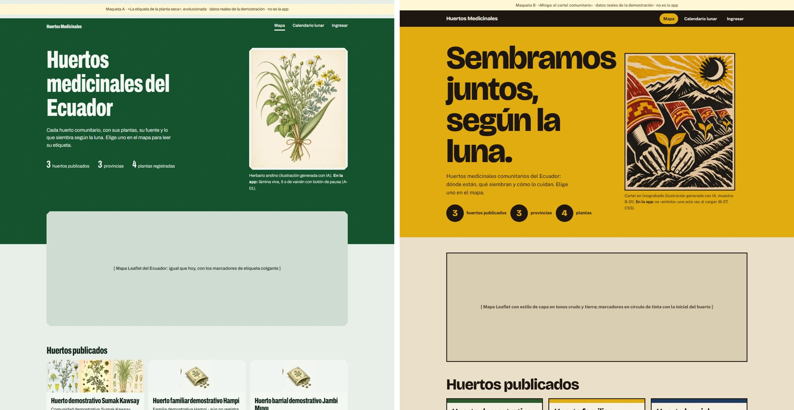
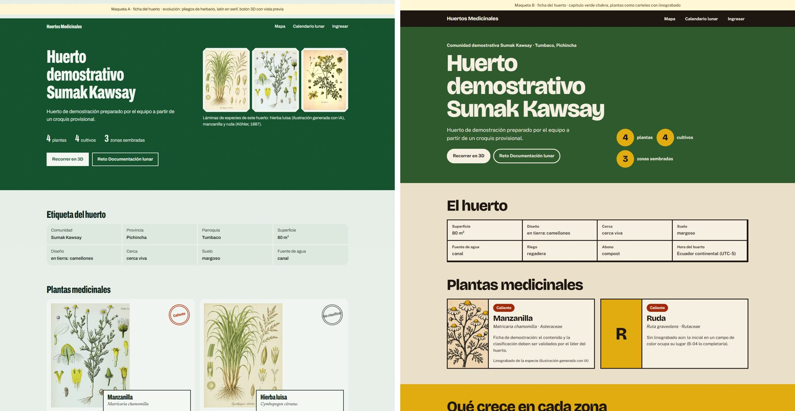
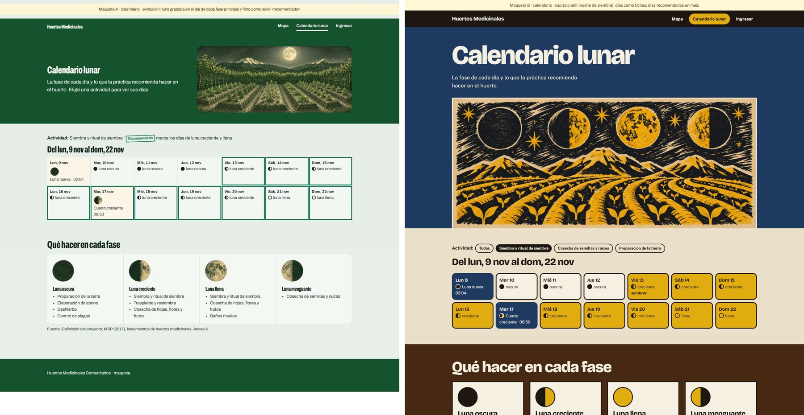

# Dirección artística: dos propuestas para comparar

> Fases 3 y 4 de `DESIGN_WORKFLOW.md`.
>
> - **A:** evolucionar «La etiqueta de la planta seca».
> - **B:** «Minga: el cartel comunitario», una dirección nueva.
>
> **Este documento no recomienda ninguna.** Las dos se presentan con la misma estructura, los mismos datos (huertos
> de demostración reales de `V2__demo.sql`) y las mismas tres páginas maquetadas. La decisión es del usuario.
> Nada de esto modifica todavía `DESIGN.md` ni la interfaz.

**Comparación visual rápida** (A a la izquierda, B a la derecha, 1440 px):

| Inicio | Ficha del huerto | Calendario |
|---|---|---|
|  |  |  |

**Maquetas navegables** (se abren en el navegador sin servidor):
- A: `maquetas/a/inicio.html`, `ficha.html` y `calendario.html`.
- B: `maquetas/b/inicio.html`, `ficha.html` y `calendario.html`.

**Capturas por ancho:** `maquetas/capturas/{a,b}-{inicio,ficha,calendario}-{1440,390}.jpg`.

**Aviso sobre las maquetas:** en las dos, las tarjetas de huerto del inicio muestran las especies de cada huerto (la
tira de láminas en A, las píldoras en B). Hoy la API pública solo devuelve el **número** de plantas
(`frontend/src/api/tipos.ts:17-27`): mostrarlas exige un cambio de API, anotado en `IMPLEMENTATION_PLAN.md`.

---

## Cómo se eligió la propuesta B

Se exploraron tres candidatas con la biblioteca de taste-skill (`.claude/skills/taste-skill/library`, con 20
arquetipos de dirección y 56 paletas). A ya ocupa el arquetipo `page-is-the-object` (la página es la etiqueta).
B debía diferir de A en **concepto, tipografía y uso del color**.

| Candidata | Arquetipo | Por qué no, o por qué sí |
|---|---|---|
| «Crónica andina»: la página como el códice de Guamán Poma, con dibujos de línea del calendario agrícola | `page-is-the-object` | **Descartada.** El concepto es el mismo que el de A (un documento histórico como autoridad), solo cambia el archivo. Además, la licencia de reutilización de los dibujos no está confirmada: la Biblioteca Real de Dinamarca los publica en línea, pero sus términos de uso no aparecen en las fuentes revisadas ([kb.dk](https://www.kb.dk/en/find-materials/collections/manuscript-collection/chronicle-guaman-poma)) |
| «Noche lunar»: todo oscuro, con la luna como único motivo | `dark-room` + `one-motif` | **Descartada.** Exige el modo oscuro por defecto, y eso perjudica al líder que trabaja al sol en el huerto (`PRODUCT.md`, Users). Además, la luna ya es fuerte en A desde ayer |
| **«Minga: el cartel comunitario»**: gráfica popular latinoamericana en xilografía y linograbado, con capítulos de color plano | `colour-chapters` + `loud-flat-poster` | **Elegida como B.** Es el opuesto de A en casi todo: colectiva frente a archivística, ruidosa frente a sobria, color plano por capítulos frente a papel y verde, y grotesca expresiva frente a condensada de etiqueta. Habla del trabajo comunitario (la minga) que el producto quiere sostener |

---

## Propuesta A: «La etiqueta de la planta seca», evolucionada

### A.1 Referencias visuales reales

| Referencia | Qué se toma |
|---|---|
| Lineamientos del MSP (2017) sobre la etiqueta de empaque de la planta seca (`DESIGN.md`) | El origen del mundo: datos verificables en campos sobre papel claro |
| Kew, colección de ilustraciones (Ehret, Redouté): [kew.org](https://www.kew.org/science/collections-and-resources/collections/illustrations-and-artefacts-collection) | La lámina botánica como autoridad visual |
| Identidad de Kew de Pentagram (2015): Baskerville para la herencia, Franklin Gothic de contraste ([Design Week](https://www.designweek.co.uk/issues/13-19-july-2015/kews-royal-botanic-gardens-blossoms-with-new-brand-identity/), [Pentagram](https://pentagram.com/work/the-royal-botanical-gardens-kew/story)) | Una serif de herencia **solo** para el latín, junto a la sans del sistema |
| Pliegos de herbario digitalizados: [JSTOR Global Plants](https://about.jstor.org/whats-in-jstor/primary-sources/global-plants/herbaria-access), [Kew Herbarium Catalogue](https://www.kew.org/herbcat) | La **etiqueta del pliego**, abajo a la derecha, como rótulo de cada planta |
| Biodiversity Heritage Library: [blog.biodiversitylibrary.org](https://blog.biodiversitylibrary.org/tag/royal-botanic-gardens-kew) | Fuente abierta de láminas con crédito: el modelo de acreditación que ya usa la app |
| Seedroom, plantilla de biblioteca de semillas con guía de campo ([framer.com](https://www.framer.com/marketplace/templates/seedroom/)) | El «cajón de especímenes», todos al mismo tamaño |

### A.2 Personalidad e identidad

Archivística, precisa y serena: **el huerto como documento oficial que se puede verificar**. Habla con la voz del
MSP y del herbario, sin levantar la voz. La identidad está en tres cosas:
- la etiqueta troquelada;
- los sellos de tinta;
- la lámina de colección.

**Lo que evoluciona:**
- cada planta pasa a ser un **pliego de herbario** con su rótulo;
- el latín se compone en serif itálica;
- aparece un «cajón de especímenes» en el inicio;
- el papel recibe un grano casi imperceptible.

### A.3 Paleta y tipografía

- **Paleta:** la misma (el verde bolsa `#14532d` domina el primer tercio, con papel, bandas y sellos) más un
  **ocre de tinta envejecida**, `#7a4a0c`, para notas de herbario (6,78:1 sobre el papel de lámina).
- **Tipografía:** Archivo Variable (anchos 62 y 100) se queda. Se suma **Newsreader itálica**, en pesos 400 y 500,
  solo para nombres científicos y pies de lámina; es el gesto de Kew de una serif solo para la herencia.

Detalle de tokens: `DESIGN_SYSTEM.md` §A.

### A.4 Tratamiento fotográfico y audiovisual

- **Grabado en cobre al estilo de Köhler** para todo: las láminas reales de dominio público y las generadas con
  IA en el mismo estilo, que ya existen (14 piezas).
- **Fotos reales** solo las del líder (siembras y plantas), que siempre tienen prioridad.
- **Video:** una sola «lámina viva» en el inicio (A-01, 5 s, con pausa).
- **Prohibido:** degradados, vidrio y sombras.

Ver `ASSET_MANIFEST.md` §2.

### A.5 Motion

Discreto y con propósito, el mismo de hoy:
- la etiqueta se revela y el sello cae;
- las láminas entran con un fundido de 220 ms;
- en el 3D, la cámara se desliza a la zona elegida.

No se añade nada decorativo. Ver `MOTION_GUIDELINES.md` §A.

### A.6 Three.js / WebGL

El 3D pasa a ser una **maqueta de herbario**:
- texturas grabadas de tierra, césped y grava (A-02);
- luz de cielo suave;
- plantas de bajo polígono con la silueta de cada especie;
- cámara guiada por zonas.

En el inicio no hay WebGL. Ver `WEBGL_EXPERIENCES.md` §A.

### A.7 Coherencia con usuarios y funciones

- **Visitante:** alta para el que quiere aprender. Las láminas enseñan a reconocer la especie, y la sobriedad
  refuerza la confianza en un contenido medicinal atribuido a su fuente.
- **Riesgo:** puede sentirse «institucional» o frío para la comunidad, y el reto o la gamificación tienen menos
  fiesta.
- **Líder:** sin cambios en la gestión, que ya es sobria.

### A.8 Viabilidad técnica y rendimiento

- **Esfuerzo:** bajo. Se construye sobre `estilos.css` y `DESIGN.md` actuales; solo se suma una fuente (unos
  25 KB en subconjunto latino) y CSS.
- **Peso extra en el inicio:** la lámina viva, que solo se descarga en escritorio.
- **Conflicto con los demás integrantes:** bajo. La mayoría de los cambios son de CSS y de archivos de Oscar.

---

## Propuesta B: «Minga, el cartel comunitario»

### B.1 Referencias visuales reales

| Referencia | Qué se toma |
|---|---|
| Taller de Gráfica Popular (México, 1937): grabado colectivo y cartel comunitario ([People's Graphic Design Archive](https://peoplesgdarchive.org/item/18529/crabados-mexicanos-de-taller-de-grafica-popular-mexican-prints-from-the-peoples-graphic-workshop), [Poster House](https://collection.posterhouse.org/?p=18584), [LACMA](https://www.lacma.org/art/collections/highlights/grafica?page=3)) | La xilografía como voz colectiva: uno dibuja, otro imprime |
| Difusión del grabado popular en América Latina, de los pliegos de cordel a los clubes de grabado de Brasil ([CAAC](https://www.juntadeandalucia.es/cultura/caac/descargas/CartelasEstampaPopularSur.pdf), [core.ac.uk](https://core.ac.uk/download/478496751.pdf)) | Una estética popular latinoamericana compartida, no solo mexicana |
| Patrones interandinos ecuatorianos adaptados al diseño contemporáneo ([Behance, Churana](https://www.behance.net/gallery/145361523/Churana)) y diseño desde los principios andinos ([Revista Chakiñan, UNACH](https://dialnet.unirioja.es/descarga/articulo/6294872.pdf)) | Una identidad andina contemporánea **que se debe co-crear**, no copiar |
| Paquete KUNA: patrón de telar inca con tonos de fibra ([portafolio](https://hugocorzodesign.myportfolio.com/kunapackagingmilenium)) | La paleta sale de los materiales: maíz, tierra y fibra cruda |
| Seedmap, mapa de agroecología con historias de la comunidad ([citizenscience.eu](https://citizenscience.eu/platform/45)) | El huerto como historia de su gente, no como registro |
| Biblioteca de taste-skill: arquetipos `colour-chapters` y `loud-flat-poster`, paleta `post-red-mustard`, tipografía `bricolage-contrast` | La estructura por capítulos de color y la tipografía expresiva |

### B.2 Personalidad e identidad

Colectiva, cálida y ruidosa: **el huerto como trabajo de la comunidad**. Habla en primera persona del plural
(«Sembramos juntos, según la luna»). La identidad está en:
- los **capítulos de color plano**, cada sección como un cartel de borde a borde;
- el **linograbado** de tinta negra con una o dos tintas;
- los **sellos de goma redondos** para las cifras;
- los **bordes de tinta gruesos** de 3 px.

### B.3 Paleta y tipografía

**Paleta**, tomada de la chakra (todos los pares verificados ≥ 4,5:1, ver `DESIGN_SYSTEM.md` §B):

| Color | Valor | Uso |
|---|---|---|
| Crudo | `#eadfc8` | Fondo |
| Papel | `#f6f0e3` | Tarjetas |
| Tinta | `#1d1611` | Texto |
| Maíz | `#e1ac10` | Capítulo y días recomendados |
| Tierra | `#472913` | Capítulo |
| Añil | `#1f3a5f` | Capítulo nocturno y enlaces |
| Chakra | `#2f5a2e` | Capítulo de la ficha |

La caliente (`#a12a0c`) y la fría (`#1d5c3a`) se reservan **solo** para la clasificación, para que no se confundan
con los capítulos.

**Tipografía:**
- **Bricolage Grotesque**, de ancho variable y con ojo óptico, a 800 para titulares grandes y expresivos.
- **Public Sans** para el texto: legible, neutra y gratuita.

Las dos se pueden autoalojar con `@fontsource`.

### B.4 Tratamiento fotográfico y audiovisual

- **Linograbado latinoamericano** generado con IA: muestras B-01 a B-03 en `maquetas/recursos/`, en tinta negra
  más maíz y achiote sobre papel crudo. Sin fotorrealismo y sin rostros.
- **Fotos reales** solo las del líder, igual que en A.
- **Video:** ninguno; el «entintado» del cartel se hace con CSS.
- **Riesgo cultural:** el cartel B-01 usa mangas con motivos textiles andinos. Los motivos deben validarse con
  alguna comunidad o con el MSP (Dirección de Salud Intercultural) antes de publicarse, para no caer en
  folclorización.
- **Las 14 ilustraciones de Köhler** de ayer quedarían fuera de las pantallas públicas o mezclarían dos lenguajes.

### B.5 Motion

Con más carácter:
- el cartel del inicio se «entinta» una vez (`clip-path` en 600 ms);
- los capítulos entran como hojas que se apilan;
- los sellos de cifras rebotan levemente al llegar;
- el filtro del calendario «imprime» los días recomendados con un barrido de color.

Todo se apaga con reduced-motion. Ver `MOTION_GUIDELINES.md` §B.

### B.6 Three.js / WebGL

El 3D pasa a ser una **maqueta de papel recortado**:
- sombreado plano por capas (toon) con la paleta de capítulos;
- camellones como tiras de cartón;
- plantas como recortes de linograbado en planos que miran a la cámara;
- la misma cámara guiada por zonas.

En el inicio no hay WebGL. Ver `WEBGL_EXPERIENCES.md` §B.

### B.7 Coherencia con usuarios y funciones

- **Comunidad y reto:** alta. La gamificación y la minga encajan con la fiesta del cartel, y el lenguaje cercano
  sirve a un público con alfabetización digital variable.
- **Contenido medicinal:** riesgo. La estética de cartel tiene menos autoridad «científica», y las fuentes y
  atribuciones deben seguir muy visibles.
- **Líder:** los capítulos de color intensos cansan en pantallas de trabajo. La gestión necesitaría una variante
  sobria del sistema (papel y tinta, sin capítulos).

### B.8 Viabilidad técnica y rendimiento

- **Esfuerzo:** alto.
  - Se reescriben los tokens y buena parte de `estilos.css` (2143 líneas, compartido por los 6 integrantes).
  - Se cambia la familia tipográfica, con unos 90 KB de Bricolage variable más unos 50 KB de Public Sans, frente a
    los unos 60 KB de Archivo hoy.
  - Se regeneran las ilustraciones, con un costo en créditos bajo.
- **Conflicto con los demás integrantes:** alto. Toca todas las pantallas.
- **Rendimiento en el navegador:** los colores planos y el `clip-path` son baratos.

---

## Matriz comparativa (misma medida para ambas, sin recomendación)

| Criterio | A: etiqueta evolucionada | B: Minga, el cartel comunitario |
|---|---|---|
| Concepto | El huerto como documento verificable (archivo, herbario) | El huerto como trabajo colectivo (cartel, minga) |
| Tono | Sobrio, preciso, institucional | Cálido, expresivo, popular |
| Encaje con el visitante en el celular | Alto para aprender a reconocer especies; menos llamativo | Alto en impacto y cercanía; las fuentes deben seguir visibles |
| Encaje con el líder en el huerto | Alto (sin cambios en gestión) | Medio: necesita una variante sobria para gestión |
| Reto y gamificación | Correcto, pero sobrio | Muy bueno: el cartel celebra |
| Autoridad del contenido medicinal | Muy alta (lenguaje de herbario) | Media (hay que reforzar fuentes y créditos) |
| Riesgo cultural | Bajo (láminas europeas de dominio público, acreditadas) | Medio: los motivos andinos requieren validación comunitaria |
| Accesibilidad (WCAG 2.2 AA) | Cumple; pares de 5 a 15:1 | Cumple; pares de 5,6 a 15,7:1 |
| Fuentes nuevas | +1 (Newsreader itálica, unos 25 KB) | Se reemplaza la familia (unos 140 KB frente a unos 60 KB) |
| LCP estimado del inicio, 4G | ≈ igual que hoy (la lámina es de 136 KB; el video solo en escritorio) | ≈ +0,2 s (fuentes más pesadas; cartel de 114 KB) |
| Esfuerzo estimado | 4 a 6 días por persona | 12 a 18 días por persona |
| Riesgo de conflicto con las ramas de otros | Bajo | Alto (cambia `estilos.css` y todas las páginas) |
| Créditos de Higgsfield | Unos 3 (más 7,5 si se hace la lámina viva) | Unos 4,5 |
| Reutiliza lo hecho ayer (14 ilustraciones) | Todo | Casi nada en las pantallas públicas |
| Cambios a `DESIGN.md` | Se amplía | Se reescribe |

**Preguntas que pueden ayudar a decidir** (sin respuesta sugerida):
1. ¿El producto debe sentirse como **la voz del MSP** (A) o como **la voz de las comunidades** (B)?
2. ¿Hay tiempo para un cambio de 12 a 18 días por persona antes de la iteración 2, coordinado con los 6
   integrantes?
3. ¿Se puede validar con una comunidad o con la Dirección de Salud Intercultural el uso de motivos andinos (B)?

**También es posible un híbrido,** que deberá definirse si el usuario lo pide: el sistema A con capítulos de color B
solo en el reto y en el calendario.
