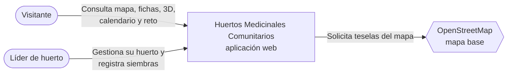
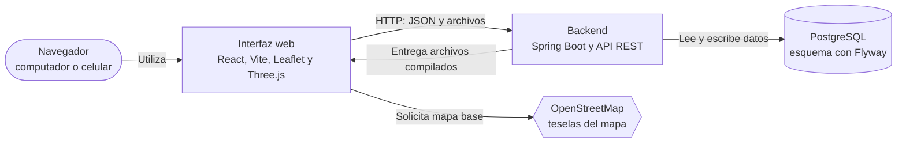
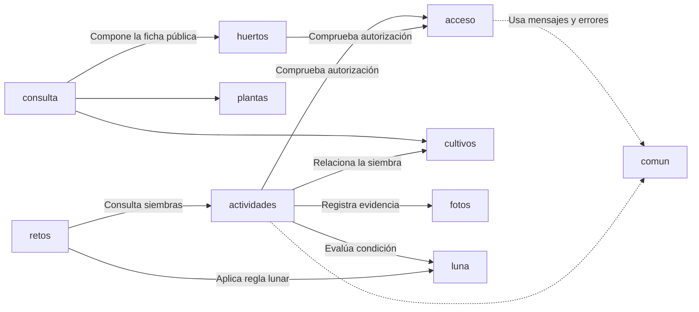

# Arquitectura y diseño del producto

**Proyecto:** Huertos Medicinales Comunitarios  
**Equipo:** techmOS  
**Integrantes:** Mauricio López · Dhalin Avila · Oscar Gualotuña · Christian Yanchatipan · Jean Espinosa · Gabriel Vinueza  
**Entrega:** Versión 1 del producto · primer incremento (HU-001 a HU-020)  
**Versión documental:** 1.0  
**Fecha de edición:** 12 de noviembre de 2026  
**Rama de referencia:** `develop`  
**Institución:** Escuela Politécnica Nacional · Ingeniería de Software · Calidad de Software (ISWD652) · GR2SW · Período 2026-B

La arquitectura de la iteración 1 define las piezas y decisiones técnicas que permiten implementar el alcance acordado en las 20 historias de usuario. Este documento presenta el enfoque elegido, las decisiones principales, las vistas de contexto, contenedores y componentes, y las decisiones transversales de seguridad, calidad y despliegue. El detalle de las historias y sus criterios de aceptación se encuentra en los documentos de requisitos y pruebas; los diagramas de clases y de base de datos corresponden a la parte de diseño.

## 1. Enfoque arquitectónico

La decisión principal para la versión 1 es construir un **monolito modular**: una aplicación backend de Spring Boot organizada por funciones del producto. Los paquetes `acceso`, `huertos`, `plantas`, `cultivos`, `fotos`, `actividades`, `luna`, `retos`, `consulta` y `comun` permiten localizar las responsabilidades de cada función dentro de la misma aplicación. Esta organización responde al tiempo de la iteración y al trabajo del equipo.

El usuario interactúa desde una interfaz React en el navegador. La interfaz solicita información y envía operaciones a la API REST del backend; PostgreSQL conserva los datos. Esa comunicación entre navegador y servidor puede describirse como **cliente-servidor**, pero no cambia el enfoque principal de monolito modular. Spring Boot entrega también los archivos compilados de React, de modo que la interfaz y la API se ofrecen desde un mismo origen. La base de datos se configura como una pieza separada.

La separación por funciones no implica que cada paquete sea una aplicación autónoma ni que esté completamente aislado. En la implementación, algunos servicios consultan repositorios de otras funciones. Las vistas siguientes muestran las piezas y relaciones principales del sistema. La corrección integrada en `develop` incorpora un catálogo institucional de plantas dentro del paquete `plantas`, sin cambiar este enfoque arquitectónico.

## 2. Decisiones de arquitectura

Se conserva la numeración `AD-01` a `AD-11` del diseño original para relacionar cada decisión con las referencias del proyecto. La tabla reúne la decisión, su motivo y la alternativa considerada. El contenido se ajusta a lo implementado en la primera iteración.

| ID | Decisión | Motivo | Alternativa descartada |
|---|---|---|---|
| AD-01 | Monolito modular organizado por funciones. | Permite integrar el trabajo en una aplicación y localizar las responsabilidades de cada función. | Microservicios: añaden despliegues y comunicación por red para este primer incremento. |
| AD-02 | Backend Spring Boot y frontend React; Spring Boot entrega la interfaz compilada. | La interfaz y la API se ofrecen desde un mismo origen. | Desplegar frontend y backend por separado. |
| AD-03 | Sesión de servidor con cookie y protección CSRF. | Permite controlar el acceso a gestión y cerrar la sesión en el servidor. | JWT para la sesión del navegador. |
| AD-04 | Escena 3D generada a partir de zonas y cultivos guardados como datos. | La representación virtual usa la información del huerto. | Mantener un modelo 3D independiente por huerto. |
| AD-05 | Fotografías almacenadas en PostgreSQL. | La fotografía y la siembra pueden guardarse o revertirse en una misma transacción. | Almacenamiento de objetos separado. |
| AD-06 | Cálculo lunar mediante interfaces sustituibles y reloj inyectado. | Permite utilizar efemérides reales y escenarios de prueba controlados. | Consultar un servicio externo de efemérides para cada cálculo. |
| AD-07 | Condición lunar e insignia calculadas al consultarlas. | Reflejan la versión vigente de las siembras. | Guardar resultados derivados y actualizarlos después de cada cambio. |
| AD-08 | Correcciones de siembra registradas como nuevas versiones. | Conservan el historial y la evidencia de los registros anteriores. | Sobrescribir la siembra y mantener un registro de cambios separado. |
| AD-09 | Autorización y validaciones en el servidor con mensajes identificables. | Las reglas se aplican también cuando una solicitud llega directamente a la API. | Validar únicamente en la interfaz. |
| AD-10 | Instantes de actividad con zona horaria definida por huerto. | La interpretación de la fecha local y de la fase lunar depende de la ubicación. | Guardar solo horas locales sin referencia de zona. |
| AD-11 | Referencias por identificador entre entidades de distintas funciones y composición de consultas públicas. | Reduce el acoplamiento del modelo de datos; las dependencias entre servicios se documentan según la implementación. | Crear relaciones directas entre todas las entidades de paquetes distintos. |

La incorporación del catálogo MSP precisa la aplicación de AD-09: el servidor valida que la ficha seleccionada exista y esté activa, y no admite que el líder modifique libremente su contenido educativo. El líder sí puede aportar una fotografía del ejemplar de su huerto. La carga inicial del catálogo se realiza mediante una migración de base de datos; no se añadió un servicio externo ni un editor institucional en esta iteración.

## 3. Vista de contexto (C4, nivel 1)

La vista de contexto muestra quién utiliza el producto y qué servicio externo interviene en la experiencia pública. El visitante consulta los huertos sin iniciar sesión. El líder inicia sesión para mantener la información de su huerto y registrar siembras. El mapa obtiene sus teselas de OpenStreetMap; los datos de huertos y cultivos provienen de la aplicación.

**Figura 1.** Contexto de la aplicación en la primera iteración.

La aplicación no se conecta con sistemas del MSP en esta versión. El catálogo inicial se carga con información trazada a sus lineamientos y queda almacenado en PostgreSQL. El alta administrativa de líderes no forma parte de la aplicación de esta iteración; las cuentas incluidas para la demostración son ficticias. OpenStreetMap aporta únicamente el mapa base; la información que aparece sobre él se mantiene en el producto.

## 4. Vista de contenedores (C4, nivel 2)

En esta vista, *contenedor* significa una pieza ejecutable o almacén de datos dentro del sistema, no necesariamente un contenedor Docker. La interfaz React se ejecuta en el navegador. Spring Boot expone la API REST y entrega los archivos compilados de la interfaz. PostgreSQL conserva los registros. El frontend y la API se ofrecen desde un mismo origen en la aplicación integrada.

**Figura 2.** Contenedores lógicos del producto. La interfaz y el backend se entregan juntos; la base PostgreSQL se configura por separado.

| Contenedor | Tecnología principal | Responsabilidad |
|---|---|---|
| Interfaz web | React, Vite, React Router, Leaflet y React Three Fiber | Presenta las pantallas públicas y de gestión, el mapa, la escena 3D y el calendario; envía solicitudes a la API. |
| Backend | Spring Boot con Java | Atiende la API, gestiona sesiones y autorizaciones, aplica reglas de negocio, calcula información lunar y entrega la interfaz compilada. |
| Base de datos | PostgreSQL y Flyway | Conserva huertos, catálogo institucional, plantas vinculadas al catálogo, cultivos, fotografías y actividades con sus versiones; Flyway aplica las migraciones del esquema. |

La interfaz no decide si un usuario está autorizado a modificar un huerto. Puede guiar la interacción, pero la comprobación se realiza en el backend. Esta separación mantiene las reglas del producto en el servidor aun cuando una solicitud se envíe directamente a la API.

## 5. Vista de componentes del backend (C4, nivel 3)

El backend es una sola aplicación organizada en diez paquetes funcionales. La vista identifica qué responsabilidad concentra cada paquete y cómo participan en los flujos principales. Los nombres corresponden a la organización del código, no a diez servicios desplegados por separado.

### 5.1. Paquetes y responsabilidades

| Paquete | Responsabilidad principal |
|---|---|
| `comun` | Define los códigos y textos de error de la API, convierte las excepciones en respuestas HTTP, configura el reloj usado para comprobar fechas y permite abrir las rutas de la interfaz React desde Spring Boot. |
| `acceso` | Inicio y cierre de sesión, configuración de seguridad y autorización para operar sobre el huerto asignado. |
| `huertos` | Datos de comunidades, huertos y zonas; actualización y publicación de la información del huerto. |
| `plantas` | Consulta del catálogo institucional, selección de fichas para el huerto y gestión de sus fotografías; el contenido educativo de la ficha no se edita libremente desde la aplicación. |
| `cultivos` | Ubicación de una planta en una zona del huerto y estado de ese cultivo. |
| `fotos` | Validación, almacenamiento y entrega de fotografías según el acceso permitido. |
| `actividades` | Registro de siembras, reintentos, correcciones, bitácora e historial de versiones. |
| `luna` | Fases lunares, condición de una siembra y calendario de actividades por fase. |
| `retos` | Evaluación de la insignia *Documentación lunar* a partir de las siembras vigentes. |
| `consulta` | Composición de la información pública de huertos, plantas, cultivos y zonas para el visitante. |

### 5.2. Colaboración entre funciones

El siguiente diagrama corresponde a la vista de componentes del backend (nivel 3 de C4), la última vista C4 incluida en este documento. Resume las colaboraciones principales entre paquetes funcionales. Las flechas representan esa colaboración; no pretenden enumerar todas las importaciones entre clases Java.

**Figura 3.** Colaboraciones principales del backend en la primera iteración. Las flechas salen del paquete que solicita una función hacia el que la proporciona.

En una consulta pública, `consulta` reúne información de `huertos`, `plantas` y `cultivos` y forma una respuesta para el visitante. En el registro de una siembra, `actividades` comprueba la autorización mediante `acceso`, relaciona el cultivo, guarda la fotografía con apoyo de `fotos` y utiliza `luna` para determinar la condición de la fecha registrada. `retos` consulta las siembras vigentes y aplica la regla de la insignia.

Dentro de `plantas`, `CatalogoMsp` consulta las fichas institucionales almacenadas en la base. Al seleccionar una ficha, el servidor vincula su código y su procedencia con la planta del huerto; la fotografía propia se gestiona por separado. Esta colaboración permanece dentro del monolito y, por ello, no se representa como otro contenedor en la Figura 2.

### 5.3. Organización interna de una solicitud

Una solicitud HTTP llega a un controlador. El controlador recibe los datos y delega la operación a un servicio. El servicio coordina autorización, reglas de negocio y persistencia mediante repositorios o consultas específicas a PostgreSQL. Las respuestas de la API se construyen con los datos que necesita cada pantalla. Este recorrido describe la forma general del backend; no exige que cada paquete tenga exactamente las mismas clases o capas.

## 6. Seguridad y acceso

La consulta de huertos publicados, calendario, catálogo y reto está disponible sin iniciar sesión. Las operaciones de gestión requieren una sesión de líder. La configuración de seguridad distingue las rutas públicas de las rutas de gestión, y los servicios comprueban que el líder pueda modificar el huerto relacionado con cada solicitud. La interfaz muestra las acciones disponibles, pero la autorización se decide en el servidor. Las cuentas ficticias de demostración permiten comprobar los permisos del producto, sin representar el alta administrativa de líderes.

El inicio de sesión utiliza una sesión mantenida por Spring Boot. La cookie de sesión se configura como `HttpOnly` y `SameSite=Lax`; en la imagen preparada para HTTPS también se habilita `Secure`. Para las operaciones que modifican datos, el navegador lee el token de la cookie `XSRF-TOKEN` y lo envía en la cabecera `X-XSRF-TOKEN`. Las contraseñas se verifican mediante BCrypt. Estas medidas corresponden a la decisión AD-03.

El acceso a una fotografía se comprueba antes de devolver su contenido. La consulta pública puede obtener fotografías asociadas a plantas o a versiones vigentes de siembras de huertos publicados; el líder puede consultar las evidencias de su huerto. La validación del archivo comprueba su tamaño y contenido antes de guardarlo. La respuesta de la API utiliza mensajes identificables para informar errores de negocio sin depender de las validaciones de la pantalla.

## 7. Persistencia, tiempo y cálculo lunar

PostgreSQL conserva la información del huerto, el catálogo institucional y las fotografías. Flyway aplica los cambios de esquema versionados con el código. La migración `V4__catalogo_institucional_msp.sql` incorpora cuatro fichas iniciales trazadas a los lineamientos del MSP y vincula las plantas de demostración que coinciden con ellas. Conserva los identificadores y las relaciones de cultivos, fotografías, siembras e historial; los textos educativos anteriores de las plantas coincidentes se sustituyen por los datos institucionales. Los registros sin correspondencia permanecen privados hasta su conciliación.

Cuando se registra una siembra, la fotografía, la actividad y su primera versión se guardan en una transacción. Una corrección agrega otra versión en lugar de reemplazar la anterior. Las claves de envío permiten reconocer los reintentos y evitar que una misma operación cree dos siembras. Estas decisiones desarrollan AD-05 y AD-08.

Las fechas de las actividades se guardan como instantes, mientras cada huerto conserva su zona horaria para interpretar la fecha local introducida por el líder. Así se puede comparar correctamente el momento de la siembra con los eventos de fase lunar. El cálculo astronómico se obtiene mediante una fuente de eventos separada de la lógica que clasifica la fase. En las pruebas se sustituye la calculadora por un calendario controlado y se fija el reloj; en el uso normal se emplean efemérides calculadas con Commons SunCalc. Estas fases alimentan el calendario lunar que consulta el usuario. La condición lunar y la insignia se obtienen al consultar las siembras vigentes, sin guardarlas como datos independientes.

## 8. Atributos de calidad y comprobación

Se toma **ISO/IEC 25010:2023** como referencia para seleccionar atributos de calidad relacionados con el uso y la operación del producto. En esta primera iteración se incorporan decisiones iniciales para atenderlos y se comprueban algunos comportamientos concretos. La tabla distingue esas bases implementadas de las verificaciones que todavía faltan; no representa una evaluación completa de cada atributo.

| Atributo | Base aplicada en la versión 1 | Comprobación y límite |
|---|---|---|
| Seguridad | Sesión de servidor, protección CSRF y autorización por huerto en los servicios. | P-003 y P-005 comprueban restricciones de acceso; P-063 conserva la comprobación del entorno HTTPS de entrega como parcial. Estas pruebas no constituyen una certificación general de seguridad. |
| Fiabilidad | Siembra y fotografía en una transacción; claves de envío e historial por versiones. | Los casos P-033, P-037 y P-065 comprueban reenvíos y fallos de guardado. La recuperación completa ante pérdida de infraestructura sigue pendiente de una prueba de operación. |
| Adecuación funcional | API y reglas de negocio vinculadas con las historias de la iteración. | La trazabilidad relaciona historias, criterios y casos de prueba. Los resultados específicos deben leerse en el documento de pruebas; la arquitectura por sí sola no demuestra las 20 historias. |
| Mantenibilidad | Paquetes por función, migraciones versionadas y cálculo lunar sustituible en pruebas. | La estructura se observa en el código y existen pruebas unitarias y de integración. No hay una medición formal de mantenibilidad. |
| Capacidad de interacción | Interfaz adaptable y lista de zonas y cultivos cuando la escena 3D no puede utilizarse. | P-028 comprueba la alternativa ante un fallo de la escena. P-027, la evaluación en Android físico con un huerto aprobado, sigue pendiente. |
| Eficiencia de desempeño | Escena 3D cargada cuando se necesita y validación del tamaño de las fotografías antes de leerlas por completo. | Son medidas implementadas para limitar trabajo y datos. Las mediciones formales P-066 y P-067 siguen pendientes. |
| Flexibilidad | Interfaz y backend preparados en una imagen Docker; PostgreSQL configurado por separado. | La imagen se construyó satisfactoriamente en el CI de `develop`. No se registra todavía una comprobación de la aplicación en un alojamiento externo. |

Estas decisiones sientan una base para la calidad del producto. En las siguientes versiones se podrán ampliar las pruebas con usuarios y dispositivos reales, medir el rendimiento, verificar la recuperación de datos y comprobar la ejecución en otros entornos. Esas actividades permitirán aplicar y evaluar los atributos con mayor profundidad, según el crecimiento del producto y las prioridades que se acuerden con el cliente.

## 9. Herramientas y tecnologías de desarrollo

Las tecnologías se eligieron para implementar la solución integrada y comprobar sus funciones. Las versiones indicadas son las declaradas en los archivos de configuración del proyecto; las versiones efectivamente instaladas dependen de la resolución del gestor de dependencias y del entorno de ejecución.

| Área | Herramienta o tecnología | Uso en la arquitectura |
|---|---|---|
| Backend | Java 21 y Spring Boot 4.1.2 | API REST, seguridad, servicios de negocio y entrega de la interfaz compilada. |
| Base de datos | PostgreSQL 17, Spring Data JPA y consultas JDBC | Persistencia transaccional de huertos, catálogo institucional, fotografías y actividades. |
| Migraciones | Flyway | Al iniciar el backend, aplica en orden los archivos SQL versionados pendientes (`V1` a `V4`) para crear o modificar la base de datos y cargar el catálogo inicial. Registra los cambios ya aplicados y evita repetirlos en cada arranque. |
| Frontend | React 19, TypeScript, Vite y React Router | Pantallas públicas y de gestión en el navegador. |
| Mapa | Leaflet, React Leaflet y OpenStreetMap | Ubicación y consulta de huertos publicados. |
| Escena 3D | Three.js y React Three Fiber | Three.js dibuja la escena 3D mediante WebGL en el navegador; React Three Fiber permite construirla con componentes React. La representación se genera a partir de las zonas y cultivos registrados. |
| Calendario lunar | Commons SunCalc 3.11 | Biblioteca Java integrada al backend que calcula localmente los instantes de las fases lunares utilizados por el calendario. No consulta una API web externa. |
| Pruebas | JUnit, Spring Boot Test, Testcontainers, Playwright y JaCoCo | Pruebas de lógica, API y navegador; cobertura del backend. |
| Empaquetado | Docker y Docker Compose | Construcción de la aplicación integrada y ejecución local con PostgreSQL. |

## 10. Despliegue y entornos

El `Dockerfile` construye primero la interfaz con Node, después la incorpora a los recursos estáticos del backend y empaqueta el JAR de Spring Boot. La imagen de ejecución contiene el JRE y el JAR, sin necesitar un servidor adicional para el frontend. PostgreSQL funciona como una pieza separada y se configura mediante `DB_URL`, `DB_USER` y `DB_PASSWORD`. Flyway aplica las migraciones al arrancar la aplicación.

| Entorno | Organización |
|---|---|
| Desarrollo local | Docker Compose inicia PostgreSQL. El backend y Vite pueden ejecutarse por separado para trabajar en el código. |
| Demostración local | Docker Compose puede construir e iniciar la imagen de la aplicación junto con PostgreSQL. El navegador accede a la interfaz y a la API desde el mismo origen. |
| Pruebas automatizadas | Las pruebas de integración utilizan una base PostgreSQL aislada; las pruebas de navegador emplean un perfil y datos controlados. |
| Alojamiento externo | La misma imagen está preparada para conectarse a una base PostgreSQL configurada en el servicio de alojamiento. Su ejecución externa debe verificarse y registrarse por separado. |

El CI del commit integrado en `develop` completó las pruebas del backend, la compilación del frontend, los recorridos de navegador y la construcción de la imagen Docker. Este resultado comprueba la construcción automatizada, pero no equivale a un despliegue público operativo. El estado de la ejecución en otros entornos corresponde al informe de pruebas y operación de la entrega.

## 11. Diseño del producto

<!-- Espacio para integrar el diagrama de clases, el modelo de base de datos y el resto del diseño. -->
