# Casos de prueba ejecutados · Iteración 1

**Proyecto:** Huertos Medicinales Comunitarios  
**Equipo:** techmOS  
**Institución:** Escuela Politécnica Nacional · Ingeniería de Software · Calidad de Software (ISWD652) · Período 2026-B  
**Fecha de ejecución:** 12-noviembre-2026  
**Responsables:** Oscar Gualotuña, Mauricio López, Gabriel Vinueza, Jean Espinosa, Christian Yanchatipan

Ejecución de los 82 casos de la iteración 1 (P-001 a P-082) con el texto vigente del [documento 04](04_Casos_de_prueba_y_resultados_v1.md), automatizada con Playwright y registrada con capturas de pantalla, en el formato de la plantilla de casos de prueba del aula. Versión en Word: [Casos_de_prueba_ejecutados_I1_v1.docx](Casos_de_prueba_ejecutados_I1_v1.docx) · versión en PDF: [Casos_de_prueba_ejecutados_I1_v1.pdf](Casos_de_prueba_ejecutados_I1_v1.pdf).

**Resultado:** 82 de 82 casos aprobados.

> Versión: rama develop, commit 202393c · Navegador: Chromium 156.0.8078.4 (Playwright 1.64.1) · Entorno de prueba e2e (datos del doc 05 §7, reloj 31/10/2026 12:00).

Cada caso parte de los datos de prueba restaurados (doc 05 §7). Las solicitudes directas al servidor y las consultas a la base de prueba no tienen pantalla propia: su evidencia es la solicitud, la respuesta o la consulta registradas. P-037, P-050, P-058, P-060, P-062, P-065 y P-069 se completan con pruebas del servidor (suite Java de 94 pruebas, todas aprobadas). P-066 y P-067 se midieron con la compilación de producción y la red del perfil Q1-I1 emulada (5 Mbps, 100 ms). Los casos P-027, P-029, P-030, P-033, P-037, P-050, P-058, P-062, P-063, P-065, P-066, P-067, P-068, P-073, P-080 llevan una observación sobre el alcance de su ejecución.

## Resumen

| ID | Título | Responsable | Resultado |
|---|---|---|---|
| [P-001](#p-001--inicio-de-sesión-con-credenciales-válidas) | Inicio de sesión con credenciales válidas | Christian Yanchatipan | Aprobado |
| [P-002](#p-002--inicio-de-sesión-con-credenciales-incorrectas) | Inicio de sesión con credenciales incorrectas | Oscar Gualotuña | Aprobado |
| [P-003](#p-003--modificación-de-un-huerto-no-asignado) | Modificación de un huerto no asignado | Mauricio López | Aprobado |
| [P-004](#p-004--cierre-de-sesión) | Cierre de sesión | Jean Espinosa | Aprobado |
| [P-005](#p-005--modificación-después-de-cerrar-sesión) | Modificación después de cerrar sesión | Oscar Gualotuña | Aprobado |
| [P-006](#p-006--actualización-de-la-ubicación-del-huerto) | Actualización de la ubicación del huerto | Gabriel Vinueza | Aprobado |
| [P-007](#p-007--coordenadas-fuera-de-rango) | Coordenadas fuera de rango | Christian Yanchatipan | Aprobado |
| [P-008](#p-008--actualización-de-las-características-del-huerto) | Actualización de las características del huerto | Jean Espinosa | Aprobado |
| [P-009](#p-009--huerto-sin-nombre) | Huerto sin nombre | Gabriel Vinueza | Aprobado |
| [P-010](#p-010--superficie-negativa) | Superficie negativa | Mauricio López | Aprobado |
| [P-011](#p-011--publicación-de-un-huerto-con-ubicación) | Publicación de un huerto con ubicación | Jean Espinosa | Aprobado |
| [P-012](#p-012--publicación-de-un-huerto-sin-ubicación) | Publicación de un huerto sin ubicación | Mauricio López | Aprobado |
| [P-013](#p-013--incorporación-desde-catálogo) | Incorporación desde catálogo | Christian Yanchatipan | Aprobado |
| [P-014](#p-014--ficha-de-catálogo-no-seleccionada) | Ficha de catálogo no seleccionada | Oscar Gualotuña | Aprobado |
| [P-015](#p-015--imagen-no-admitida-y-límite-exacto) | Imagen no admitida y límite exacto | Mauricio López | Aprobado |
| [P-016](#p-016--cambio-de-fotografía-con-contenido-protegido) | Cambio de fotografía con contenido protegido | Gabriel Vinueza | Aprobado |
| [P-017](#p-017--independencia-de-fotografías-entre-huertos) | Independencia de fotografías entre huertos | Gabriel Vinueza | Aprobado |
| [P-018](#p-018--rechazo-de-edición-de-usos) | Rechazo de edición de usos | Oscar Gualotuña | Aprobado |
| [P-019](#p-019--registro-de-cultivos-de-una-misma-planta) | Registro de cultivos de una misma planta | Christian Yanchatipan | Aprobado |
| [P-020](#p-020--cultivo-en-una-zona-de-otro-huerto) | Cultivo en una zona de otro huerto | Jean Espinosa | Aprobado |
| [P-021](#p-021--cambio-de-estado-de-un-cultivo) | Cambio de estado de un cultivo | Mauricio López | Aprobado |
| [P-022](#p-022--estado-fuera-del-catálogo) | Estado fuera del catálogo | Christian Yanchatipan | Aprobado |
| [P-023](#p-023--marcadores-de-los-huertos-publicados) | Marcadores de los huertos publicados | Gabriel Vinueza | Aprobado |
| [P-024](#p-024--huerto-no-publicado-en-el-mapa) | Huerto no publicado en el mapa | Jean Espinosa | Aprobado |
| [P-025](#p-025--consulta-de-la-ficha-pública-de-un-huerto) | Consulta de la ficha pública de un huerto | Jean Espinosa | Aprobado |
| [P-026](#p-026--enlace-directo-a-un-huerto-no-publicado) | Enlace directo a un huerto no publicado | Christian Yanchatipan | Aprobado |
| [P-027](#p-027--recorrido-de-la-escena-3d) | Recorrido de la escena 3D | Gabriel Vinueza | Aprobado |
| [P-028](#p-028--fallo-de-carga-de-la-escena) | Fallo de carga de la escena | Gabriel Vinueza | Aprobado |
| [P-029](#p-029--cultivos-de-una-zona) | Cultivos de una zona | Oscar Gualotuña | Aprobado |
| [P-030](#p-030--señalética-caliente-y-fría) | Señalética caliente y fría | Oscar Gualotuña | Aprobado |
| [P-031](#p-031--zona-sin-cultivos) | Zona sin cultivos | Mauricio López | Aprobado |
| [P-032](#p-032--registro-de-una-siembra-con-fotografía) | Registro de una siembra con fotografía | Mauricio López | Aprobado |
| [P-033](#p-033--envío-repetido-de-una-siembra) | Envío repetido de una siembra | Oscar Gualotuña | Aprobado |
| [P-034](#p-034--siembra-con-fotografía-no-válida) | Siembra con fotografía no válida | Jean Espinosa | Aprobado |
| [P-035](#p-035--siembra-con-fecha-futura) | Siembra con fecha futura | Christian Yanchatipan | Aprobado |
| [P-036](#p-036--siembra-en-un-cultivo-de-otro-huerto) | Siembra en un cultivo de otro huerto | Mauricio López | Aprobado |
| [P-037](#p-037--falla-al-guardar-la-fotografía) | Falla al guardar la fotografía | Christian Yanchatipan | Aprobado |
| [P-038](#p-038--siembra-conforme-con-la-condición-lunar) | Siembra conforme con la condición lunar | Gabriel Vinueza | Aprobado |
| [P-039](#p-039--siembra-no-conforme-con-la-condición-lunar) | Siembra no conforme con la condición lunar | Mauricio López | Aprobado |
| [P-040](#p-040--siembra-sin-información-de-fase) | Siembra sin información de fase | Oscar Gualotuña | Aprobado |
| [P-041](#p-041--corrección-de-una-siembra-con-motivo) | Corrección de una siembra con motivo | Oscar Gualotuña | Aprobado |
| [P-042](#p-042--corrección-sin-motivo) | Corrección sin motivo | Gabriel Vinueza | Aprobado |
| [P-043](#p-043--corrección-por-el-líder-de-otro-huerto) | Corrección por el líder de otro huerto | Mauricio López | Aprobado |
| [P-044](#p-044--fotografía-no-válida-en-una-corrección) | Fotografía no válida en una corrección | Jean Espinosa | Aprobado |
| [P-045](#p-045--historial-de-una-siembra-corregida) | Historial de una siembra corregida | Jean Espinosa | Aprobado |
| [P-046](#p-046--historial-de-una-siembra-sin-correcciones) | Historial de una siembra sin correcciones | Christian Yanchatipan | Aprobado |
| [P-047](#p-047--insignia-obtenida-por-la-comunidad) | Insignia obtenida por la comunidad | Jean Espinosa | Aprobado |
| [P-048](#p-048--insignia-única-con-varias-siembras-elegibles) | Insignia única con varias siembras elegibles | Gabriel Vinueza | Aprobado |
| [P-049](#p-049--comunidad-sin-siembras-elegibles) | Comunidad sin siembras elegibles | Christian Yanchatipan | Aprobado |
| [P-050](#p-050--calendario-lunar-de-los-próximos-30-días) | Calendario lunar de los próximos 30 días | Oscar Gualotuña | Aprobado |
| [P-051](#p-051--fecha-fuera-del-rango-del-calendario) | Fecha fuera del rango del calendario | Oscar Gualotuña | Aprobado |
| [P-052](#p-052--filtro-de-días-de-siembra) | Filtro de días de siembra | Jean Espinosa | Aprobado |
| [P-053](#p-053--filtro-de-días-de-cosecha-de-raíces) | Filtro de días de cosecha de raíces | Mauricio López | Aprobado |
| [P-054](#p-054--retiro-del-filtro) | Retiro del filtro | Christian Yanchatipan | Aprobado |
| [P-055](#p-055--recorrido-integrado-de-la-primera-iteración) | Recorrido integrado de la primera iteración | Gabriel Vinueza | Aprobado |
| [P-056](#p-056--gestión-privada-de-un-huerto-no-publicado) | Gestión privada de un huerto no publicado | Mauricio López | Aprobado |
| [P-057](#p-057--corrección-con-fecha-futura) | Corrección con fecha futura | Gabriel Vinueza | Aprobado |
| [P-058](#p-058--reintentos-simultáneos-de-siembra) | Reintentos simultáneos de siembra | Gabriel Vinueza | Aprobado |
| [P-059](#p-059--reutilización-de-clave-con-otros-datos) | Reutilización de clave con otros datos | Mauricio López | Aprobado |
| [P-060](#p-060--conflicto-entre-correcciones) | Conflicto entre correcciones | Oscar Gualotuña | Aprobado |
| [P-061](#p-061--insignia-sin-revelar-huertos-privados) | Insignia sin revelar huertos privados | Oscar Gualotuña | Aprobado |
| [P-062](#p-062--continuidad-y-límites-de-los-intervalos-lunares) | Continuidad y límites de los intervalos lunares | Jean Espinosa | Aprobado |
| [P-063](#p-063--ciclo-de-sesión-y-protección-csrf) | Ciclo de sesión y protección CSRF | Gabriel Vinueza | Aprobado |
| [P-064](#p-064--acceso-directo-a-fotografías-privadas) | Acceso directo a fotografías privadas | Jean Espinosa | Aprobado |
| [P-065](#p-065--reversión-después-de-guardar-evidencia) | Reversión después de guardar evidencia | Christian Yanchatipan | Aprobado |
| [P-066](#p-066--carga-y-navegación-3d-en-el-perfil-q1-i1) | Carga y navegación 3D en el perfil Q1-I1 | Gabriel Vinueza | Aprobado |
| [P-067](#p-067--tiempo-de-consulta-de-información) | Tiempo de consulta de información | Jean Espinosa | Aprobado |
| [P-068](#p-068--recuperación-de-datos-y-evidencias) | Recuperación de datos y evidencias | Christian Yanchatipan | Aprobado |
| [P-069](#p-069--reintento-de-corrección-confirmada) | Reintento de corrección confirmada | Oscar Gualotuña | Aprobado |
| [P-070](#p-070--rechazo-de-zonas-no-cultivables) | Rechazo de zonas no cultivables | Mauricio López | Aprobado |
| [P-071](#p-071--cierre-de-sesión-interrumpido) | Cierre de sesión interrumpido | Christian Yanchatipan | Aprobado |
| [P-072](#p-072--respuestas-de-filtro-desordenadas) | Respuestas de filtro desordenadas | Jean Espinosa | Aprobado |
| [P-073](#p-073--campos-institucionales-disponibles-en-ficha) | Campos institucionales disponibles en ficha | Christian Yanchatipan | Aprobado |
| [P-074](#p-074--hora-de-gestión-de-galápagos) | Hora de gestión de Galápagos | Mauricio López | Aprobado |
| [P-075](#p-075--rechazo-de-nombre-libre-largo) | Rechazo de nombre libre largo | Jean Espinosa | Aprobado |
| [P-076](#p-076--indisponibilidad-cartográfica) | Indisponibilidad cartográfica | Oscar Gualotuña | Aprobado |
| [P-077](#p-077--mapa-sin-huertos-publicados) | Mapa sin huertos publicados | Christian Yanchatipan | Aprobado |
| [P-078](#p-078--catálogo-inexistente) | Catálogo inexistente | Oscar Gualotuña | Aprobado |
| [P-079](#p-079--contenido-anterior-sin-referencia) | Contenido anterior sin referencia | Oscar Gualotuña | Aprobado |
| [P-080](#p-080--catálogo-sin-escritura-por-líder) | Catálogo sin escritura por líder | Christian Yanchatipan | Aprobado |
| [P-081](#p-081--permiso-sobre-fotografía-ajena) | Permiso sobre fotografía ajena | Gabriel Vinueza | Aprobado |
| [P-082](#p-082--selección-de-ficha-en-interfaz) | Selección de ficha en interfaz | Mauricio López | Aprobado |

## P-001 · Inicio de sesión con credenciales válidas

| Campo | Contenido |
|---|---|
| **ID** | P-001 |
| **Título** | Inicio de sesión con credenciales válidas |
| **Descripción** | Comprobar que un líder con cuenta activa inicia sesión y accede solo a la gestión del huerto que tiene asignado. |
| **Trazabilidad** | HU-001 / CA-01 · RN-01. |
| **Datos de prueba** | L1, H1, H2. |

**Procedimiento de prueba:**

1. Abrir la aplicación sin sesión.
2. Seleccionar "Iniciar sesión" e ingresar el usuario y la contraseña de L1.
3. Revisar los huertos que se ofrecen para gestionar.

**Resultados esperados:** Se inicia la sesión de L1 y se muestra la gestión de H1. No se ofrece la gestión de H2.

### Ejecución del caso de prueba

| Fecha | Responsable | Reprobado | Aprobado |
|---|---|---|---|
| 12-noviembre-2026 | Christian Yanchatipan | (   ) | ( X ) |

**Resultados obtenidos:**

- Se inició la sesión de L1 y se abrió la gestión de "Huerto de prueba H1".
- Huertos ofrecidos para gestionar: Huerto de prueba H1. No se ofrece la gestión de H2.

**Capturas:**

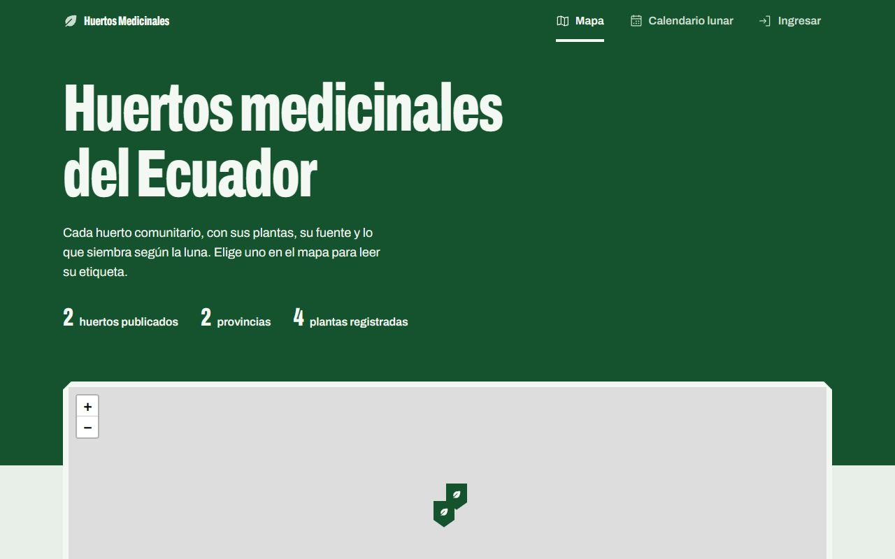

*Paso 1: aplicación abierta sin sesión (opción «Ingresar» visible).*

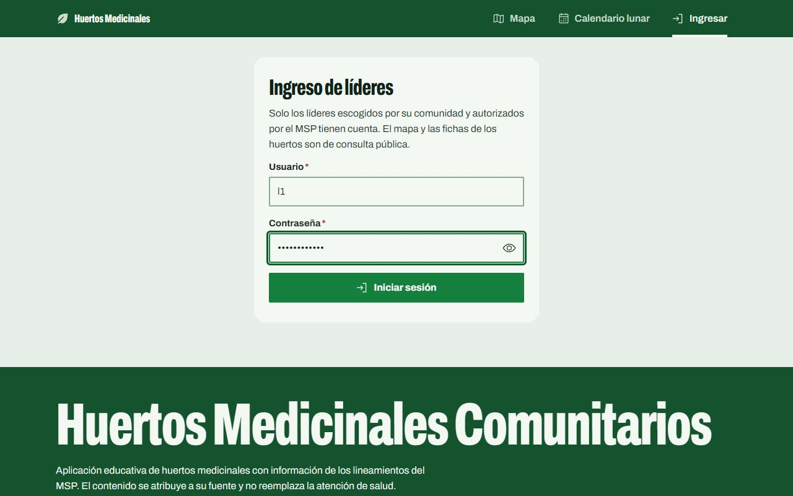

*Paso 2: usuario y contraseña de L1 ingresados.*

*Paso 3: gestión abierta; solo se ofrece el huerto H1.*

[Volver al resumen](#resumen)

---

## P-002 · Inicio de sesión con credenciales incorrectas

| Campo | Contenido |
|---|---|
| **ID** | P-002 |
| **Título** | Inicio de sesión con credenciales incorrectas |
| **Descripción** | Comprobar que el sistema no inicia sesión con credenciales incorrectas y no revela cuál dato falló. |
| **Trazabilidad** | HU-001 / CA-02 · RN-01. |
| **Datos de prueba** | L1 y el usuario inexistente "usuario.inexistente". |

**Procedimiento de prueba:**

1. Ingresar el usuario de L1 con una contraseña incorrecta.
2. Ingresar el usuario "usuario.inexistente" con cualquier contraseña.

**Resultados esperados:** En ambos intentos se muestra exactamente MSG-01 «Usuario o contraseña incorrectos.» y no se inicia sesión.

### Ejecución del caso de prueba

| Fecha | Responsable | Reprobado | Aprobado |
|---|---|---|---|
| 12-noviembre-2026 | Oscar Gualotuña | (   ) | ( X ) |

**Resultados obtenidos:**

- Intento 1 (L1 con contraseña incorrecta): se mostró «Usuario o contraseña incorrectos.» y no se inició sesión.
- Intento 2 ("usuario.inexistente"): se mostró el mismo mensaje, sin indicar qué dato falló; la sesión sigue sin iniciar.

**Capturas:**

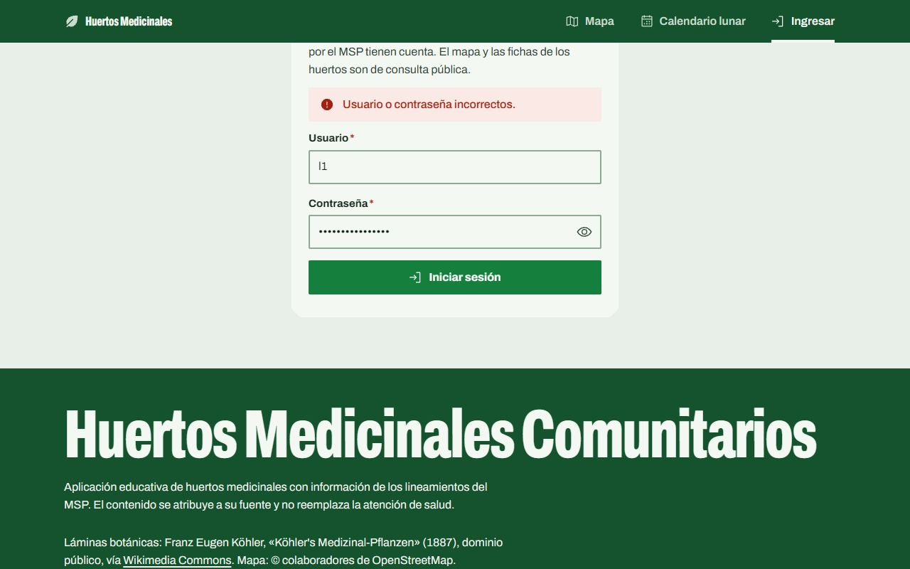

*Paso 1: L1 con contraseña incorrecta → MSG-01.*

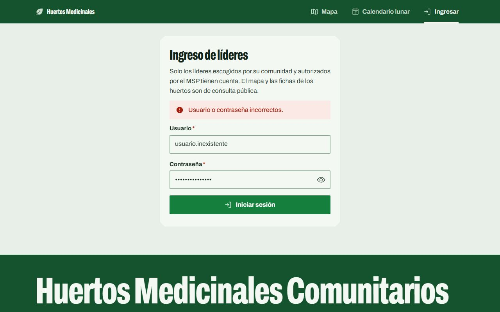

*Paso 2: usuario "usuario.inexistente" → el mismo MSG-01.*

[Volver al resumen](#resumen)

---

## P-003 · Modificación de un huerto no asignado

| Campo | Contenido |
|---|---|
| **ID** | P-003 |
| **Título** | Modificación de un huerto no asignado |
| **Descripción** | Comprobar que un líder no puede modificar un huerto que no le fue asignado, ni desde la pantalla ni con solicitudes directas al servidor. |
| **Trazabilidad** | HU-001 / CA-03 · RN-01. |
| **Datos de prueba** | L2 (líder de H2), H1. Cliente HTTP o herramientas de desarrollador. |

**Procedimiento de prueba:**

1. Anotar el nombre actual de H1.
2. Ingresar como L2.
3. Intentar abrir la gestión de H1 escribiendo su dirección en el navegador.
4. Enviar directamente al servidor una solicitud de cambio del nombre de H1.
5. Consultar H1 sin sesión.

**Resultados esperados:** Los pasos 3 y 4 se rechazan con MSG-03 «No tienes permiso para modificar la información de este huerto.». H1 conserva el nombre anotado.

### Ejecución del caso de prueba

| Fecha | Responsable | Reprobado | Aprobado |
|---|---|---|---|
| 12-noviembre-2026 | Mauricio López | (   ) | ( X ) |

**Resultados obtenidos:**

- Nombre anotado de H1: "Huerto de prueba H1".
- Paso 3: GET /api/huertos/1 como L2 → {"codigo":"MSG-03","mensaje":"No tienes permiso para modificar la información de este huerto."}
- Paso 4: PUT /api/huertos/1/caracteristicas → HTTP 403 «No tienes permiso para modificar la información de este huerto.».
- Paso 5: sin sesión, H1 conserva el nombre "Huerto de prueba H1".

**Capturas:**

*Paso 1: nombre actual de H1 anotado: "Huerto de prueba H1".*

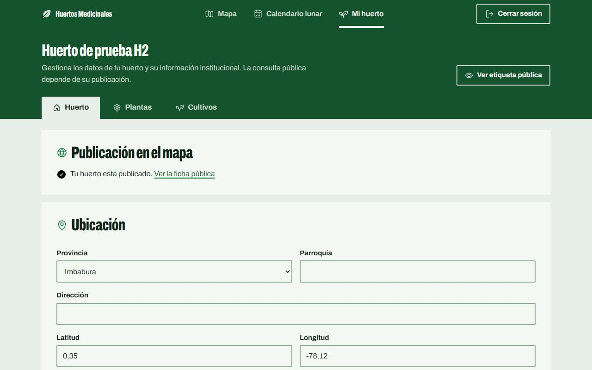

*Paso 2: sesión de L2; su gestión muestra solo H2.*

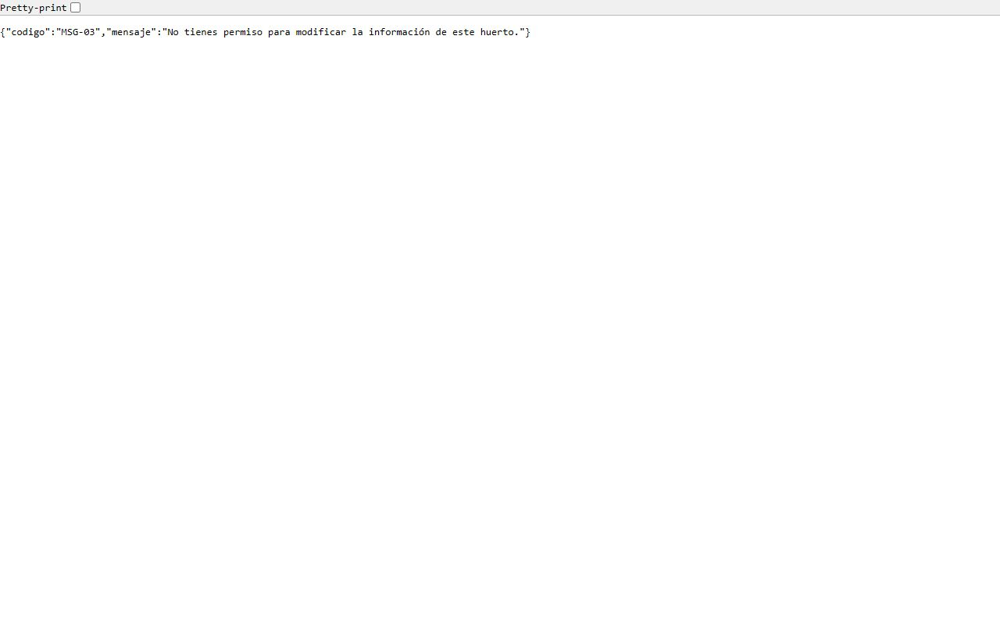

*Paso 3: dirección de gestión de H1 escrita en el navegador → rechazo con MSG-03.*

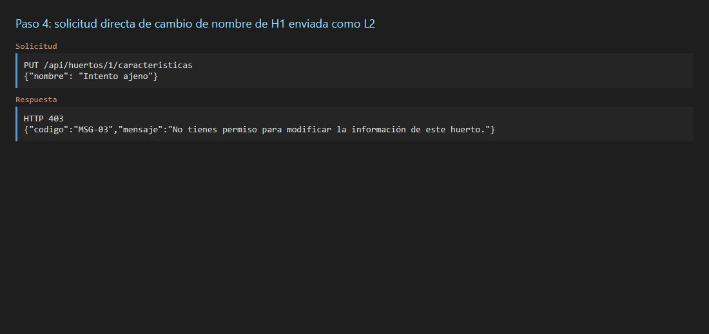

*Paso 4: solicitud directa de cambio de nombre de H1 enviada como L2*

*Paso 5: consulta de H1 sin sesión; conserva su nombre.*

[Volver al resumen](#resumen)

---

## P-004 · Cierre de sesión

| Campo | Contenido |
|---|---|
| **ID** | P-004 |
| **Título** | Cierre de sesión |
| **Descripción** | Comprobar que el líder finaliza su sesión y vuelve a la consulta pública. |
| **Trazabilidad** | HU-002 / CA-01 · RN-01. |
| **Datos de prueba** | L1, H1. |

**Procedimiento de prueba:**

1. Ingresar como L1.
2. Seleccionar "Cerrar sesión".
3. Intentar abrir la gestión de H1.

**Resultados esperados:** Tras el paso 2 se muestra la consulta pública. En el paso 3 el sistema solicita iniciar sesión.

### Ejecución del caso de prueba

| Fecha | Responsable | Reprobado | Aprobado |
|---|---|---|---|
| 12-noviembre-2026 | Jean Espinosa | (   ) | ( X ) |

**Resultados obtenidos:**

- Tras cerrar sesión se mostró la consulta pública (/ingresar) con la opción «Ingresar».
- Al intentar abrir /gestion el sistema redirigió a /ingresar y solicitó iniciar sesión.

**Capturas:**

*Paso 1: sesión de L1 iniciada.*

*Paso 2: tras «Cerrar sesión» se muestra la consulta pública.*

*Paso 3: al abrir la gestión de H1 el sistema pide iniciar sesión.*

[Volver al resumen](#resumen)

---

## P-005 · Modificación después de cerrar sesión

| Campo | Contenido |
|---|---|
| **ID** | P-005 |
| **Título** | Modificación después de cerrar sesión |
| **Descripción** | Comprobar que el servidor rechaza una modificación enviada con los datos de una sesión ya cerrada. |
| **Trazabilidad** | HU-002 / CA-02 · RN-01. |
| **Datos de prueba** | L1, H1. Cliente HTTP o herramientas de desarrollador. |

**Procedimiento de prueba:**

1. Ingresar como L1 y anotar el nombre de H1.
2. Cambiar el nombre de H1, capturar la solicitud enviada y restaurar el nombre original.
3. Cerrar sesión.
4. Reenviar al servidor la solicitud capturada.
5. Consultar H1 sin sesión.

**Resultados esperados:** La solicitud del paso 4 se rechaza con MSG-02 «Tu sesión ha finalizado. Inicia sesión para continuar.». H1 conserva el nombre anotado.

### Ejecución del caso de prueba

| Fecha | Responsable | Reprobado | Aprobado |
|---|---|---|---|
| 12-noviembre-2026 | Oscar Gualotuña | (   ) | ( X ) |

**Resultados obtenidos:**

- Nombre anotado de H1: "Huerto de prueba H1".
- Se cambió el nombre, se capturó la solicitud PUT y se restauró el nombre original.
- Reenvío tras cerrar sesión → HTTP 401 «Tu sesión ha finalizado. Inicia sesión para continuar.».
- H1 conserva el nombre "Huerto de prueba H1".

**Capturas:**

*Paso 1: sesión de L1; nombre de H1 anotado: "Huerto de prueba H1".*

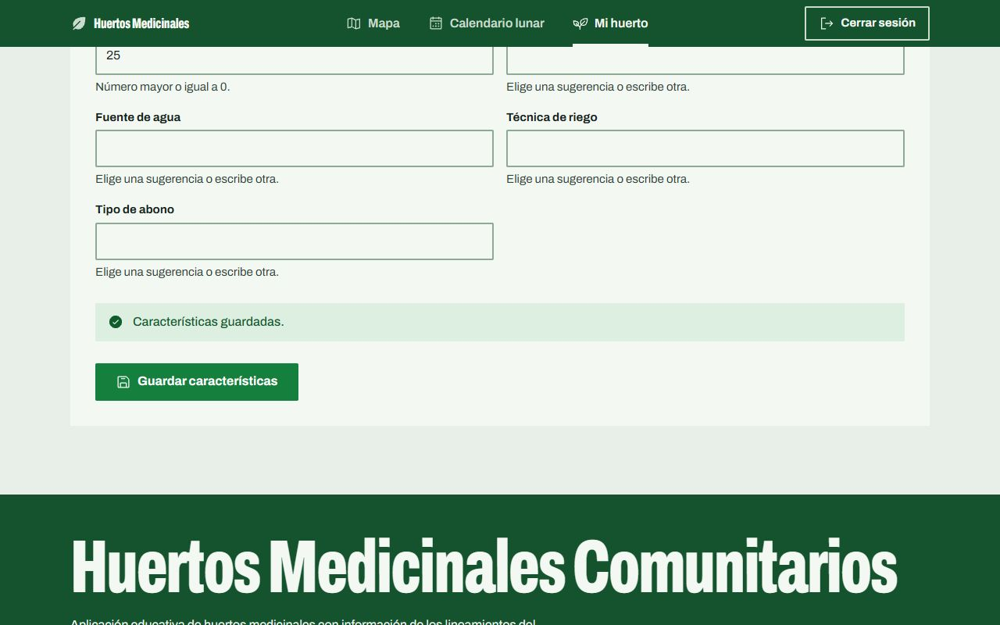

*Paso 2: nombre cambiado y solicitud capturada.*

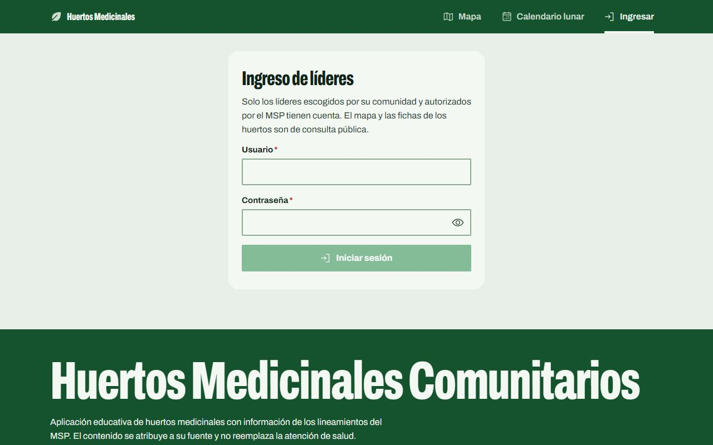

*Paso 3: sesión cerrada.*

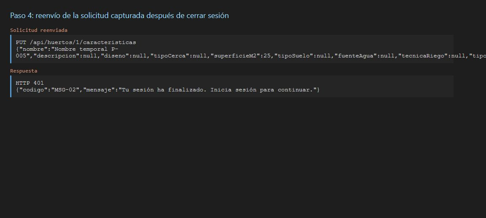

*Paso 4: reenvío de la solicitud capturada después de cerrar sesión*

*Paso 5: H1 sin sesión conserva el nombre anotado.*

[Volver al resumen](#resumen)

---

## P-006 · Actualización de la ubicación del huerto

| Campo | Contenido |
|---|---|
| **ID** | P-006 |
| **Título** | Actualización de la ubicación del huerto |
| **Descripción** | Comprobar que la ubicación se guarda y se recupera, incluidos los valores límite de las coordenadas. |
| **Trazabilidad** | HU-003 / CA-01 · RN-01. |
| **Datos de prueba** | L1, H1. |

**Procedimiento de prueba:**

1. Como L1, guardar: provincia Pichincha; parroquia "Parroquia de prueba"; dirección "Dirección de prueba"; latitud -0.2; longitud -78.5.
2. Cerrar sesión, volver a ingresar y abrir la ubicación de H1.
3. Guardar latitud 90 y longitud -180; recargar; restaurar los valores del paso 1.

**Resultados esperados:** Los pasos 2 y 3 muestran exactamente los valores guardados.

### Ejecución del caso de prueba

| Fecha | Responsable | Reprobado | Aprobado |
|---|---|---|---|
| 12-noviembre-2026 | Gabriel Vinueza | (   ) | ( X ) |

**Resultados obtenidos:**

- Paso 2: provincia Pichincha, parroquia "Parroquia de prueba", dirección "Dirección de prueba", latitud -0.2, longitud -78.5.
- Paso 3: tras recargar, latitud 90 y longitud -180 (valores límite).
- Se restauraron latitud -0.2 y longitud -78.5.

**Capturas:**

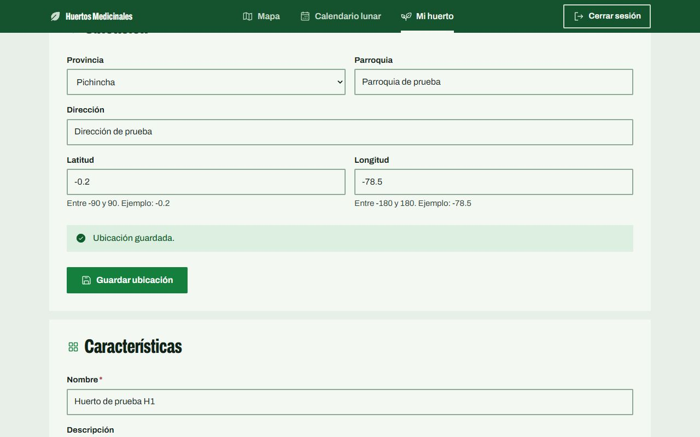

*Paso 1: ubicación guardada (Pichincha, Parroquia de prueba, -0.2 / -78.5).*

*Paso 2: tras salir y volver a ingresar se muestran los mismos valores.*

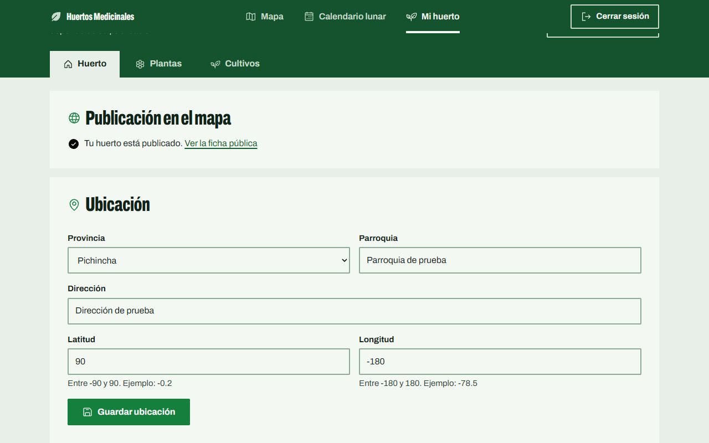

*Paso 3: valores límite 90 / -180 guardados y recuperados al recargar.*

[Volver al resumen](#resumen)

---

## P-007 · Coordenadas fuera de rango

| Campo | Contenido |
|---|---|
| **ID** | P-007 |
| **Título** | Coordenadas fuera de rango |
| **Descripción** | Comprobar que no se guardan coordenadas fuera de rango. |
| **Trazabilidad** | HU-003 / CA-02 · RN-01. |
| **Datos de prueba** | L1, H1 con la ubicación de P-006. |

**Procedimiento de prueba:**

1. Guardar latitud 91 y recargar.
2. Guardar longitud 181 y recargar.

**Resultados esperados:** Ambos intentos muestran MSG-06 «Las coordenadas no son válidas: la latitud debe estar entre -90 y 90 y la longitud entre -180 y 180.» y H1 conserva latitud -0.2 y longitud -78.5.

### Ejecución del caso de prueba

| Fecha | Responsable | Reprobado | Aprobado |
|---|---|---|---|
| 12-noviembre-2026 | Christian Yanchatipan | (   ) | ( X ) |

**Resultados obtenidos:**

- Latitud 91: se mostró «Las coordenadas no son válidas: la latitud debe estar entre -90 y 90 y la longitud entre -180 y 180.»; al recargar H1 conserva latitud -0.2 y longitud -78.5.
- Longitud 181: se mostró «Las coordenadas no son válidas: la latitud debe estar entre -90 y 90 y la longitud entre -180 y 180.»; al recargar H1 conserva latitud -0.2 y longitud -78.5.

**Capturas:**

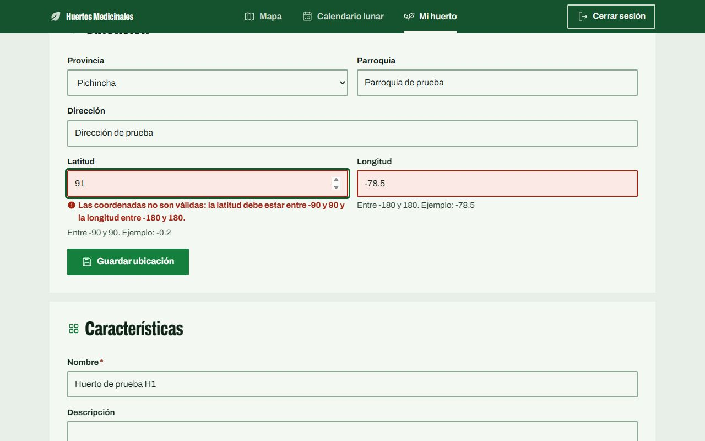

*Paso 1: latitud 91 → MSG-06.*

*Paso 1: tras recargar, H1 conserva -0.2 / -78.5.*

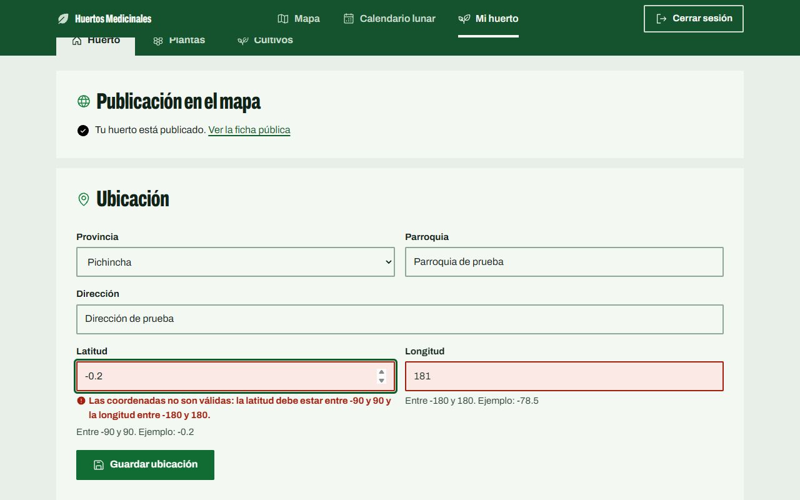

*Paso 2: longitud 181 → MSG-06.*

*Paso 2: tras recargar, H1 conserva -0.2 / -78.5.*

[Volver al resumen](#resumen)

---

## P-008 · Actualización de las características del huerto

| Campo | Contenido |
|---|---|
| **ID** | P-008 |
| **Título** | Actualización de las características del huerto |
| **Descripción** | Comprobar que las características se guardan y se recuperan, incluida la superficie 0. |
| **Trazabilidad** | HU-004 / CA-01 · RN-01, RN-02. |
| **Datos de prueba** | L1, H1. |

**Procedimiento de prueba:**

1. Como L1, guardar: nombre "Huerto Demostrativo A"; descripción "Huerto de prueba"; diseño "en tierra: camellones"; cerca "cerca viva"; superficie 25 m²; suelo "margoso"; fuente de agua "canal"; técnica de riego "regadera"; abono "compost".
2. Cerrar sesión, volver a ingresar y abrir las características.
3. Guardar superficie 0, recargar y restaurar 25 m².

**Resultados esperados:** Los pasos 2 y 3 muestran exactamente los valores guardados.

### Ejecución del caso de prueba

| Fecha | Responsable | Reprobado | Aprobado |
|---|---|---|---|
| 12-noviembre-2026 | Jean Espinosa | (   ) | ( X ) |

**Resultados obtenidos:**

- Paso 2: Nombre: Huerto Demostrativo A; Descripción: Huerto de prueba; Diseño: en tierra: camellones; Tipo de cerca: cerca viva; Superficie (m²): 25; Tipo de suelo: margoso; Fuente de agua: canal; Técnica de riego: regadera; Tipo de abono: compost.
- Paso 3: tras recargar, superficie 0 m².
- Se restauró la superficie de 25 m².

**Capturas:**

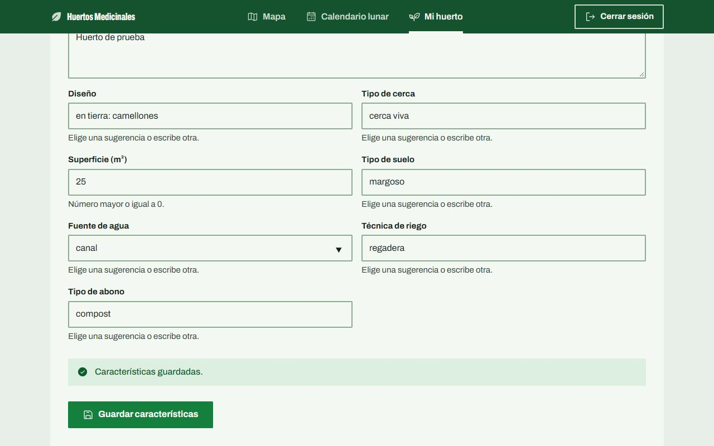

*Paso 1: características de H1 guardadas.*

*Paso 2: tras salir y volver a ingresar se muestran los mismos valores.*

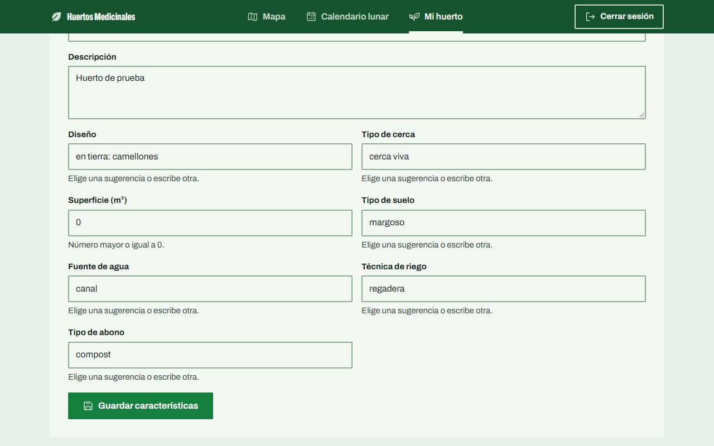

*Paso 3: superficie 0 guardada y recuperada al recargar.*

[Volver al resumen](#resumen)

---

## P-009 · Huerto sin nombre

| Campo | Contenido |
|---|---|
| **ID** | P-009 |
| **Título** | Huerto sin nombre |
| **Descripción** | Comprobar que el nombre es obligatorio. |
| **Trazabilidad** | HU-004 / CA-02 · RN-01. |
| **Datos de prueba** | L1, H1 con nombre "Huerto Demostrativo A". |

**Procedimiento de prueba:**

1. Borrar el nombre y guardar.
2. Recargar las características.

**Resultados esperados:** Se muestra MSG-04 «Completa el campo obligatorio: {campo}.» con el campo "Nombre". H1 conserva el nombre "Huerto Demostrativo A".

### Ejecución del caso de prueba

| Fecha | Responsable | Reprobado | Aprobado |
|---|---|---|---|
| 12-noviembre-2026 | Gabriel Vinueza | (   ) | ( X ) |

**Resultados obtenidos:**

- Al guardar sin nombre se mostró «Completa el campo obligatorio: Nombre.».
- Tras recargar, H1 conserva el nombre "Huerto Demostrativo A".

**Capturas:**

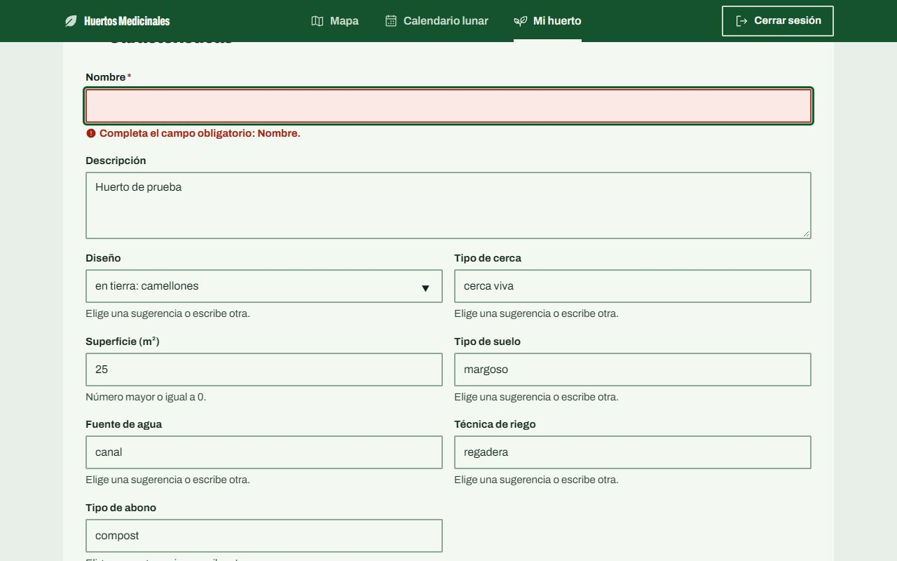

*Paso 1: nombre vacío → MSG-04 con el campo «Nombre».*

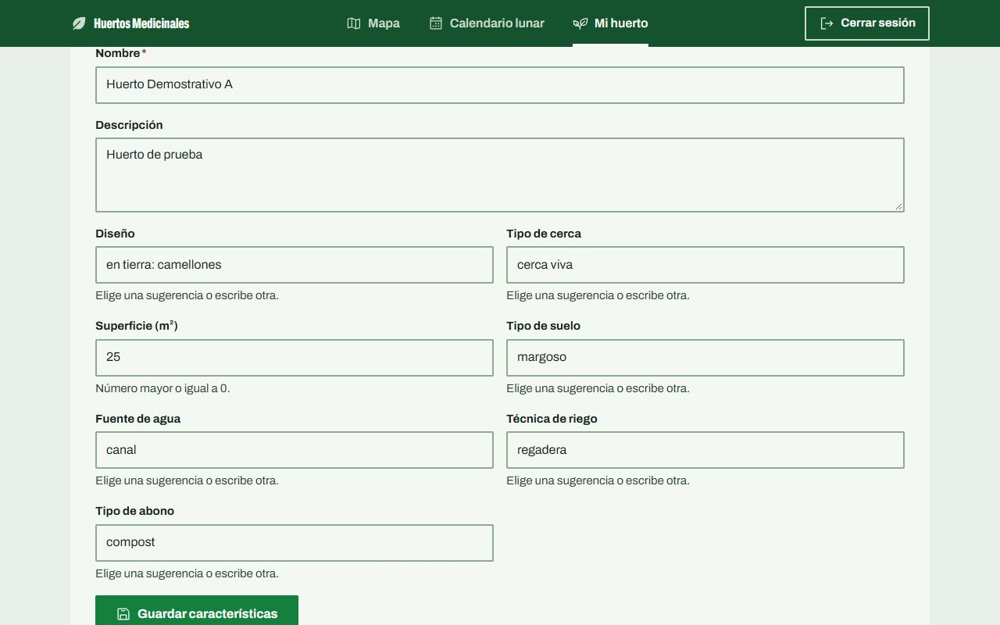

*Paso 2: tras recargar, H1 conserva el nombre "Huerto Demostrativo A".*

[Volver al resumen](#resumen)

---

## P-010 · Superficie negativa

| Campo | Contenido |
|---|---|
| **ID** | P-010 |
| **Título** | Superficie negativa |
| **Descripción** | Comprobar que la superficie no puede ser menor que 0. |
| **Trazabilidad** | HU-004 / CA-03 · RN-01. |
| **Datos de prueba** | L1, H1 con superficie 25 m². |

**Procedimiento de prueba:**

1. Guardar superficie -1.
2. Recargar las características.

**Resultados esperados:** Se muestra MSG-05 «La superficie debe ser un número mayor o igual a 0.». H1 conserva la superficie de 25 m².

### Ejecución del caso de prueba

| Fecha | Responsable | Reprobado | Aprobado |
|---|---|---|---|
| 12-noviembre-2026 | Mauricio López | (   ) | ( X ) |

**Resultados obtenidos:**

- Al guardar superficie -1 se mostró «La superficie debe ser un número mayor o igual a 0.».
- Tras recargar, H1 conserva la superficie de 25 m².

**Capturas:**

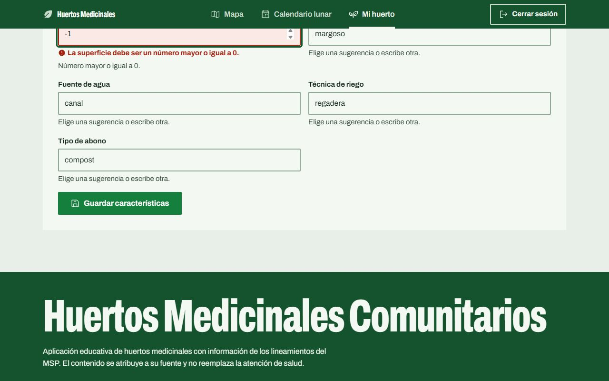

*Paso 1: superficie -1 → MSG-05.*

*Paso 2: tras recargar, H1 conserva la superficie de 25 m².*

[Volver al resumen](#resumen)

---

## P-011 · Publicación de un huerto con ubicación

| Campo | Contenido |
|---|---|
| **ID** | P-011 |
| **Título** | Publicación de un huerto con ubicación |
| **Descripción** | Comprobar que un huerto con nombre y coordenadas se publica y aparece en el mapa. |
| **Trazabilidad** | HU-005 / CA-01 · RN-02. |
| **Datos de prueba** | L4 (líder de H5), H5 no publicado con nombre y coordenadas. |

**Procedimiento de prueba:**

1. Ingresar como L4 y publicar H5.
2. Cerrar sesión y abrir el mapa.

**Resultados esperados:** H5 aparece en el mapa en sus coordenadas registradas.

### Ejecución del caso de prueba

| Fecha | Responsable | Reprobado | Aprobado |
|---|---|---|---|
| 12-noviembre-2026 | Jean Espinosa | (   ) | ( X ) |

**Resultados obtenidos:**

- L4 publicó H5: la gestión muestra «Tu huerto está publicado.».
- Sin sesión, el mapa muestra el marcador de "Huerto de prueba H5" en latitud -2.9 y longitud -79, sus coordenadas registradas.

**Capturas:**

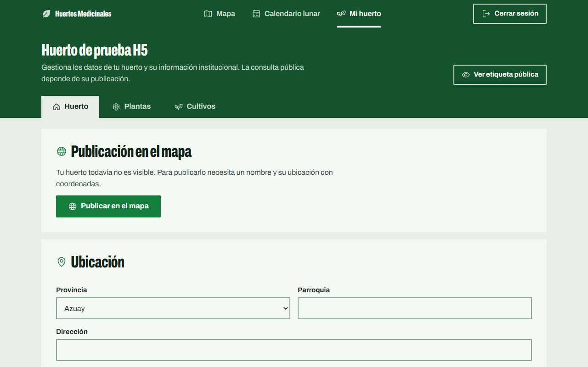

*Paso 1: L4 en la gestión de H5, todavía no publicado.*

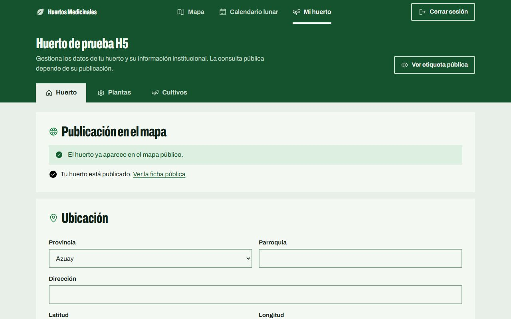

*Paso 1: H5 publicado.*

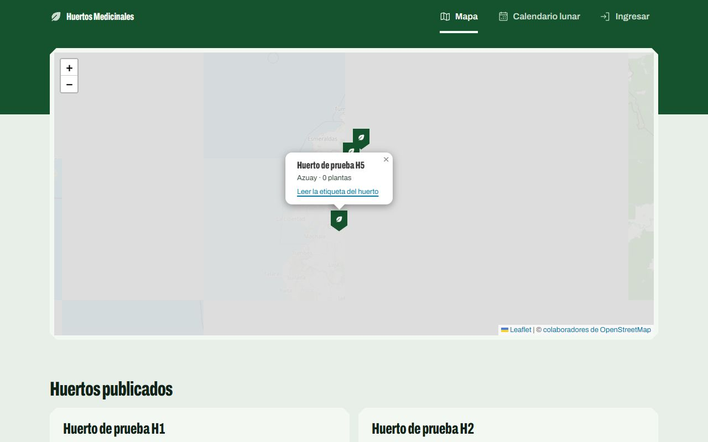

*Paso 2: sin sesión, el mapa muestra el marcador de H5 (Azuay).*

[Volver al resumen](#resumen)

---

## P-012 · Publicación de un huerto sin ubicación

| Campo | Contenido |
|---|---|
| **ID** | P-012 |
| **Título** | Publicación de un huerto sin ubicación |
| **Descripción** | Comprobar que un huerto sin coordenadas no puede publicarse. |
| **Trazabilidad** | HU-005 / CA-02 · RN-02. |
| **Datos de prueba** | L3 (líder de H4), H4 no publicado y sin coordenadas. |

**Procedimiento de prueba:**

1. Ingresar como L3 y solicitar la publicación de H4.
2. Cerrar sesión y abrir el mapa.

**Resultados esperados:** Se muestra MSG-21 «El huerto no tiene ubicación registrada y no puede publicarse en el mapa.». H4 continúa no publicado y no tiene marcador en el mapa.

### Ejecución del caso de prueba

| Fecha | Responsable | Reprobado | Aprobado |
|---|---|---|---|
| 12-noviembre-2026 | Mauricio López | (   ) | ( X ) |

**Resultados obtenidos:**

- Al solicitar la publicación de H4 se mostró «El huerto no tiene ubicación registrada y no puede publicarse en el mapa.».
- H4 continúa no publicado: el mapa muestra 2 marcadores (Huerto de prueba H1, Huerto de prueba H2) y ninguno es H4.

**Capturas:**

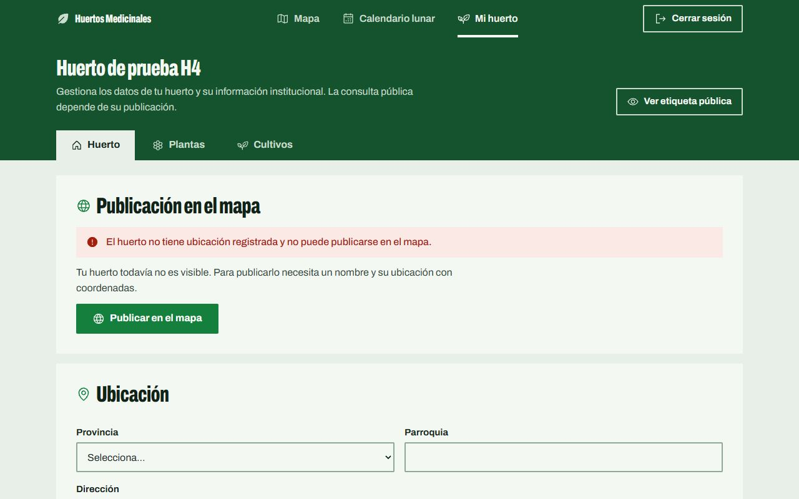

*Paso 1: L3 solicita publicar H4 → MSG-21.*

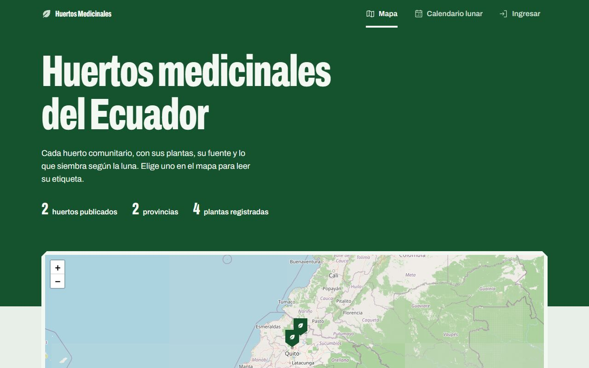

*Paso 2: el mapa no tiene marcador de H4.*

[Volver al resumen](#resumen)

---

## P-013 · Incorporación desde catálogo

| Campo | Contenido |
|---|---|
| **ID** | P-013 |
| **Título** | Incorporación desde catálogo |
| **Descripción** | Verificar selección y publicación institucional. |
| **Trazabilidad** | HU-006/CA-01; RF-021 y RF-024. |
| **Datos de prueba** | cuentas L1 y L2, huertos H1 y H2 y catálogo sintético de pruebas; estos datos no son información medicinal del MSP. |

**Procedimiento de prueba:**

1. Ingresar como L1 y elegir TEST-FRIA.
2. Guardar con F1.
3. Consultar H1 sin sesión.

**Resultados esperados:** Ficha vinculada a TEST-FRIA, datos obtenidos del servidor y fotografía visibles; los textos sintéticos permanecen identificados como prueba.

### Ejecución del caso de prueba

| Fecha | Responsable | Reprobado | Aprobado |
|---|---|---|---|
| 12-noviembre-2026 | Christian Yanchatipan | (   ) | ( X ) |

**Resultados obtenidos:**

- L1 eligió la ficha TEST-FRIA del catálogo y la guardó con la fotografía F1: «Ficha de Planta de prueba guardada.».
- Sin sesión, H1 tiene 4 plantas; la nueva está vinculada a TEST-FRIA (Plantae probatoria), su fuente es «Catálogo de prueba del equipo Versión TEST-1» y su fotografía responde HTTP 200. Los textos siguen identificados como sintéticos («Ficha sintética sin uso medicinal»).

**Capturas:**

*Paso 1: L1 elige TEST-FRIA; los datos institucionales son de solo lectura.*

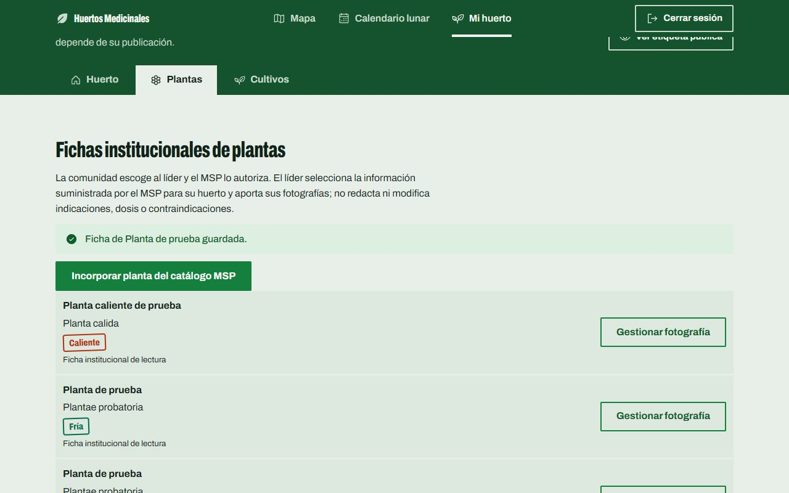

*Paso 2: ficha guardada con F1.*

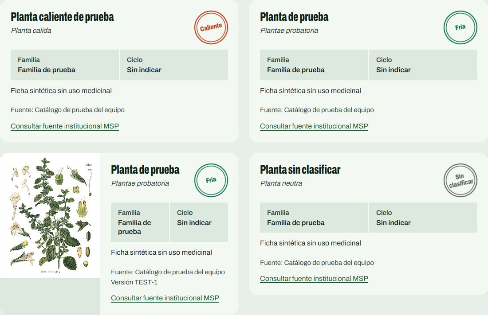

*Paso 3: sin sesión, H1 muestra la ficha vinculada a TEST-FRIA con su fotografía.*

[Volver al resumen](#resumen)

---

## P-014 · Ficha de catálogo no seleccionada

| Campo | Contenido |
|---|---|
| **ID** | P-014 |
| **Título** | Ficha de catálogo no seleccionada |
| **Descripción** | Rechazar la selección faltante. |
| **Trazabilidad** | HU-006/CA-02; RF-023. |
| **Datos de prueba** | cuentas L1 y L2, huertos H1 y H2 y catálogo sintético de pruebas; estos datos no son información medicinal del MSP. |

**Procedimiento de prueba:**

1. Como L1, enviar catalogoCodigo vacío.
2. Consultar las plantas de H1.

**Resultados esperados:** HTTP 400, MSG-04 y campo catalogoCodigo; no se crea ficha.

### Ejecución del caso de prueba

| Fecha | Responsable | Reprobado | Aprobado |
|---|---|---|---|
| 12-noviembre-2026 | Oscar Gualotuña | (   ) | ( X ) |

**Resultados obtenidos:**

- En pantalla se mostró «Completa el campo obligatorio: Ficha del catálogo MSP.». El envío directo respondió HTTP 400, MSG-04, campo catalogoCodigo.
- Las plantas de H1 siguen siendo 3: no se creó ninguna ficha.

**Capturas:**

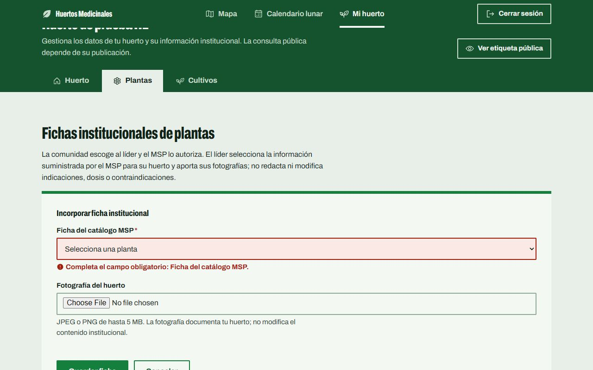

*Paso 1: guardar sin elegir ficha del catálogo → MSG-04.*

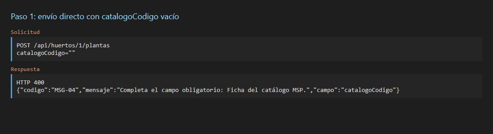

*Paso 1: envío directo con catalogoCodigo vacío*

*Paso 2: las plantas de H1 no cambiaron.*

[Volver al resumen](#resumen)

---

## P-015 · Imagen no admitida y límite exacto

| Campo | Contenido |
|---|---|
| **ID** | P-015 |
| **Título** | Imagen no admitida y límite exacto |
| **Descripción** | Comprobar que cambiar el origen de textos conserva la validación de fotos. |
| **Trazabilidad** | HU-006/CA-03; RN-05. |
| **Datos de prueba** | cuentas L1 y L2, huertos H1 y H2 y catálogo sintético de pruebas; estos datos no son información medicinal del MSP. |

**Procedimiento de prueba:**

1. Seleccionar TEST-FRIA con F2 y con F3.
2. Repetir con F4 de exactamente 5 MB.

**Resultados esperados:** F2 y F3 se rechazan con MSG-07, sin altas; F4 se admite.

### Ejecución del caso de prueba

| Fecha | Responsable | Reprobado | Aprobado |
|---|---|---|---|
| 12-noviembre-2026 | Mauricio López | (   ) | ( X ) |

**Resultados obtenidos:**

- TEST-FRIA con F2 (texto con extensión .jpg): «La imagen debe estar en formato JPEG o PNG y pesar como máximo 5 MB.».
- TEST-FRIA con F3 (PNG de 6 MB): «La imagen debe estar en formato JPEG o PNG y pesar como máximo 5 MB.».
- Sin altas: H1 sigue con 3 plantas.
- F4 de exactamente 5242880 bytes (5 MB) se admitió: H1 pasó a 4 plantas.

**Capturas:**

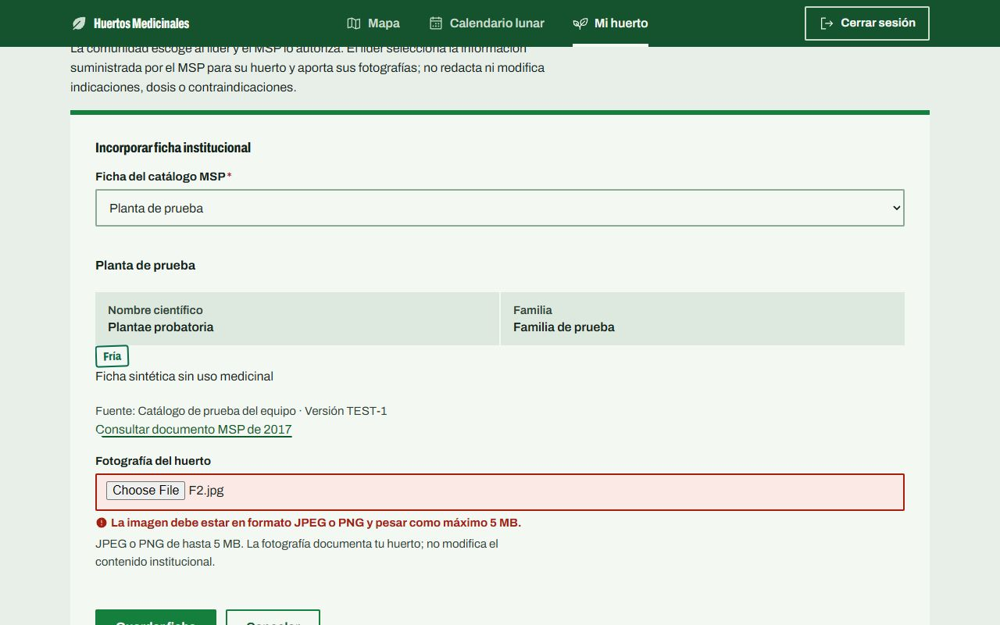

*Paso 1: TEST-FRIA con F2 (texto con extensión .jpg) → MSG-07.*

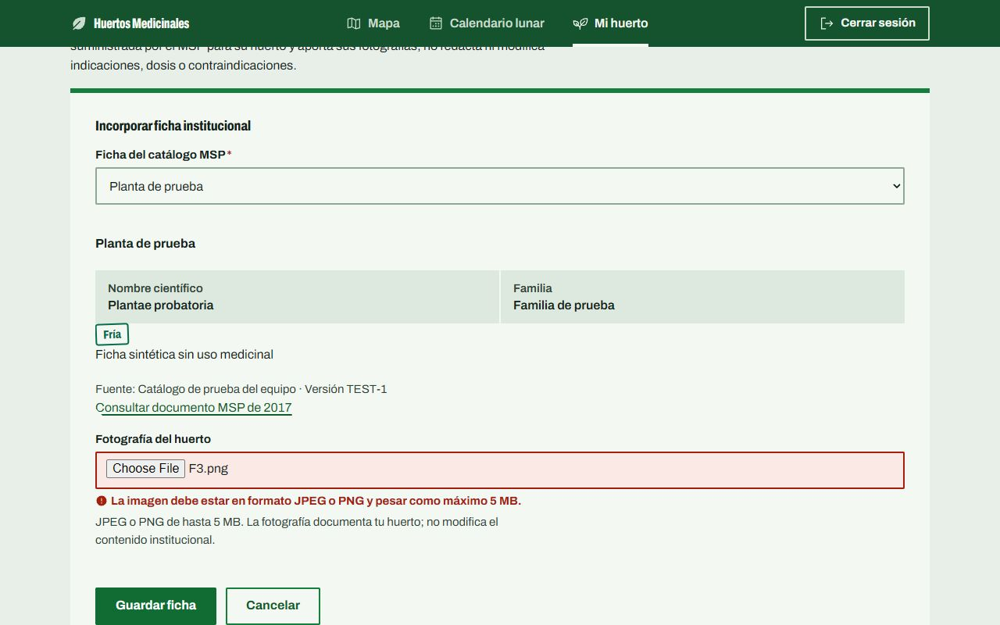

*Paso 1: TEST-FRIA con F3 (PNG de 6 MB) → MSG-07.*

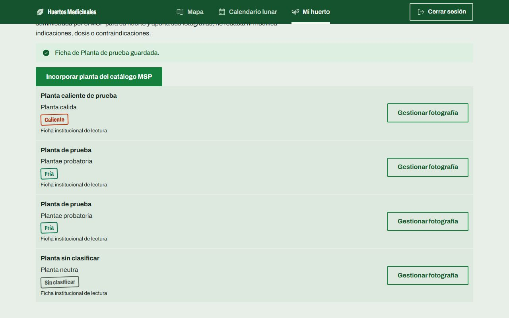

*Paso 2: TEST-FRIA con F4 de exactamente 5242880 bytes → se admite.*

[Volver al resumen](#resumen)

---

## P-016 · Cambio de fotografía con contenido protegido

| Campo | Contenido |
|---|---|
| **ID** | P-016 |
| **Título** | Cambio de fotografía con contenido protegido |
| **Descripción** | Verificar modificación exclusiva de la foto. |
| **Trazabilidad** | HU-007/CA-01; RF-022. |
| **Datos de prueba** | cuentas L1 y L2, huertos H1 y H2 y catálogo sintético de pruebas; estos datos no son información medicinal del MSP. |

**Procedimiento de prueba:**

1. Como L1, sustituir la fotografía de E1.
2. Consultar la ficha.

**Resultados esperados:** Foto actualizada; descripción institucional sin modificaciones.

### Ejecución del caso de prueba

| Fecha | Responsable | Reprobado | Aprobado |
|---|---|---|---|
| 12-noviembre-2026 | Gabriel Vinueza | (   ) | ( X ) |

**Resultados obtenidos:**

- La fotografía de E1 pasó de ninguna a /api/fotos/1.
- La descripción institucional sigue igual: «Ficha sintética sin uso medicinal».

**Capturas:**

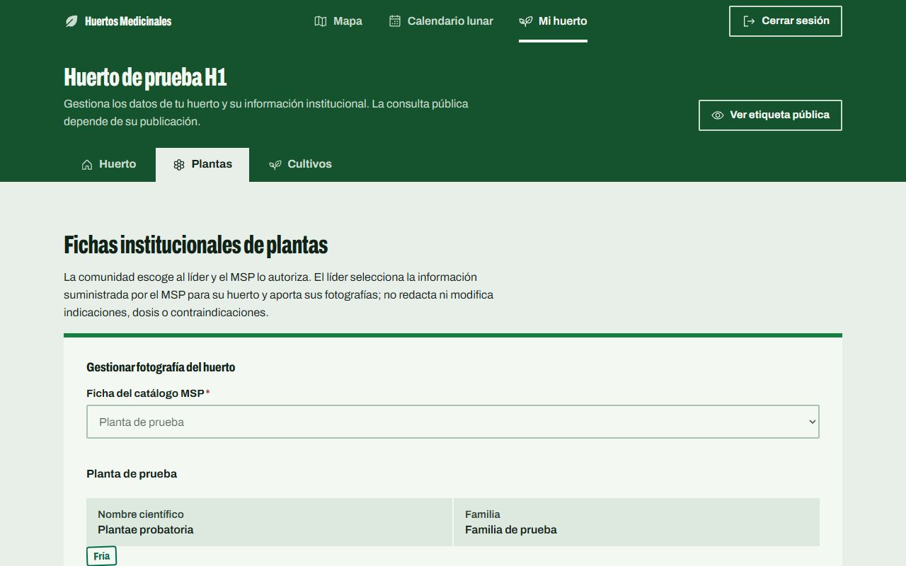

*Paso 1: L1 sustituye la fotografía de E1; la ficha del catálogo no se puede cambiar.*

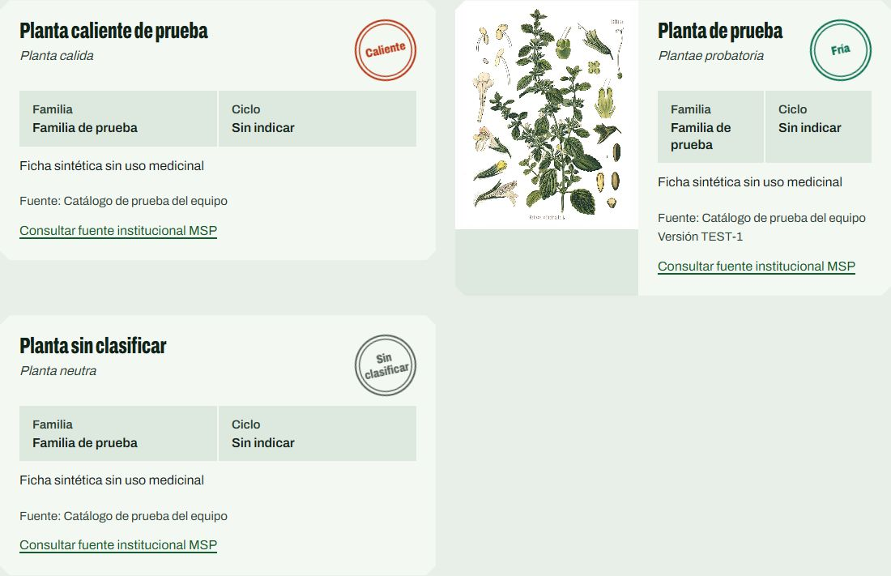

*Paso 2: la ficha pública muestra la foto nueva y la descripción institucional sin cambios.*

[Volver al resumen](#resumen)

---

## P-017 · Independencia de fotografías entre huertos

| Campo | Contenido |
|---|---|
| **ID** | P-017 |
| **Título** | Independencia de fotografías entre huertos |
| **Descripción** | Verificar aislamiento de las fotografías. |
| **Trazabilidad** | HU-007/CA-02; RN-02. |
| **Datos de prueba** | cuentas L1 y L2, huertos H1 y H2 y catálogo sintético de pruebas; estos datos no son información medicinal del MSP. |

**Procedimiento de prueba:**

1. Actualizar la foto de E1 en H1.
2. Consultar la ficha de la misma especie en H2.

**Resultados esperados:** La foto de H2 permanece intacta.

### Ejecución del caso de prueba

| Fecha | Responsable | Reprobado | Aprobado |
|---|---|---|---|
| 12-noviembre-2026 | Gabriel Vinueza | (   ) | ( X ) |

**Resultados obtenidos:**

- Se actualizó la foto de E1 en H1 (HTTP 200).
- En H2, "Planta de prueba" sigue sin fotografía (ninguna); la foto de H1 no se propagó.

**Capturas:**

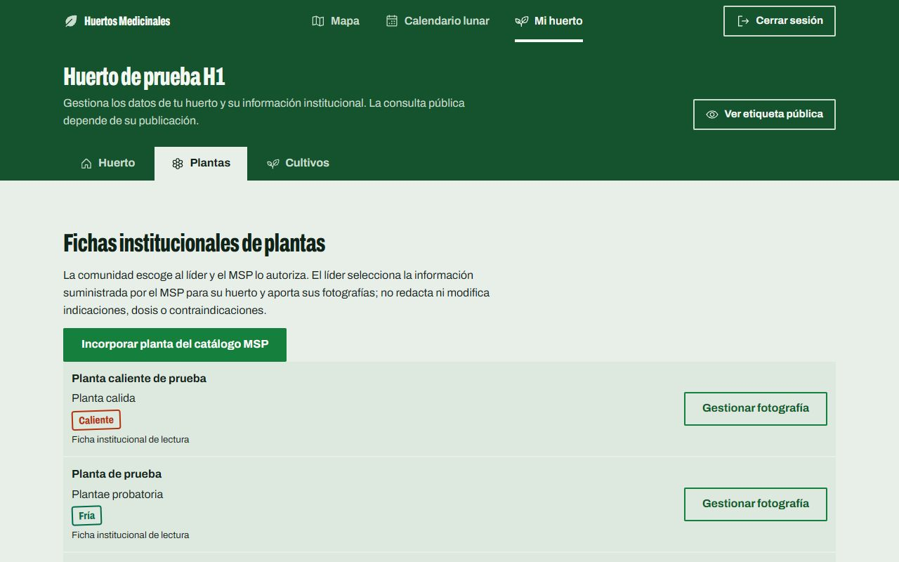

*Paso 1: foto de E1 actualizada en H1.*

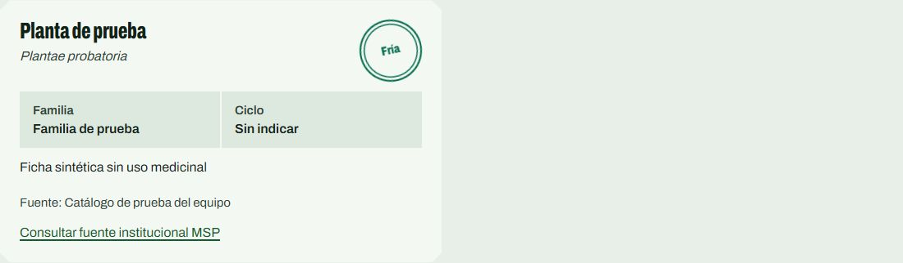

*Paso 2: la misma especie en H2 conserva su ficha sin la foto de H1.*

[Volver al resumen](#resumen)

---

## P-018 · Rechazo de edición de usos

| Campo | Contenido |
|---|---|
| **ID** | P-018 |
| **Título** | Rechazo de edición de usos |
| **Descripción** | Verificar protección del contenido en el servidor. |
| **Trazabilidad** | HU-007/CA-03; RN-11. |
| **Datos de prueba** | cuentas L1 y L2, huertos H1 y H2 y catálogo sintético de pruebas; estos datos no son información medicinal del MSP. |

**Procedimiento de prueba:**

1. Como L1, enviar catalogoCodigo junto con usos manipulados.
2. Consultar la ficha y los datos persistidos.

**Resultados esperados:** HTTP 400, MSG-28; el contenido institucional anterior permanece intacto.

### Ejecución del caso de prueba

| Fecha | Responsable | Reprobado | Aprobado |
|---|---|---|---|
| 12-noviembre-2026 | Oscar Gualotuña | (   ) | ( X ) |

**Resultados obtenidos:**

- El servidor respondió HTTP 400 MSG-28: «La información educativa proviene del catálogo del MSP. Selecciona una ficha institucional; esos campos no se pueden editar.».
- La fila de E1 en la base es idéntica antes y después: usos sigue vacío y la descripción institucional no cambió.

**Capturas:**

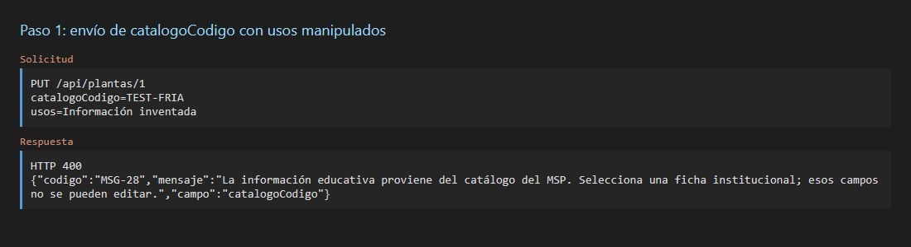

*Paso 1: envío de catalogoCodigo con usos manipulados*

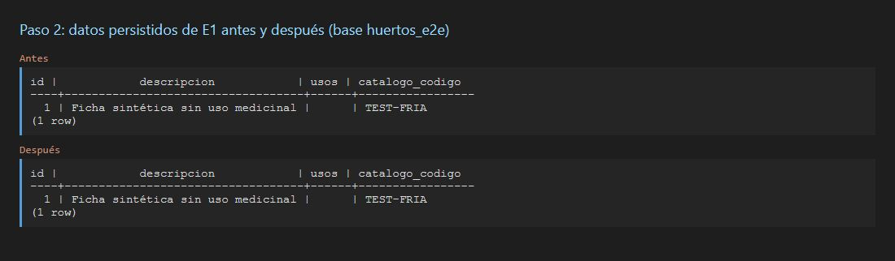

*Paso 2: datos persistidos de E1 antes y después (base huertos_e2e)*

[Volver al resumen](#resumen)

---

## P-019 · Registro de cultivos de una misma planta

| Campo | Contenido |
|---|---|
| **ID** | P-019 |
| **Título** | Registro de cultivos de una misma planta |
| **Descripción** | Comprobar que una planta puede tener cultivos distintos en zonas distintas. |
| **Trazabilidad** | HU-008 / CA-01 · RN-03. |
| **Datos de prueba** | L1, E1, Z1, Z2. Reloj fijado. |

**Procedimiento de prueba:**

1. Como L1, registrar K1: planta E1, zona Z1.
2. Registrar K2: planta E1, zona Z2.
3. Consultar K1 y K2.

**Resultados esperados:** K1 y K2 muestran planta E1, su zona, estado "sembrado" y fecha 31/10/2026 12:00.

### Ejecución del caso de prueba

| Fecha | Responsable | Reprobado | Aprobado |
|---|---|---|---|
| 12-noviembre-2026 | Christian Yanchatipan | (   ) | ( X ) |

**Resultados obtenidos:**

- Cultivo 101: planta Planta de prueba, zona Z1, estado "sembrado", registrado 2026-10-31T17:00:00Z (31/10/2026 12:00 en Ecuador).
- Cultivo 102: planta Planta de prueba, zona Z2, estado "sembrado", registrado 2026-10-31T17:00:00Z (31/10/2026 12:00 en Ecuador).

**Capturas:**

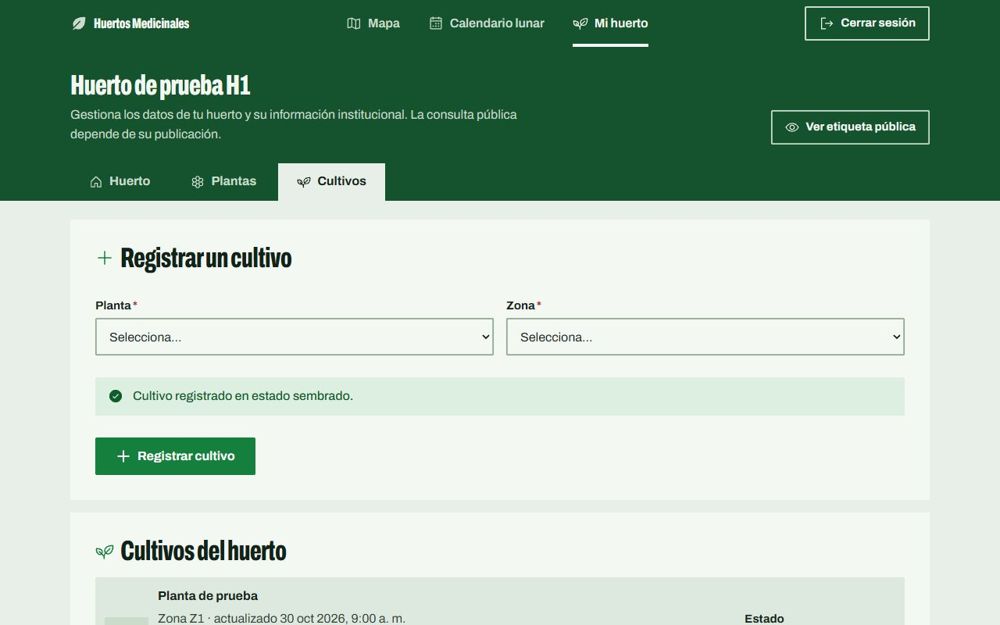

*Paso 1: cultivo de E1 en Z1 registrado.*

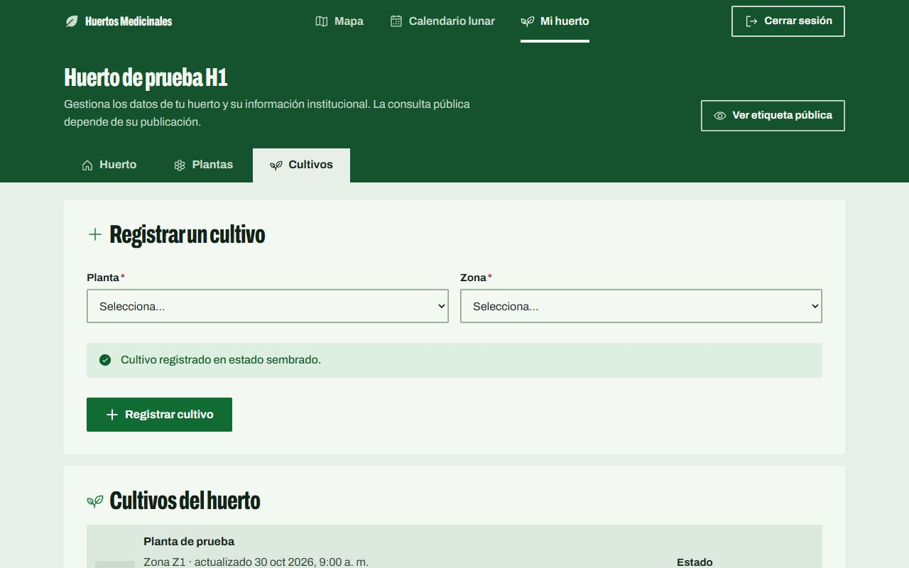

*Paso 2: cultivo de E1 en Z2 registrado.*

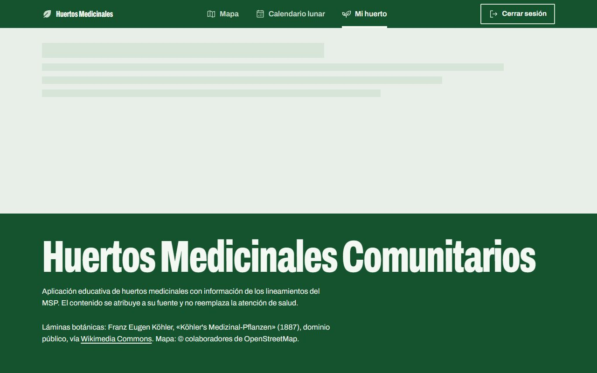

*Paso 3: lista de cultivos con los dos nuevos.*

[Volver al resumen](#resumen)

---

## P-020 · Cultivo en una zona de otro huerto

| Campo | Contenido |
|---|---|
| **ID** | P-020 |
| **Título** | Cultivo en una zona de otro huerto |
| **Descripción** | Comprobar que no se registra un cultivo en una zona de otro huerto. |
| **Trazabilidad** | HU-008 / CA-02 · RN-03. |
| **Datos de prueba** | L1, E1, Z3 (de H2). |

**Procedimiento de prueba:**

1. Como L1, enviar un cultivo de E1 en Z3, que pertenece a H2.
2. Enviar un cultivo con E2 de H2 en Z1 de H1.
3. Consultar los cultivos de H1 y H2.

**Resultados esperados:** Ambos intentos se rechazan sin registrar cultivos. Zona ajena: MSG-09. Planta ajena: error de validación que identifica la referencia inválida sin revelar datos del otro huerto. Ninguna referencia cruzada se persiste.

### Ejecución del caso de prueba

| Fecha | Responsable | Reprobado | Aprobado |
|---|---|---|---|
| 12-noviembre-2026 | Jean Espinosa | (   ) | ( X ) |

**Resultados obtenidos:**

- Zona ajena: HTTP 400 MSG-09 «La zona seleccionada no pertenece a este huerto.».
- Planta ajena: HTTP 403 MSG-03, campo plantaId, sin datos de H2 en la respuesta.
- Cultivos antes/después: H1 4→4, H2 1→1. No se persistió ninguna referencia cruzada.

**Capturas:**

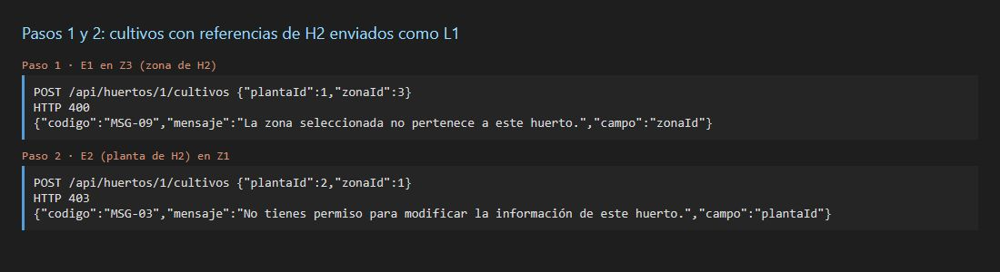

*Pasos 1 y 2: cultivos con referencias de H2 enviados como L1*

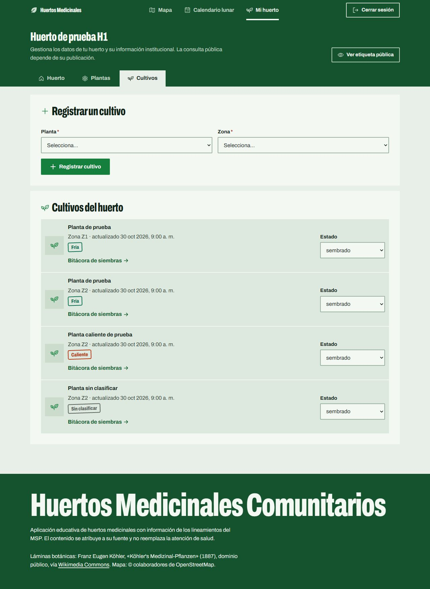

*Paso 3: los cultivos de H1 no cambiaron.*

[Volver al resumen](#resumen)

---

## P-021 · Cambio de estado de un cultivo

| Campo | Contenido |
|---|---|
| **ID** | P-021 |
| **Título** | Cambio de estado de un cultivo |
| **Descripción** | Comprobar que el estado pertenece al cultivo y no a la planta. |
| **Trazabilidad** | HU-009 / CA-01 · RN-03. |
| **Datos de prueba** | L1, K1 y K2 en estado "sembrado". |

**Procedimiento de prueba:**

1. Como L1, cambiar K1 a "en crecimiento".
2. Consultar K1, K2 y la ficha de E1.

**Resultados esperados:** K1 muestra "en crecimiento" y una nueva fecha de actualización. K2 sigue "sembrado". La ficha de E1 no muestra un estado.

### Ejecución del caso de prueba

| Fecha | Responsable | Reprobado | Aprobado |
|---|---|---|---|
| 12-noviembre-2026 | Mauricio López | (   ) | ( X ) |

**Resultados obtenidos:**

- K1: "en crecimiento", actualizado 2026-10-31T17:00:00Z (antes 30/10/2026 09:00). K2: "sembrado".
- La ficha pública de E1 no muestra ningún estado: el estado pertenece al cultivo.

**Capturas:**

*Paso 1: K1 cambia a «en crecimiento»; K2 sigue «sembrado».*

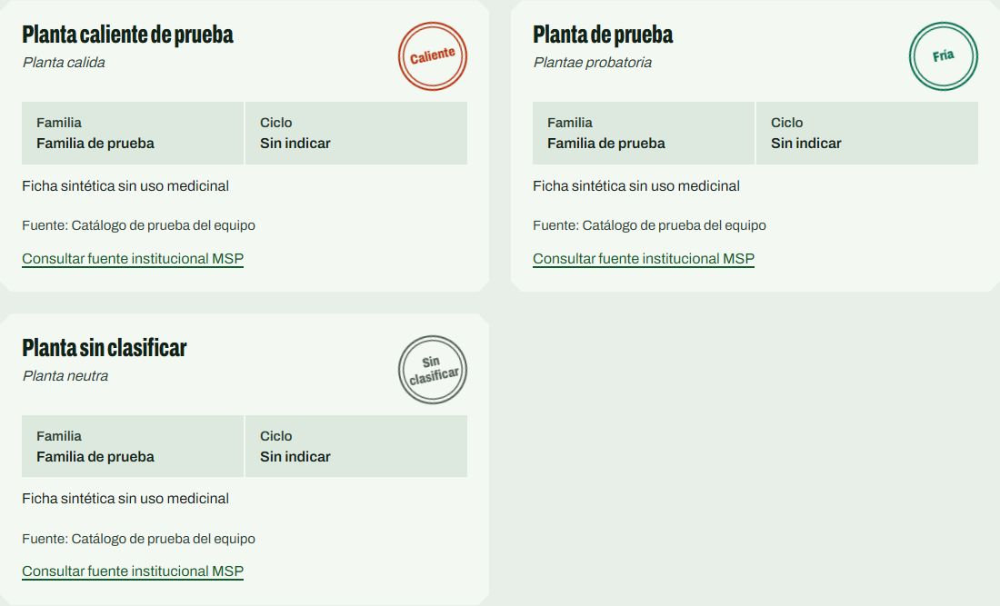

*Paso 2: la ficha de E1 no muestra un estado.*

[Volver al resumen](#resumen)

---

## P-022 · Estado fuera del catálogo

| Campo | Contenido |
|---|---|
| **ID** | P-022 |
| **Título** | Estado fuera del catálogo |
| **Descripción** | Comprobar que solo se aceptan estados del catálogo. |
| **Trazabilidad** | HU-009 / CA-02 · RN-03. |
| **Datos de prueba** | L1, K1. |

**Procedimiento de prueba:**

1. Como L1, enviar directamente al servidor el estado "gigante" para K1.
2. Consultar K1.

**Resultados esperados:** Se muestra MSG-10 «Selecciona un estado válido: sembrado, en crecimiento, cosechado o perdido.». K1 conserva su estado anterior.

### Ejecución del caso de prueba

| Fecha | Responsable | Reprobado | Aprobado |
|---|---|---|---|
| 12-noviembre-2026 | Christian Yanchatipan | (   ) | ( X ) |

**Resultados obtenidos:**

- Respuesta HTTP 400 MSG-10: «Selecciona un estado válido: sembrado, en crecimiento, cosechado o perdido.». K1 conserva el estado "sembrado".

**Capturas:**

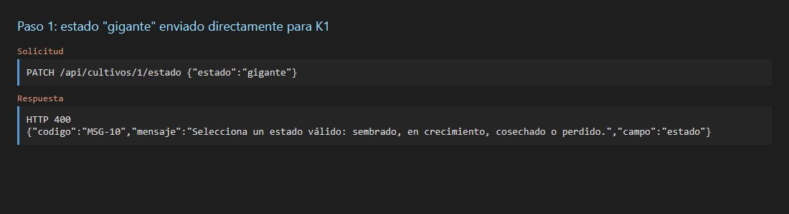

*Paso 1: estado "gigante" enviado directamente para K1*

*Paso 2: K1 conserva el estado «sembrado».*

[Volver al resumen](#resumen)

---

## P-023 · Marcadores de los huertos publicados

| Campo | Contenido |
|---|---|
| **ID** | P-023 |
| **Título** | Marcadores de los huertos publicados |
| **Descripción** | Comprobar que el mapa muestra un marcador por cada huerto publicado en su ubicación registrada. |
| **Trazabilidad** | HU-010 / CA-01 · RN-02. |
| **Datos de prueba** | H1 y H2 publicados con coordenadas. |

**Procedimiento de prueba:**

1. Sin sesión, abrir el mapa.
2. Comparar la posición de cada marcador con las coordenadas registradas de H1 y H2.

**Resultados esperados:** Aparecen marcadores de H1 y H2 en sus coordenadas registradas.

### Ejecución del caso de prueba

| Fecha | Responsable | Reprobado | Aprobado |
|---|---|---|---|
| 12-noviembre-2026 | Gabriel Vinueza | (   ) | ( X ) |

**Resultados obtenidos:**

- Se ven exactamente 2 marcadores: H1 (-0.2, -78.5) y H2 (0.35, -78.12), iguales a las coordenadas registradas.
- En pantalla H2 queda 18 px a la derecha y 25 px arriba de H1; la proporción medida (0.72) coincide con la de las coordenadas (0.69).

**Capturas:**

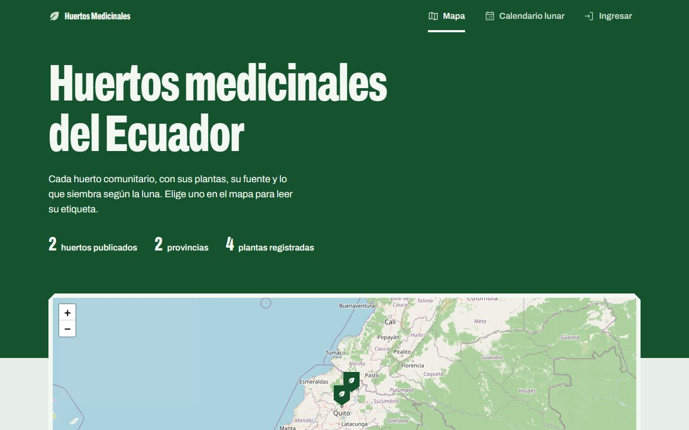

*Paso 1: sin sesión, el mapa muestra los marcadores de H1 y H2.*

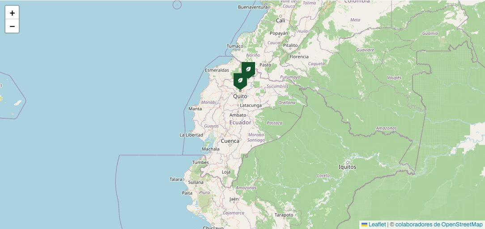

*Paso 2: posición relativa de los marcadores de H1 (Pichincha) y H2 (Imbabura).*

[Volver al resumen](#resumen)

---

## P-024 · Huerto no publicado en el mapa

| Campo | Contenido |
|---|---|
| **ID** | P-024 |
| **Título** | Huerto no publicado en el mapa |
| **Descripción** | Comprobar que un huerto no publicado no aparece en el mapa. |
| **Trazabilidad** | HU-010 / CA-02 · RN-02. |
| **Datos de prueba** | H3 no publicado. |

**Procedimiento de prueba:**

1. Sin sesión, abrir el mapa y buscar H3.

**Resultados esperados:** H3 no tiene marcador.

### Ejecución del caso de prueba

| Fecha | Responsable | Reprobado | Aprobado |
|---|---|---|---|
| 12-noviembre-2026 | Jean Espinosa | (   ) | ( X ) |

**Resultados obtenidos:**

- Marcadores visibles: Huerto de prueba H1, Huerto de prueba H2. H3 no tiene marcador ni aparece en la página.

**Capturas:**

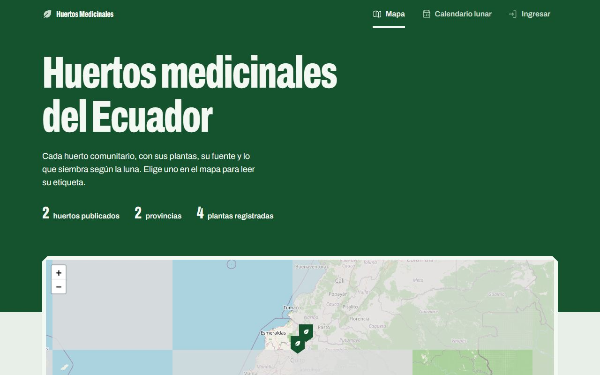

*Paso 1: el mapa no tiene marcador de H3.*

[Volver al resumen](#resumen)

---

## P-025 · Consulta de la ficha pública de un huerto

| Campo | Contenido |
|---|---|
| **ID** | P-025 |
| **Título** | Consulta de la ficha pública de un huerto |
| **Descripción** | Comprobar que cada marcador abre la ficha correcta y que no muestra datos privados. |
| **Trazabilidad** | HU-011 / CA-01 · RN-02. |
| **Datos de prueba** | H1 con contacto del responsable registrado, H2. |

**Procedimiento de prueba:**

1. Sin sesión, seleccionar el marcador de H1.
2. Revisar los datos mostrados y abrir sus plantas, cultivos y vista 3D.
3. Volver al mapa y seleccionar H2.

**Resultados esperados:** Cada marcador abre la ficha de su huerto con sus plantas, cultivos y acceso a la vista 3D. No se muestran el contacto del responsable ni datos de la cuenta.

### Ejecución del caso de prueba

| Fecha | Responsable | Reprobado | Aprobado |
|---|---|---|---|
| 12-noviembre-2026 | Jean Espinosa | (   ) | ( X ) |

**Resultados obtenidos:**

- Huerto de prueba H1: el marcador abre su ficha con 3 plantas, la sección de cultivos por zona y el enlace «Recorrer en 3D». No aparece el contacto del responsable ni datos de la cuenta.
- Desde la ficha de H1 se abrió su vista 3D.
- Huerto de prueba H2: el marcador abre su ficha con 1 plantas, la sección de cultivos por zona y el enlace «Recorrer en 3D». No aparece el contacto del responsable ni datos de la cuenta.

**Capturas:**

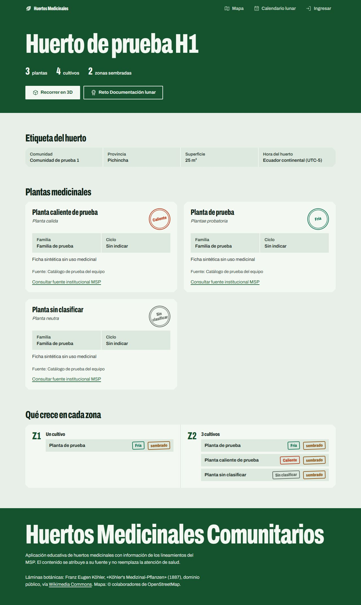

*Ficha pública de Huerto de prueba H1 abierta desde su marcador.*

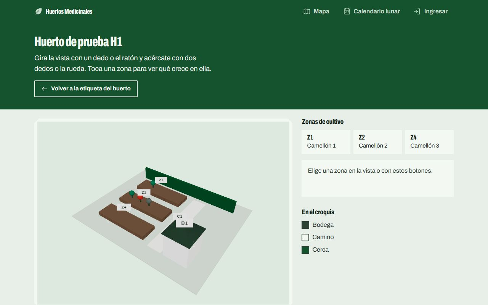

*Paso 2: desde la ficha de H1 se abre su vista 3D.*

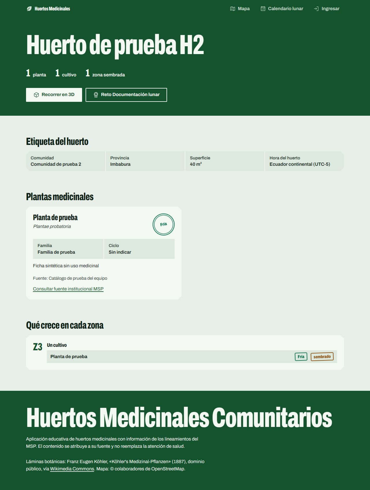

*Ficha pública de Huerto de prueba H2 abierta desde su marcador.*

[Volver al resumen](#resumen)

---

## P-026 · Enlace directo a un huerto no publicado

| Campo | Contenido |
|---|---|
| **ID** | P-026 |
| **Título** | Enlace directo a un huerto no publicado |
| **Descripción** | Comprobar que no se pueden consultar los datos de un huerto no publicado mediante su enlace. |
| **Trazabilidad** | HU-011 / CA-02 · RN-02. |
| **Datos de prueba** | H3 no publicado. |

**Procedimiento de prueba:**

1. Sin sesión, abrir el enlace directo de H3.

**Resultados esperados:** Se muestra MSG-14 «El huerto solicitado no existe o no está publicado.» y ningún dato de H3.

### Ejecución del caso de prueba

| Fecha | Responsable | Reprobado | Aprobado |
|---|---|---|---|
| 12-noviembre-2026 | Christian Yanchatipan | (   ) | ( X ) |

**Resultados obtenidos:**

- Al abrir /huertos/3 se mostró «El huerto solicitado no existe o no está publicado.» y ningún dato de H3.

**Capturas:**

*Paso 1: el enlace directo de H3 muestra MSG-14.*

[Volver al resumen](#resumen)

---

## P-027 · Recorrido de la escena 3D

| Campo | Contenido |
|---|---|
| **ID** | P-027 |
| **Título** | Recorrido de la escena 3D |
| **Descripción** | Comprobar representación del croquis y navegación en dispositivos registrados. El tiempo de carga se mide en P-066. |
| **Trazabilidad** | HU-012 / CA-01. |
| **Datos de prueba** | H1, CR1 versionado, modelo de computador y celular Android, navegador y versión anotados antes de ejecutar. |

**Procedimiento de prueba:**

1. Abrir la vista 3D de H1.
2. Rotar, acercar y alejar la vista.
3. Comparar con CR1 las zonas Z1 y Z2, los caminos, la cerca y la bodega.
4. Repetir en el otro dispositivo.

**Resultados esperados:** Las cuatro categorías presentes en CR1 se identifican en posiciones correspondientes. La navegación funciona en ambos dispositivos.

### Ejecución del caso de prueba

| Fecha | Responsable | Reprobado | Aprobado |
|---|---|---|---|
| 12-noviembre-2026 | Gabriel Vinueza | (   ) | ( X ) |

**Resultados obtenidos:**

- Computador: la escena se rotó, se acercó y se alejó. Aparecen las cuatro categorías del croquis: zonas de cultivo (Z1, Z2, Z4), camino, cerca y bodega, en las posiciones de la geometría de CR1.
- Celular: la vista carga y se navega en un Android emulado (Pixel 7, 412×915, táctil).

> **Observación:** Ejecución automatizada: el celular fue emulado con Playwright (Pixel 7); no se repitió en un Android físico. El croquis se dibujó desde la geometría versionada de CR1.

**Capturas:**

*Croquis CR1 de H1 en planta, dibujado con la geometría versionada en los datos de prueba.*

*Paso 1: vista 3D de H1 en computador (Chromium 1280×800).*

*Paso 2: vista rotada arrastrando con el ratón.*

*Paso 2: vista acercada con la rueda.*

*Paso 2: vista alejada con la rueda.*

*Paso 4: misma vista en celular Android emulado (Pixel 7).*

*Paso 4: en el celular emulado se elige Z2 con un toque.*

[Volver al resumen](#resumen)

---

## P-028 · Fallo de carga de la escena

| Campo | Contenido |
|---|---|
| **ID** | P-028 |
| **Título** | Fallo de carga de la escena |
| **Descripción** | Comprobar que, si la escena no carga, el visitante consulta el mismo huerto en forma de lista. |
| **Trazabilidad** | HU-012 / CA-02 · RN-02. |
| **Datos de prueba** | H1. Entorno de prueba con el recurso de la escena bloqueado. |

**Procedimiento de prueba:**

1. Preparar H1 y mantener disponible su consulta de zonas y cultivos.
2. Simular WebGL no disponible o un fallo controlado del componente de escena, sin bloquear los datos de la lista.
3. Abrir el 3D; después retirar el fallo y recargar.

**Resultados esperados:** Se muestra MSG-13 «No se pudo cargar la vista 3D del huerto. Puedes consultar sus zonas y cultivos en la lista.» y la lista de Z1 y Z2 con sus cultivos, sin la escena de otro huerto. Al restaurar, la escena de H1 se muestra.

### Ejecución del caso de prueba

| Fecha | Responsable | Reprobado | Aprobado |
|---|---|---|---|
| 12-noviembre-2026 | Gabriel Vinueza | (   ) | ( X ) |

**Resultados obtenidos:**

- Con el componente de la escena bloqueado se mostró «No se pudo cargar la vista 3D del huerto. Puedes consultar sus zonas y cultivos en la lista.» y la lista de Z1 y Z2 con sus cultivos; no aparece Z3 (de H2) ni ningún lienzo 3D.
- Al retirar el fallo y recargar, se muestra la escena 3D de H1.

**Capturas:**

*Pasos 1 y 2: componente de escena bloqueado → MSG-13 y lista de zonas de H1.*

*Paso 3: sin el fallo, la escena de H1 se muestra al recargar.*

[Volver al resumen](#resumen)

---

## P-029 · Cultivos de una zona

| Campo | Contenido |
|---|---|
| **ID** | P-029 |
| **Título** | Cultivos de una zona |
| **Descripción** | Comprobar que al seleccionar una zona se muestran sus cultivos con planta y estado. |
| **Trazabilidad** | HU-013 / CA-01 · RN-03. |
| **Datos de prueba** | H1; K1 en Z1; K2, K4 y K5 en Z2. |

**Procedimiento de prueba:**

1. En la vista 3D de H1, seleccionar Z1.
2. Seleccionar Z2.

**Resultados esperados:** Z1 muestra K1. Z2 muestra K2, K4 y K5. Cada cultivo indica planta, estado informado y fecha de actualización. No aparecen cultivos de H2.

### Ejecución del caso de prueba

| Fecha | Responsable | Reprobado | Aprobado |
|---|---|---|---|
| 12-noviembre-2026 | Oscar Gualotuña | (   ) | ( X ) |

**Resultados obtenidos:**

- Z1: Planta de prueba Fría sembrado Actualizado: 30/10/26, 9:00 a. m..
- Z2: Planta de prueba Fría sembrado Actualizado: 30/10/26, 9:00 a. m. | Planta caliente de prueba Caliente sembrado Actualizado: 30/10/26, 9:00 a. m. | Planta sin clasificar Sin clasificar sembrado Actualizado: 30/10/26, 9:00 a. m.. Cada cultivo indica planta, estado y fecha de actualización; no aparecen cultivos de H2.

> **Observación:** La zona se eligió con los botones laterales de la vista 3D, no tocando el objeto dentro del lienzo.

**Capturas:**

*Paso 1: Z1 muestra K1 (planta, estado y fecha).*

*Paso 2: Z2 muestra K2, K4 y K5.*

[Volver al resumen](#resumen)

---

## P-030 · Señalética caliente y fría

| Campo | Contenido |
|---|---|
| **ID** | P-030 |
| **Título** | Señalética caliente y fría |
| **Descripción** | Comprobar el color de cada cultivo según la clasificación de su planta. |
| **Trazabilidad** | HU-013 / CA-02 · RN-03. |
| **Datos de prueba** | Z2 con K2 (E1, fría), K4 (E3, caliente) y K5 (E4, sin clasificación). |

**Procedimiento de prueba:**

1. En la vista 3D de H1, seleccionar Z2.

**Resultados esperados:** K2 se señala en verde, K4 en rojo y K5 en gris.

### Ejecución del caso de prueba

| Fecha | Responsable | Reprobado | Aprobado |
|---|---|---|---|
| 12-noviembre-2026 | Oscar Gualotuña | (   ) | ( X ) |

**Resultados obtenidos:**

- Z2: K2 (Planta de prueba) «Fría» en verde rgb(4,108,78); K4 (Planta caliente de prueba) «Caliente» en rojo rgb(180,50,15); K5 (Planta sin clasificar) «Sin clasificar» en gris rgb(86,96,90).

> **Observación:** Se verificó el color de los sellos del panel; no se inspeccionó el material de cada objeto WebGL.

**Capturas:**

*Paso 1: en Z2, K2 en verde (fría), K4 en rojo (caliente) y K5 en gris (sin clasificar).*

*Paso 1: vista 3D con Z2 elegida.*

[Volver al resumen](#resumen)

---

## P-031 · Zona sin cultivos

| Campo | Contenido |
|---|---|
| **ID** | P-031 |
| **Título** | Zona sin cultivos |
| **Descripción** | Comprobar el mensaje de una zona sin cultivos. |
| **Trazabilidad** | HU-013 / CA-03 · RN-03. |
| **Datos de prueba** | H1 con la zona Z4 sin cultivos. |

**Procedimiento de prueba:**

1. En la vista 3D de H1, seleccionar Z4.

**Resultados esperados:** Se muestra MSG-22 «Esta zona no tiene cultivos registrados.».

### Ejecución del caso de prueba

| Fecha | Responsable | Reprobado | Aprobado |
|---|---|---|---|
| 12-noviembre-2026 | Mauricio López | (   ) | ( X ) |

**Resultados obtenidos:**

- Al elegir Z4 se mostró «Esta zona no tiene cultivos registrados.».

**Capturas:**

*Paso 1: Z4 muestra MSG-22.*

[Volver al resumen](#resumen)

---

## P-032 · Registro de una siembra con fotografía

| Campo | Contenido |
|---|---|
| **ID** | P-032 |
| **Título** | Registro de una siembra con fotografía |
| **Descripción** | Comprobar que la siembra se guarda con fecha del hecho, fecha de registro y autor separados, y que persiste. |
| **Trazabilidad** | HU-014 / CA-01 · RN-04, RN-05. |
| **Datos de prueba** | L1, K1, F1. Reloj fijado. |

**Procedimiento de prueba:**

1. Como L1, registrar una siembra de K1: fecha y hora 10/10/2026 08:00; técnica semillas; descripción "Siembra de prueba"; fotografía F1.
2. Consultar la bitácora de K1.
3. Cerrar sesión, volver a ingresar y consultar la bitácora.

**Resultados esperados:** La bitácora muestra la siembra A1 con fecha del hecho 10/10/2026 08:00, fecha de registro 31/10/2026 12:00, autor L1, técnica, descripción y F1, también después de volver a ingresar. El estado de K1 no cambia automáticamente.

### Ejecución del caso de prueba

| Fecha | Responsable | Reprobado | Aprobado |
|---|---|---|---|
| 12-noviembre-2026 | Mauricio López | (   ) | ( X ) |

**Resultados obtenidos:**

- A1: «Siembra del 10/10/2026 a las 08:00», registrada 31/10/26, 12:00 p. m., autor Líder 1, técnica Semillas, descripción "Siembra de prueba" y fotografía F1.
- Tras cerrar sesión y volver a ingresar, A1 persiste. El estado de K1 sigue "sembrado".

**Capturas:**

*Pasos 1 y 2: A1 registrada y visible en la bitácora de K1.*

*Paso 3: tras volver a ingresar, A1 sigue en la bitácora; K1 sigue «sembrado».*

[Volver al resumen](#resumen)

---

## P-033 · Envío repetido de una siembra

| Campo | Contenido |
|---|---|
| **ID** | P-033 |
| **Título** | Envío repetido de una siembra |
| **Descripción** | Comprobar que un reenvío por falla de conexión no duplica la siembra y que una siembra distinta sí se registra. |
| **Trazabilidad** | HU-014 / CA-02 · RN-04. |
| **Datos de prueba** | L1, K1, F1, F4. Cliente HTTP o simulación de red. |

**Procedimiento de prueba:**

1. Registrar A1 como en P-032 y reenviar la misma solicitud con el mismo identificador de envío.
2. Registrar otra siembra A2 de K1 con fecha 13/10/2026 09:00 y fotografía F4.
3. Consultar la bitácora de K1.

**Resultados esperados:** La bitácora contiene exactamente dos siembras: una A1 y una A2.

### Ejecución del caso de prueba

| Fecha | Responsable | Reprobado | Aprobado |
|---|---|---|---|
| 12-noviembre-2026 | Oscar Gualotuña | (   ) | ( X ) |

**Resultados obtenidos:**

- A1 y su reenvío con la misma clave respondieron HTTP 201 y 200 con el mismo id 1: no se duplicó.
- A2 (13/10/2026 09:00, F4): el primer intento falló sin conexión; al recuperarla, el reintento del mismo formulario la registró.
- La bitácora de K1 contiene exactamente dos siembras: 2026-10-10T08:00 y 2026-10-13T09:00.

> **Observación:** El reenvío idéntico se hizo con cliente HTTP; la falla de conexión en pantalla se simuló cortando la red del navegador.

**Capturas:**

*Paso 1: A1 enviada y reenviada con el mismo identificador de envío*

*Paso 2: sin conexión, el registro de A2 falla y el formulario conserva los datos.*

*Paso 3: la bitácora de K1 contiene exactamente A1 y A2.*

[Volver al resumen](#resumen)

---

## P-034 · Siembra con fotografía no válida

| Campo | Contenido |
|---|---|
| **ID** | P-034 |
| **Título** | Siembra con fotografía no válida |
| **Descripción** | Comprobar que no se registra una siembra con evidencia no admitida. |
| **Trazabilidad** | HU-014 / CA-03 · RN-05. |
| **Datos de prueba** | L1, K1, F2, F3. |

**Procedimiento de prueba:**

1. Registrar una siembra de K1 con F2.
2. Registrar una siembra de K1 con F3.
3. Consultar la bitácora.

**Resultados esperados:** Ambos intentos muestran MSG-07 «La imagen debe estar en formato JPEG o PNG y pesar como máximo 5 MB.». La bitácora no contiene esas siembras.

### Ejecución del caso de prueba

| Fecha | Responsable | Reprobado | Aprobado |
|---|---|---|---|
| 12-noviembre-2026 | Jean Espinosa | (   ) | ( X ) |

**Resultados obtenidos:**

- F2 y F3: en ambos intentos se mostró «La imagen debe estar en formato JPEG o PNG y pesar como máximo 5 MB.». La bitácora de K1 sigue vacía.

**Capturas:**

*Paso 1: siembra con F2 (texto .jpg) → MSG-07.*

*Paso 2: siembra con F3 (PNG de 6 MB) → MSG-07.*

*Paso 3: la bitácora no contiene esas siembras.*

[Volver al resumen](#resumen)

---

## P-035 · Siembra con fecha futura

| Campo | Contenido |
|---|---|
| **ID** | P-035 |
| **Título** | Siembra con fecha futura |
| **Descripción** | Comprobar que la fecha del hecho no puede ser posterior al momento actual, incluido su valor límite. |
| **Trazabilidad** | HU-014 / CA-04 · RN-05. |
| **Datos de prueba** | L1, K1, F1. Reloj fijado en 31/10/2026 12:00. |

**Procedimiento de prueba:**

1. Intentar registrar una siembra el 01/11/2026 08:00.
2. Registrar otra exactamente en el instante del reloj 31/10/2026 12:00.
3. Intentar otra un segundo después del reloj.

**Resultados esperados:** Pasos 1 y 3: MSG-08 y no se registra. Paso 2: se registra, porque el instante igual al reloj no es futuro.

### Ejecución del caso de prueba

| Fecha | Responsable | Reprobado | Aprobado |
|---|---|---|---|
| 12-noviembre-2026 | Christian Yanchatipan | (   ) | ( X ) |

**Resultados obtenidos:**

- 01/11/2026 08:00: «La fecha y hora de la actividad no pueden ser posteriores al momento actual.», no se registró.
- 31/10/2026 12:00 (instante del reloj): se registró, porque no es futuro.
- 31/10/2026 12:00:01: HTTP 400 MSG-08, no se registró. La bitácora tiene 1 siembra.

**Capturas:**

*Paso 1: siembra del 01/11/2026 08:00 → MSG-08.*

*Paso 2: siembra exactamente en el instante del reloj (31/10/2026 12:00) → se registra.*

*Paso 3: siembra un segundo después del reloj (la pantalla solo admite minutos)*

[Volver al resumen](#resumen)

---

## P-036 · Siembra en un cultivo de otro huerto

| Campo | Contenido |
|---|---|
| **ID** | P-036 |
| **Título** | Siembra en un cultivo de otro huerto |
| **Descripción** | Comprobar que un líder no registra actividades en cultivos ajenos. |
| **Trazabilidad** | HU-014 / CA-05 · RN-01, RN-04. |
| **Datos de prueba** | L1, K3 (de H2). |

**Procedimiento de prueba:**

1. Como L1, enviar directamente al servidor una siembra para K3.
2. Consultar la bitácora de K3.

**Resultados esperados:** Se muestra MSG-19 «El cultivo seleccionado no pertenece a tu huerto.». La bitácora de K3 no cambia.

### Ejecución del caso de prueba

| Fecha | Responsable | Reprobado | Aprobado |
|---|---|---|---|
| 12-noviembre-2026 | Mauricio López | (   ) | ( X ) |

**Resultados obtenidos:**

- Respuesta HTTP 403 MSG-19: «El cultivo seleccionado no pertenece a tu huerto.». La bitácora de K3 sigue con 0 siembras.

**Capturas:**

*Paso 1: L1 envía directamente una siembra para K3 (de H2)*

*Paso 2: la bitácora de K3, vista por su líder L2, no cambió.*

[Volver al resumen](#resumen)

---

## P-037 · Falla al guardar la fotografía

| Campo | Contenido |
|---|---|
| **ID** | P-037 |
| **Título** | Falla al guardar la fotografía |
| **Descripción** | Verificar fallo antes de insertar la fotografía. La reversión después de escribirla se comprueba adicionalmente en P-065. |
| **Trazabilidad** | HU-014 / CA-06; RN-05. |
| **Datos de prueba** | L1, K1, F1; sustitución controlada de FotoRepositorio en pruebas, sin desactivar PostgreSQL completo. |

**Procedimiento de prueba:**

1. Inyectar un fallo al intentar guardar la fotografía.
2. Enviar una siembra y consultar la base.
3. Retirar el fallo y reintentar la misma clave.

**Resultados esperados:** Primer intento: MSG-11 y ninguna siembra. Tras retirar el fallo se registra una sola siembra con evidencia.

### Ejecución del caso de prueba

| Fecha | Responsable | Reprobado | Aprobado |
|---|---|---|---|
| 12-noviembre-2026 | Christian Yanchatipan | (   ) | ( X ) |

**Resultados obtenidos:**

- En pantalla, ante la respuesta de falla del almacenamiento se muestra «No se pudo guardar la fotografía. La actividad no se registró; inténtalo nuevamente.» y la bitácora sigue vacía.
- Al retirar la falla, el reintento del mismo formulario (misma clave) registró una sola siembra con fotografía.
- Prueba del servidor SiembraPruebaIntegracion.p037: aprobada (Pruebas: 1 · fallos: 0 · errores: 0 · omitidas: 0). Con el almacenamiento desactivado responde HTTP 503 MSG-11 sin guardar siembra ni foto; al retirar el fallo, el reintento registra una sola siembra.

> **Observación:** La falla del almacenamiento se inyecta en el servidor solo en la prueba Java SiembraPruebaIntegracion.p037 (doble de FotoRepositorio). En el navegador se reprodujo la respuesta MSG-11 del servidor para comprobar la pantalla.

**Capturas:**

*Pasos 1 y 2 (pantalla): ante la falla de almacenamiento se muestra MSG-11 y no hay siembra.*

*Paso 3: al retirar la falla, el reintento con la misma clave registra una sola siembra con su evidencia.*

*Pasos 1 a 3 (servidor): prueba de integración con el almacenamiento de fotos desactivado.*

[Volver al resumen](#resumen)

---

## P-038 · Siembra conforme con la condición lunar

| Campo | Contenido |
|---|---|
| **ID** | P-038 |
| **Título** | Siembra conforme con la condición lunar |
| **Descripción** | Comprobar que una siembra en luna creciente o llena se evalúa conforme usando la fecha del hecho. |
| **Trazabilidad** | HU-015 / CA-01 · RN-06, RN-09. |
| **Datos de prueba** | L1, K1, F1, CAL-T. |

**Procedimiento de prueba:**

1. Configurar CAL-T en el entorno de prueba.
2. Registrar A1 con fecha del hecho 10/10/2026 08:00 y consultar su condición lunar.
3. Registrar A3 con fecha del hecho 13/10/2026 08:00 y consultar su condición lunar.

**Resultados esperados:** A1 muestra fase "luna creciente", la regla RN-06 y MSG-15 «Conforme con la condición lunar: la siembra se realizó en {fase}.». A3 muestra fase "luna llena" y MSG-15 «Conforme con la condición lunar: la siembra se realizó en {fase}.». La fecha de registro (31/10/2026) no influye en la fase.

### Ejecución del caso de prueba

| Fecha | Responsable | Reprobado | Aprobado |
|---|---|---|---|
| 12-noviembre-2026 | Gabriel Vinueza | (   ) | ( X ) |

**Resultados obtenidos:**

- A1: fase "luna creciente", «Conforme con la condición lunar: la siembra se realizó en luna creciente.». Regla: «La siembra se realiza en luna creciente o luna llena (RN-06; definición del proyecto y lineamientos del MSP).».
- A3: fase "luna llena", «Conforme con la condición lunar: la siembra se realizó en luna llena.».
- Ambas se registraron el 31/10/2026; la fase se calculó con la fecha del hecho, no con la de registro.

**Capturas:**

*Paso 2: A1 (10/10/2026 08:00) en luna creciente → conforme (MSG-15) con la regla RN-06.*

*Paso 3: A3 (13/10/2026 08:00) en luna llena → conforme (MSG-15).*

[Volver al resumen](#resumen)

---

## P-039 · Siembra no conforme con la condición lunar

| Campo | Contenido |
|---|---|
| **ID** | P-039 |
| **Título** | Siembra no conforme con la condición lunar |
| **Descripción** | Comprobar que una siembra en luna menguante u oscura se evalúa no conforme y se conserva. |
| **Trazabilidad** | HU-015 / CA-02 · RN-06. |
| **Datos de prueba** | L1, K1, F1, CAL-T. |

**Procedimiento de prueba:**

1. Registrar una siembra con fecha 11/10/2026 08:00 y consultar su condición lunar.
2. Registrar una siembra con fecha 14/10/2026 08:00 y consultar su condición lunar.
3. Consultar la bitácora.

**Resultados esperados:** La primera muestra "luna menguante" y MSG-16 «No conforme con la condición lunar: la siembra se realizó en {fase}; la práctica indica luna creciente o luna llena.»; la segunda "luna oscura" y MSG-16 «No conforme con la condición lunar: la siembra se realizó en {fase}; la práctica indica luna creciente o luna llena.». Ambas permanecen en la bitácora.

### Ejecución del caso de prueba

| Fecha | Responsable | Reprobado | Aprobado |
|---|---|---|---|
| 12-noviembre-2026 | Mauricio López | (   ) | ( X ) |

**Resultados obtenidos:**

- 11/10/2026: «No conforme con la condición lunar: la siembra se realizó en luna menguante; la práctica indica luna creciente o luna llena.».
- 14/10/2026: «No conforme con la condición lunar: la siembra se realizó en luna oscura; la práctica indica luna creciente o luna llena.». Ambas permanecen en la bitácora.

**Capturas:**

*Paso 1: 11/10/2026 en luna menguante → no conforme (MSG-16).*

*Paso 2: 14/10/2026 en luna oscura → no conforme (MSG-16).*

*Paso 3: ambas siembras permanecen en la bitácora.*

[Volver al resumen](#resumen)

---

## P-040 · Siembra sin información de fase

| Campo | Contenido |
|---|---|
| **ID** | P-040 |
| **Título** | Siembra sin información de fase |
| **Descripción** | Comprobar que, sin información de fase, la siembra queda pendiente de comprobación. |
| **Trazabilidad** | HU-015 / CA-03 · RN-06. |
| **Datos de prueba** | L1, K1, F1, CAL-T. |

**Procedimiento de prueba:**

1. Registrar una siembra con fecha 12/10/2026 08:00 y consultar su condición lunar.
2. Consultar la bitácora.

**Resultados esperados:** La siembra muestra MSG-17 «Pendiente de comprobación: no hay información de fase lunar para la fecha de la siembra.» y aparece en la bitácora como pendiente de comprobación.

### Ejecución del caso de prueba

| Fecha | Responsable | Reprobado | Aprobado |
|---|---|---|---|
| 12-noviembre-2026 | Oscar Gualotuña | (   ) | ( X ) |

**Resultados obtenidos:**

- 12/10/2026: «Pendiente de comprobación: no hay información de fase lunar para la fecha de la siembra.». En la bitácora aparece con el sello "Pendiente".

**Capturas:**

*Paso 1: 12/10/2026 sin dato de fase → MSG-17.*

*Paso 2: la siembra figura en la bitácora como pendiente.*

[Volver al resumen](#resumen)

---

## P-041 · Corrección de una siembra con motivo

| Campo | Contenido |
|---|---|
| **ID** | P-041 |
| **Título** | Corrección de una siembra con motivo |
| **Descripción** | Comprobar que la corrección crea una versión nueva, conserva la anterior y evalúa la condición lunar con la versión vigente. |
| **Trazabilidad** | HU-016 / CA-01 · RN-06, RN-07. |
| **Datos de prueba** | L1, A1 conforme (10/10/2026), CAL-T. |

**Procedimiento de prueba:**

1. Como L1, corregir la fecha de A1 a 11/10/2026 08:00 con el motivo "Fecha registrada por error".
2. Consultar A1 y su condición lunar.
3. Consultar en la base de datos de prueba las versiones de A1.

**Resultados esperados:** A1 muestra la fecha 11/10/2026 y MSG-16 «No conforme con la condición lunar: la siembra se realizó en {fase}; la práctica indica luna creciente o luna llena.». Existen dos versiones: la vigente del 11/10/2026 con su motivo y autor, y la anterior del 10/10/2026 sin modificar.

### Ejecución del caso de prueba

| Fecha | Responsable | Reprobado | Aprobado |
|---|---|---|---|
| 12-noviembre-2026 | Oscar Gualotuña | (   ) | ( X ) |

**Resultados obtenidos:**

- A1 muestra 11/10/2026 08:00 y «No conforme con la condición lunar: la siembra se realizó en luna menguante; la práctica indica luna creciente o luna llena.».
- En la base hay dos versiones: la 2 (vigente, 11/10/2026, motivo "Fecha registrada por error", autor L1) y la 1 (10/10/2026, sin modificar).

**Capturas:**

*Pasos 1 y 2: A1 corregida al 11/10/2026 → no conforme (MSG-16).*

*Paso 3: versiones de A1 en la base de prueba (actividad 1)*

[Volver al resumen](#resumen)

---

## P-042 · Corrección sin motivo

| Campo | Contenido |
|---|---|
| **ID** | P-042 |
| **Título** | Corrección sin motivo |
| **Descripción** | Comprobar que no se acepta una corrección sin motivo. |
| **Trazabilidad** | HU-016 / CA-02 · RN-07. |
| **Datos de prueba** | L1, A1 conforme. |

**Procedimiento de prueba:**

1. Como L1, cambiar la fecha de A1 sin escribir motivo y guardar.
2. Consultar A1 y su condición lunar.

**Resultados esperados:** Se muestra MSG-12 «Indica el motivo de la corrección.». A1 conserva su fecha y su condición lunar.

### Ejecución del caso de prueba

| Fecha | Responsable | Reprobado | Aprobado |
|---|---|---|---|
| 12-noviembre-2026 | Gabriel Vinueza | (   ) | ( X ) |

**Resultados obtenidos:**

- Se mostró «Indica el motivo de la corrección.». A1 conserva la fecha 10/10/2026 08:00, la versión 1 y la condición conforme.

**Capturas:**

*Paso 1: corrección sin motivo → MSG-12.*

*Paso 2: A1 conserva su fecha y su condición lunar.*

[Volver al resumen](#resumen)

---

## P-043 · Corrección por el líder de otro huerto

| Campo | Contenido |
|---|---|
| **ID** | P-043 |
| **Título** | Corrección por el líder de otro huerto |
| **Descripción** | Comprobar que solo el líder del huerto puede corregir sus siembras. |
| **Trazabilidad** | HU-016 / CA-03 · RN-01, RN-07. |
| **Datos de prueba** | L2, A1 de H1. |

**Procedimiento de prueba:**

1. Como L2, enviar directamente al servidor una corrección de A1 con motivo.
2. Consultar A1.

**Resultados esperados:** Se muestra MSG-03 «No tienes permiso para modificar la información de este huerto.». A1 no cambia.

### Ejecución del caso de prueba

| Fecha | Responsable | Reprobado | Aprobado |
|---|---|---|---|
| 12-noviembre-2026 | Mauricio López | (   ) | ( X ) |

**Resultados obtenidos:**

- Respuesta HTTP 403 MSG-03: «No tienes permiso para modificar la información de este huerto.». A1 sigue con fecha 10/10/2026 08:00 y versión 1.

**Capturas:**

*Paso 1: L2 envía directamente una corrección de A1 (de H1)*

*Paso 2: A1 no cambió.*

[Volver al resumen](#resumen)

---

## P-044 · Fotografía no válida en una corrección

| Campo | Contenido |
|---|---|
| **ID** | P-044 |
| **Título** | Fotografía no válida en una corrección |
| **Descripción** | Comprobar que una corrección con evidencia no admitida no reemplaza la fotografía vigente. |
| **Trazabilidad** | HU-016 / CA-04 · RN-05, RN-07. |
| **Datos de prueba** | L1, A1 con F1, F2. |

**Procedimiento de prueba:**

1. Como L1, reemplazar la fotografía de A1 por F2 con el motivo "Cambio de foto".
2. Consultar A1.

**Resultados esperados:** Se muestra MSG-07 «La imagen debe estar en formato JPEG o PNG y pesar como máximo 5 MB.». A1 conserva F1.

### Ejecución del caso de prueba

| Fecha | Responsable | Reprobado | Aprobado |
|---|---|---|---|
| 12-noviembre-2026 | Jean Espinosa | (   ) | ( X ) |

**Resultados obtenidos:**

- Se mostró «La imagen debe estar en formato JPEG o PNG y pesar como máximo 5 MB.». A1 conserva su fotografía F1 (/api/fotos/1) y sigue en la versión 1.

**Capturas:**

*Paso 1: corrección con F2 → MSG-07.*

[Volver al resumen](#resumen)

---

## P-045 · Historial de una siembra corregida

| Campo | Contenido |
|---|---|
| **ID** | P-045 |
| **Título** | Historial de una siembra corregida |
| **Descripción** | Comprobar que el historial muestra todas las versiones en orden con autor, fecha y motivo. |
| **Trazabilidad** | HU-017 / CA-01 · RN-07. |
| **Datos de prueba** | L1, A1 corregida como en P-041. |

**Procedimiento de prueba:**

1. Como L1, consultar el historial de A1.

**Resultados esperados:** Dos versiones en orden descendente, ambas con fecha del hecho, fotografía consultable por el líder y autor. La vigente incluye fecha de corrección y motivo; la original se identifica como registro inicial, sin motivo de corrección inventado.

### Ejecución del caso de prueba

| Fecha | Responsable | Reprobado | Aprobado |
|---|---|---|---|
| 12-noviembre-2026 | Jean Espinosa | (   ) | ( X ) |

**Resultados obtenidos:**

- El historial muestra 2 versiones en orden descendente, ambas con fecha del hecho, fotografía consultable y autor Líder 1.
- Vigente: "Corrección 1", 11/10/2026 08:00, fecha de corrección y motivo "Fecha registrada por error". Original: "Registro original", 10/10/2026 08:00, sin motivo (—).

**Capturas:**

*Paso 1: historial de A1 con la versión vigente arriba y el registro original abajo.*

[Volver al resumen](#resumen)

---

## P-046 · Historial de una siembra sin correcciones

| Campo | Contenido |
|---|---|
| **ID** | P-046 |
| **Título** | Historial de una siembra sin correcciones |
| **Descripción** | Comprobar el mensaje de una siembra que nunca se corrigió. |
| **Trazabilidad** | HU-017 / CA-02 · RN-07. |
| **Datos de prueba** | L1, A3 sin correcciones. |

**Procedimiento de prueba:**

1. Como L1, consultar el historial de A3.

**Resultados esperados:** Se muestra MSG-23 «Esta siembra no tiene correcciones registradas.».

### Ejecución del caso de prueba

| Fecha | Responsable | Reprobado | Aprobado |
|---|---|---|---|
| 12-noviembre-2026 | Christian Yanchatipan | (   ) | ( X ) |

**Resultados obtenidos:**

- El historial de A3 muestra «Esta siembra no tiene correcciones registradas.».

**Capturas:**

*Paso 1: historial de A3 sin correcciones → MSG-23.*

[Volver al resumen](#resumen)

---

## P-047 · Insignia obtenida por la comunidad

| Campo | Contenido |
|---|---|
| **ID** | P-047 |
| **Título** | Insignia obtenida por la comunidad |
| **Descripción** | Comprobar que la insignia se muestra con la siembra que la sustenta y la explicación de la práctica. |
| **Trazabilidad** | HU-018 / CA-01 · RN-08. |
| **Datos de prueba** | H1 con A1 conforme y fotografía F1. |

**Procedimiento de prueba:**

1. Sin sesión, consultar el reto Documentación lunar de H1.

**Resultados esperados:** Se muestra la insignia Documentación lunar de la comunidad de H1, la siembra A1 como sustento y la explicación: la siembra se realiza en luna creciente o luna llena según la práctica.

### Ejecución del caso de prueba

| Fecha | Responsable | Reprobado | Aprobado |
|---|---|---|---|
| 12-noviembre-2026 | Jean Espinosa | (   ) | ( X ) |

**Resultados obtenidos:**

- Se muestra «Insignia Documentación lunar de Comunidad de prueba 1», sustentada por la siembra de Planta de prueba en Z1 del 10/10/2026 a las 08:00.
- Explicación: «La siembra se realiza en luna creciente o luna llena, según la práctica de las comunidades. La comunidad obtiene la insignia al documentar al menos una siembra con fotografía realizada en esas fases.».

**Capturas:**

*Paso 1: sin sesión, el reto de H1 muestra la insignia, la siembra A1 y la explicación.*

[Volver al resumen](#resumen)

---

## P-048 · Insignia única con varias siembras elegibles

| Campo | Contenido |
|---|---|
| **ID** | P-048 |
| **Título** | Insignia única con varias siembras elegibles |
| **Descripción** | Comprobar que varias siembras elegibles no duplican la insignia y que corregir una no la retira si queda otra. |
| **Trazabilidad** | HU-018 / CA-02 · RN-07, RN-08. |
| **Datos de prueba** | L1, H1 con A1 (10/10) y A3 (13/10) conformes, CAL-T. |

**Procedimiento de prueba:**

1. Consultar el reto de H1 y recargar la página.
2. Como L1, corregir A1 a 11/10/2026 08:00 con motivo.
3. Consultar el reto de H1.

**Resultados esperados:** En los pasos 1 y 3 se muestra una sola insignia. Después de la corrección sigue activa, sustentada por A3.

### Ejecución del caso de prueba

| Fecha | Responsable | Reprobado | Aprobado |
|---|---|---|---|
| 12-noviembre-2026 | Gabriel Vinueza | (   ) | ( X ) |

**Resultados obtenidos:**

- Con A1 (10/10) y A3 (13/10) conformes, el reto muestra 1 insignia, también después de recargar.
- Tras corregir A1 al 11/10/2026, la insignia sigue activa (una sola) y la sustenta A3 del 13/10/2026 a las 08:00.

**Capturas:**

*Paso 1: con A1 y A3 conformes se muestra una sola insignia (también tras recargar).*

*Paso 2: L1 corrige A1 al 11/10/2026 (no conforme).*

*Paso 3: la insignia sigue activa, ahora sustentada por A3.*

[Volver al resumen](#resumen)

---

## P-049 · Comunidad sin siembras elegibles

| Campo | Contenido |
|---|---|
| **ID** | P-049 |
| **Título** | Comunidad sin siembras elegibles |
| **Descripción** | Comprobar que las siembras no conformes o pendientes no otorgan la insignia. |
| **Trazabilidad** | HU-018 / CA-03 · RN-08. |
| **Datos de prueba** | L1, H1 sin siembras, CAL-T. |

**Procedimiento de prueba:**

1. Consultar el reto de H1.
2. Registrar una siembra con fecha 11/10/2026 y otra con fecha 12/10/2026.
3. Consultar el reto de H1.

**Resultados esperados:** En los pasos 1 y 3 no hay insignia y se muestra MSG-18 «Tu comunidad aún no tiene la insignia Documentación lunar: se necesita al menos una siembra con fotografía realizada en luna creciente o luna llena.». No se otorgan puntos, niveles ni posiciones de ranking.

### Ejecución del caso de prueba

| Fecha | Responsable | Reprobado | Aprobado |
|---|---|---|---|
| 12-noviembre-2026 | Christian Yanchatipan | (   ) | ( X ) |

**Resultados obtenidos:**

- Antes y después de registrar las siembras del 11/10 y 12/10, el reto muestra «Tu comunidad aún no tiene la insignia Documentación lunar: se necesita al menos una siembra con fotografía realizada en luna creciente o luna llena.». No aparecen puntos, niveles ni posiciones de ranking; el reto aclara: «La insignia reconoce una práctica documentada. No otorga puntos, niveles ni posiciones, y no certifica talentos ni aprendizajes.».

**Capturas:**

*Paso 1: H1 sin siembras → sin insignia (MSG-18).*

*Paso 2: siembras del 11/10 (no conforme) y 12/10 (pendiente).*

*Paso 3: sigue sin insignia; no se muestran puntos, niveles ni ranking.*

[Volver al resumen](#resumen)

---

## P-050 · Calendario lunar de los próximos 30 días

| Campo | Contenido |
|---|---|
| **ID** | P-050 |
| **Título** | Calendario lunar de los próximos 30 días |
| **Descripción** | Comprobar que el calendario muestra fases correctas para Ecuador continental y las actividades recomendadas con su fuente. |
| **Trazabilidad** | HU-019 / CA-01 · RN-09, RN-10. |
| **Datos de prueba** | Reloj fijado en 31/10/2026 12:00. REF-LUNA. |

**Procedimiento de prueba:**

1. Sin sesión, abrir el calendario con cálculo real y reloj fijo.
2. Comparar eventos principales con REF-LUNA independiente, incluyendo sus vecinos externos al mes.
3. Revisar fase diaria según RN-09, actividades, fuente y zona horaria indicada.
4. Ejecutar P-062 para límites de los intervalos.

**Resultados esperados:** Se muestran 30 días a partir del 31/10/2026, cada uno con una fase. Las horas de las fases principales coinciden con REF-LUNA con una diferencia máxima de una hora. Las actividades corresponden a RN-10 e indican su fuente.

### Ejecución del caso de prueba

| Fecha | Responsable | Reprobado | Aprobado |
|---|---|---|---|
| 12-noviembre-2026 | Oscar Gualotuña | (   ) | ( X ) |

**Resultados obtenidos:**

- Se muestran 30 días del 31/10/2026 al 29/11/2026, todos con fase (0 sin dato).
- cuarto menguante sistema 2026-11-01T20:28Z · REF-LUNA 2026-11-01T20:28Z · diferencia 0.5 min
- luna nueva sistema 2026-11-09T07:04Z · REF-LUNA 2026-11-09T07:02Z · diferencia 2.5 min
- cuarto creciente sistema 2026-11-17T11:50Z · REF-LUNA 2026-11-17T11:48Z · diferencia 2.1 min
- luna llena sistema 2026-11-24T14:58Z · REF-LUNA 2026-11-24T14:53Z · diferencia 5.8 min
- Actividades por fase con su fuente: «Fuente: Definición del proyecto; MSP (2017), lineamientos de huertos medicinales, Anexo 4. Horas de Ecuador continental (UTC-5).».
- Prueba del servidor: p050ReferenciaOficial aprobada; LunaTest con P-062 (punto medio 05/11/2026 13:45 UT: un segundo antes menguante, en el punto y después oscura) aprobada (Pruebas: 15 · fallos: 0 · errores: 0 · omitidas: 0).

> **Observación:** El paso 4 (límites de los intervalos, P-062) se comprobó con la prueba Java LunaTest; ver su evidencia.

**Capturas:**

*Paso 1: calendario sin sesión con 30 días desde el 31/10/2026, cada uno con su fase.*

*Paso 2: fases principales del calendario frente a REF-LUNA (USNO 2026)*

*Paso 2: fases principales tal como las ve el visitante.*

*Paso 3: actividades de cada fase con su fuente y la zona horaria.*

*Pasos 2 y 4 (servidor): comparación con REF-LUNA y límites de los intervalos (P-062).*

[Volver al resumen](#resumen)

---

## P-051 · Fecha fuera del rango del calendario

| Campo | Contenido |
|---|---|
| **ID** | P-051 |
| **Título** | Fecha fuera del rango del calendario |
| **Descripción** | Comprobar el rango disponible del calendario. |
| **Trazabilidad** | HU-019 / CA-02 · RN-09. |
| **Datos de prueba** | Reloj fijado en 31/10/2026 12:00. |

**Procedimiento de prueba:**

1. Solicitar el calendario de diciembre de 2027.
2. Solicitar el calendario de septiembre de 2025.

**Resultados esperados:** En ambos casos se muestra MSG-20 «El calendario lunar está disponible desde {fecha inicial} hasta {fecha final}.» con el rango 31/10/2025 a 31/10/2027 y se conserva la vista anterior.

### Ejecución del caso de prueba

| Fecha | Responsable | Reprobado | Aprobado |
|---|---|---|---|
| 12-noviembre-2026 | Oscar Gualotuña | (   ) | ( X ) |

**Resultados obtenidos:**

- Diciembre de 2027: «El calendario lunar está disponible desde 31/10/2025 hasta 31/10/2027.». La vista sigue en «Del sáb, 31 oct al dom, 29 nov».
- Septiembre de 2025: «El calendario lunar está disponible desde 31/10/2025 hasta 31/10/2027.». La vista sigue en «Del sáb, 31 oct al dom, 29 nov».

**Capturas:**

*Paso 1: solicitud de diciembre de 2027 → MSG-20; se conserva la vista.*

*Paso 2: solicitud de septiembre de 2025 → MSG-20; se conserva la vista.*

[Volver al resumen](#resumen)

---

## P-052 · Filtro de días de siembra

| Campo | Contenido |
|---|---|
| **ID** | P-052 |
| **Título** | Filtro de días de siembra |
| **Descripción** | Comprobar que el filtro de siembra resalta exactamente los días recomendados. |
| **Trazabilidad** | HU-020 / CA-01 · RN-10. |
| **Datos de prueba** | Calendario de P-050. |

**Procedimiento de prueba:**

1. Elegir la actividad "Siembra".

**Resultados esperados:** Se resaltan solo los días en luna creciente o luna llena.

### Ejecución del caso de prueba

| Fecha | Responsable | Reprobado | Aprobado |
|---|---|---|---|
| 12-noviembre-2026 | Jean Espinosa | (   ) | ( X ) |

**Resultados obtenidos:**

- Con «Siembra» se resaltan 15 de 30 días, todos en luna creciente o luna llena; ninguno de otra fase.

**Capturas:**

*Paso 1: filtro «Siembra» → solo días de luna creciente o llena resaltados.*

[Volver al resumen](#resumen)

---

## P-053 · Filtro de días de cosecha de raíces

| Campo | Contenido |
|---|---|
| **ID** | P-053 |
| **Título** | Filtro de días de cosecha de raíces |
| **Descripción** | Comprobar que el filtro de cosecha de semillas y raíces resalta exactamente los días recomendados. |
| **Trazabilidad** | HU-020 / CA-02 · RN-10. |
| **Datos de prueba** | Calendario de P-050. |

**Procedimiento de prueba:**

1. Elegir la actividad "Cosecha de semillas y raíces".

**Resultados esperados:** Se resaltan solo los días en luna menguante.

### Ejecución del caso de prueba

| Fecha | Responsable | Reprobado | Aprobado |
|---|---|---|---|
| 12-noviembre-2026 | Mauricio López | (   ) | ( X ) |

**Resultados obtenidos:**

- Con «Cosecha de semillas y raíces» se resaltan 7 de 30 días, todos en luna menguante.

**Capturas:**

*Paso 1: filtro «Cosecha de semillas y raíces» → solo días de luna menguante.*

[Volver al resumen](#resumen)

---

## P-054 · Retiro del filtro

| Campo | Contenido |
|---|---|
| **ID** | P-054 |
| **Título** | Retiro del filtro |
| **Descripción** | Comprobar que quitar el filtro restablece la vista completa. |
| **Trazabilidad** | HU-020 / CA-03 · RN-10. |
| **Datos de prueba** | Calendario filtrado por "Siembra". |

**Procedimiento de prueba:**

1. Quitar el filtro.

**Resultados esperados:** Se muestran todos los días sin resaltar.

### Ejecución del caso de prueba

| Fecha | Responsable | Reprobado | Aprobado |
|---|---|---|---|
| 12-noviembre-2026 | Christian Yanchatipan | (   ) | ( X ) |

**Resultados obtenidos:**

- Al quitar el filtro se muestran los 30 días y ninguno queda resaltado.

**Capturas:**

*Estado inicial: calendario filtrado por «Siembra».*

*Paso 1: al quitar el filtro se muestran los 30 días sin resaltar.*

[Volver al resumen](#resumen)

---

## P-055 · Recorrido integrado de la primera iteración

| Campo | Contenido |
|---|---|
| **ID** | P-055 |
| **Título** | Recorrido integrado de la primera iteración |
| **Descripción** | Verificar el recorrido de demostración con cálculo real y estado inicial conocido; no sustituye las pruebas individuales. |
| **Trazabilidad** | HU-001 a HU-020, recorrido representativo. |
| **Datos de prueba** | reloj fijo; H1 publicado sin siembras, K1 y K2; F1; dos instantes pasados documentados desde REF-LUNA y RN-09, uno conforme y otro no conforme. No usar CAL-T ni precargar A1/A3. |

**Procedimiento de prueba:**

1. Como visitante, ubicar H1, abrir su ficha, recorrer el 3D y seleccionar Z2.
2. Abrir calendario real y filtrar siembra.
3. Como L1, actualizar H1 y el estado de K1; comprobar K2.
4. Registrar la única siembra en el instante conforme del 18/10/2026 a las 08:00 de America/Guayaquil y consultar el reto.
5. Corregir esa siembra al instante no conforme con motivo; consultar historial y reto.
6. Como L2, intentar modificar H1; cerrar sesión y revisar la consulta pública.

**Resultados esperados:** La fase coincide con la referencia y la convención registrada. Paso 4: una siembra y una insignia. Paso 5: dos versiones, condición no conforme e insignia desactivada, porque no queda ninguna otra siembra elegible. El huerto ajeno no cambia ni se revelan datos privados.

### Ejecución del caso de prueba

| Fecha | Responsable | Reprobado | Aprobado |
|---|---|---|---|
| 12-noviembre-2026 | Gabriel Vinueza | (   ) | ( X ) |

**Resultados obtenidos:**

- 1. Visitante: ubicó H1 en el mapa, abrió su ficha y su vista 3D; Z2 muestra 3 cultivos.
- 2. Calendario real filtrado por «Siembra»: 15 días recomendados.
- 3. L1 actualizó el tipo de suelo de H1 a "Franco arcilloso" y K1 a "en crecimiento"; K2 sigue "sembrado".
- 4. Siembra del 18/10/2026 08:00: «Conforme con la condición lunar: la siembra se realizó en luna creciente.» (REF-LUNA: cuarto creciente 18/10 11:12). El reto muestra una insignia.
- 5. Corrección al 03/10/2026 08:00 (REF-LUNA: cuarto menguante 03/10 08:25): «No conforme con la condición lunar: la siembra se realizó en luna menguante; la práctica indica luna creciente o luna llena.», historial de 2 versiones e insignia desactivada.
- 6. L2 intentó cambiar el nombre de H1: HTTP 403 «No tienes permiso para modificar la información de este huerto.». La ficha pública conserva su nombre y no muestra el contacto privado.

**Capturas:**

*Paso 1: el visitante ubica H1, abre su ficha, recorre el 3D y elige Z2.*

*Paso 2: calendario real filtrado por siembra.*

*Paso 3: L1 actualiza H1 y K1 pasa a «en crecimiento»; K2 no cambia.*

*Paso 4: única siembra del 18/10/2026 08:00 → conforme (luna creciente, cálculo real).*

*Paso 4: el reto muestra la insignia.*

*Paso 5: corregida al 03/10/2026 08:00 → no conforme; historial con dos versiones.*

*Paso 5: sin otra siembra elegible, la insignia se desactiva.*

*Paso 6: tras el intento de L2, la ficha pública de H1 no cambió ni revela datos privados.*

[Volver al resumen](#resumen)

---

## P-056 · Gestión privada de un huerto no publicado

| Campo | Contenido |
|---|---|
| **ID** | P-056 |
| **Título** | Gestión privada de un huerto no publicado |
| **Descripción** | Gestión privada de un huerto no publicado. |
| **Trazabilidad** | HU-001 / CA-04. |
| **Datos de prueba** | L3 y H4 no publicado; planta y cultivo propios preparados. |

**Procedimiento de prueba:**

1. Ingresar como L3 y recargar la gestión.
2. Consultar ficha, zonas, plantas y cultivos de H4 mediante sus rutas privadas.
3. Repetir las solicitudes como L1 y sin sesión.

**Resultados esperados:** L3 recupera únicamente datos autorizados; L1 recibe 403 y la consulta sin sesión recibe 401; las rutas públicas no exponen H4.

### Ejecución del caso de prueba

| Fecha | Responsable | Reprobado | Aprobado |
|---|---|---|---|
| 12-noviembre-2026 | Mauricio López | (   ) | ( X ) |

**Resultados obtenidos:**

- Preparación: H4 (no publicado) recibió la zona Z1, la planta propia Planta de prueba y un cultivo (HTTP 201 y 201).
- L3 obtuvo 200 en la ficha, zonas, plantas y cultivos de H4; L1 recibió 403 y la consulta sin sesión 401 en las cuatro rutas.
- Las rutas públicas no exponen H4: su ficha pública responde 404 y no aparece en la lista del mapa.

**Capturas:**

*Paso 1: L3 recarga la gestión de su huerto H4, todavía no publicado.*

*Pasos 2 y 3: rutas privadas de H4 como L3, como L1 y sin sesión*

[Volver al resumen](#resumen)

---

## P-057 · Corrección con fecha futura

| Campo | Contenido |
|---|---|
| **ID** | P-057 |
| **Título** | Corrección con fecha futura |
| **Descripción** | Corrección con fecha futura. |
| **Trazabilidad** | HU-016 / CA-05. |
| **Datos de prueba** | L1, A1, CAL-T; reloj fijo. |

**Procedimiento de prueba:**

1. Corregir A1 a un minuto después del reloj, con motivo y foto válida.
2. Consultar versiones, fotografía vigente y condición lunar.

**Resultados esperados:** MSG-08. No cambia la versión vigente, no se agrega una revisión ni una foto y se conserva la evaluación.

### Ejecución del caso de prueba

| Fecha | Responsable | Reprobado | Aprobado |
|---|---|---|---|
| 12-noviembre-2026 | Gabriel Vinueza | (   ) | ( X ) |

**Resultados obtenidos:**

- Se mostró «La fecha y hora de la actividad no pueden ser posteriores al momento actual.».
- A1 sigue en la versión 1 con su foto /api/fotos/1 y condición conforme; no se agregaron versiones (1) ni fotos (1).

**Capturas:**

*Paso 1: corrección de A1 al 31/10/2026 12:01 (un minuto después del reloj) con motivo y foto → MSG-08.*

*Paso 2: versiones, fotografías y condición de A1 antes y después*

[Volver al resumen](#resumen)

---

## P-058 · Reintentos simultáneos de siembra

| Campo | Contenido |
|---|---|
| **ID** | P-058 |
| **Título** | Reintentos simultáneos de siembra |
| **Descripción** | Reintentos simultáneos de siembra. |
| **Trazabilidad** | HU-014 / CA-07. |
| **Datos de prueba** | H1 sin actividades; L1, K1, F1; PostgreSQL real. |

**Procedimiento de prueba:**

1. Enviar en paralelo dos solicitudes idénticas con la misma clave; sincronizar su llegada al guardado.
2. Consultar actividad, versiones y fotografías.

**Resultados esperados:** Una respuesta de creación y otra de recuperación, ambas con el mismo identificador. Una sola siembra, una versión y una evidencia; ningún error interno por la carrera.

### Ejecución del caso de prueba

| Fecha | Responsable | Reprobado | Aprobado |
|---|---|---|---|
| 12-noviembre-2026 | Gabriel Vinueza | (   ) | ( X ) |

**Resultados obtenidos:**

- Las dos solicitudes paralelas respondieron HTTP 201 y 200 con el mismo id 1. En la base hay 1 actividad, 1 versión y 1 foto; ninguna respuesta fue un error interno.
- Prueba del servidor con llegada sincronizada al guardado: ✔ aprobada  IntegridadEnviosPruebaIntegracion.envioSimultaneo  (0.341 s).

> **Observación:** En el navegador las solicitudes se lanzaron en paralelo sin sincronizar su llegada al guardado; la sincronización exacta la hace la prueba Java IntegridadEnviosPruebaIntegracion.envioSimultaneo.

**Capturas:**

*Pasos 1 y 2: dos solicitudes idénticas con la misma clave enviadas en paralelo desde dos sesiones de L1*

*Paso 2: la bitácora de K1 muestra una sola siembra.*

*Paso 1 (servidor): llegada sincronizada de ambos envíos al guardado.*

[Volver al resumen](#resumen)

---

## P-059 · Reutilización de clave con otros datos

| Campo | Contenido |
|---|---|
| **ID** | P-059 |
| **Título** | Reutilización de clave con otros datos |
| **Descripción** | Reutilización de clave con otros datos. |
| **Trazabilidad** | HU-014 / CA-08. |
| **Datos de prueba** | L1, K1, F1; un envío confirmado. |

**Procedimiento de prueba:**

1. Reenviar la clave cambiando fecha o fotografía.
2. Consultar el registro y contar actividades y versiones.

**Resultados esperados:** 409 y MSG-24; el contenido anterior permanece y no se crea otra actividad.

### Ejecución del caso de prueba

| Fecha | Responsable | Reprobado | Aprobado |
|---|---|---|---|
| 12-noviembre-2026 | Mauricio López | (   ) | ( X ) |

**Resultados obtenidos:**

- Con otra fecha y con otra fotografía el servidor respondió HTTP 409 MSG-24: «Este envío ya se registró con otros datos. Revisa el resultado antes de realizar un nuevo envío.».
- El registro conserva la fecha 10/10/2026 08:00 y la foto F1; sigue habiendo 1 actividad, 1 versión y 1 foto.

**Capturas:**

*Pasos 1 y 2: la clave de un envío confirmado se reutiliza con otra fecha y con otra fotografía*

*Paso 2: el registro conserva el contenido original.*

[Volver al resumen](#resumen)

---

## P-060 · Conflicto entre correcciones

| Campo | Contenido |
|---|---|
| **ID** | P-060 |
| **Título** | Conflicto entre correcciones |
| **Descripción** | Conflicto entre correcciones. |
| **Trazabilidad** | HU-016 / CA-06. |
| **Datos de prueba** | L1, A1 versión 1; dos solicitudes con claves distintas. |

**Procedimiento de prueba:**

1. Enviar simultáneamente dos correcciones diferentes basadas en la versión 1.
2. Consultar el historial; volver a intentar la rechazada tras revisar la nueva versión.

**Resultados esperados:** Una crea la versión 2; la otra recibe 409 y MSG-25. El nuevo intento deliberado sobre versión 2 puede crear versión 3. Ninguna versión confirmada se sobrescribe.

### Ejecución del caso de prueba

| Fecha | Responsable | Reprobado | Aprobado |
|---|---|---|---|
| 12-noviembre-2026 | Oscar Gualotuña | (   ) | ( X ) |

**Resultados obtenidos:**

- De las dos correcciones simultáneas sobre la versión 1, una creó la versión 2 (HTTP 201) y la otra recibió HTTP 409 MSG-25: «La siembra cambió desde que abriste la corrección. Revisa la versión vigente e inténtalo nuevamente.».
- Al reintentar deliberadamente la rechazada sobre la versión 2 se creó la versión 3. El historial muestra 3 versiones y ninguna confirmada se sobrescribió.
- Prueba del servidor con llegada sincronizada: ✔ aprobada  IntegridadEnviosPruebaIntegracion.correccionSimultanea  (0.474 s).

**Capturas:**

*Paso 1: dos correcciones distintas sobre la versión 1 enviadas a la vez, y reintento sobre la versión 2*

*Paso 2: el historial conserva las tres versiones; ninguna se sobrescribió.*

*Paso 1 (servidor): correcciones con llegada sincronizada.*

[Volver al resumen](#resumen)

---

## P-061 · Insignia sin revelar huertos privados

| Campo | Contenido |
|---|---|
| **ID** | P-061 |
| **Título** | Insignia sin revelar huertos privados |
| **Descripción** | Insignia sin revelar huertos privados. |
| **Trazabilidad** | HU-018 / CA-04. |
| **Datos de prueba** | Comunidad C1: H1 publicado sin siembras elegibles y H6 privado con una siembra elegible. |

**Procedimiento de prueba:**

1. Consultar públicamente el reto de H1 y revisar el cuerpo de la respuesta.
2. Agregar una siembra elegible a H1 y repetir.

**Resultados esperados:** Primero no hay insignia pública ni datos de H6. Después hay una insignia sustentada únicamente por la siembra pública de H1.

### Ejecución del caso de prueba

| Fecha | Responsable | Reprobado | Aprobado |
|---|---|---|---|
| 12-noviembre-2026 | Oscar Gualotuña | (   ) | ( X ) |

**Resultados obtenidos:**

- Con una siembra conforme (id 1) solo en el huerto privado de la comunidad C1, el reto público de H1 no tiene insignia y su respuesta no menciona el huerto privado ni su siembra.
- Tras registrar una siembra conforme en H1 (id 2), aparece la insignia sustentada únicamente por esa siembra (siembraId 2).

**Capturas:**

*Paso 1: el reto público de H1 no muestra insignia aunque el huerto privado de su comunidad tiene una siembra conforme.*

*Paso 1: cuerpo de la respuesta pública del reto de H1*

*Paso 2: tras una siembra elegible en H1, la insignia se sustenta solo en esa siembra pública.*

[Volver al resumen](#resumen)

---

## P-062 · Continuidad y límites de los intervalos lunares

| Campo | Contenido |
|---|---|
| **ID** | P-062 |
| **Título** | Continuidad y límites de los intervalos lunares |
| **Descripción** | Continuidad y límites de los intervalos lunares. |
| **Trazabilidad** | HU-015 / CA-04. |
| **Datos de prueba** | Eventos sintéticos en días relativos −7,4; 0; 7,4; 14,8; conjunto real ampliado REF-LUNA. |

**Procedimiento de prueba:**

1. Consultar el día relativo 3,6 y cada límite menos un segundo, en el límite y más un segundo.
2. Recorrer un mes real hora a hora. Comparar instantes equivalentes expresados en Guayaquil y Galápagos.

**Resultados esperados:** El día 3,6 tiene fase; no hay huecos ni solapamientos. El límite pertenece al intervalo siguiente. Un mismo instante obtiene la misma fase, independientemente de su representación local.

### Ejecución del caso de prueba

| Fecha | Responsable | Reprobado | Aprobado |
|---|---|---|---|
| 12-noviembre-2026 | Jean Espinosa | (   ) | ( X ) |

**Resultados obtenidos:**

- Calendario real: 180 días consecutivos desde el 31/10/2026 tienen fase y las fases se suceden sin saltos ni retrocesos (0 anomalías).
- Pruebas unitarias: ✔ aprobada  LunaTest.faseEntreEventos  (0.222 s); ✔ aprobada  LunaTest.elCambioOcurreEnElPuntoMedio  (0.001 s); ✔ aprobada  LunaTest.elInstanteDeCadaFasePrincipalPerteneceASuFase  (0.006 s). En el punto medio 05/11/2026 13:45 UT, un segundo antes es menguante y el límite y un segundo después son oscura; recorriendo un mes hora a hora, Guayaquil y Galápagos obtienen la misma fase para el mismo instante.

> **Observación:** Los límites con eventos sintéticos y la comparación entre zonas horarias se ejecutan en la prueba unitaria LunaTest (faseEntreEventos); el navegador comprobó la continuidad del calendario real.

**Capturas:**

*Paso 2 (calendario real): 180 días consecutivos desde el 31/10/2026*

*Pasos 1 y 2 (servidor): límites ±1 s en el punto medio y recorrido horario de un mes en Guayaquil y Galápagos.*

[Volver al resumen](#resumen)

---

## P-063 · Ciclo de sesión y protección CSRF

| Campo | Contenido |
|---|---|
| **ID** | P-063 |
| **Título** | Ciclo de sesión y protección CSRF |
| **Descripción** | Ciclo de sesión y protección CSRF. |
| **Trazabilidad** | Q-I1-01. |
| **Datos de prueba** | Aplicación desplegada con configuración equivalente a entrega. |

**Procedimiento de prueba:**

1. Obtener token, iniciar sesión, renovar token y guardar una ficha.
2. Cerrar sesión; reenviar una modificación con la sesión anterior.
3. Probar modificación con sesión válida y token ausente o inválido.

**Resultados esperados:** Inicio, modificación y cierre correctos. La sesión anterior no modifica datos y responde MSG-02. Token inválido con sesión válida: 403 y MSG-26. Ningún rechazo cambia datos.

### Ejecución del caso de prueba

| Fecha | Responsable | Reprobado | Aprobado |
|---|---|---|---|
| 12-noviembre-2026 | Gabriel Vinueza | (   ) | ( X ) |

**Resultados obtenidos:**

- Inicio de sesión, guardado de la ficha y cierre correctos; el token CSRF se renovó al iniciar sesión.
- Con sesión válida y token ausente o inválido: HTTP 403 MSG-26 «No se pudo validar la solicitud. Actualiza la página e inténtalo nuevamente.».
- La sesión anterior, ya cerrada, recibió HTTP 401 MSG-02. Ningún rechazo cambió los datos (H1 conserva nombre y la superficie guardada de 30 m²).

> **Observación:** Ejecutado en HTTP local. El transporte HTTPS y los atributos Secure de las cookies requieren el entorno de entrega.

**Capturas:**

*Pasos 1 a 3: token, inicio, guardado, rechazos y cierre de sesión*

[Volver al resumen](#resumen)

---

## P-064 · Acceso directo a fotografías privadas

| Campo | Contenido |
|---|---|
| **ID** | P-064 |
| **Título** | Acceso directo a fotografías privadas |
| **Descripción** | Acceso directo a fotografías privadas. |
| **Trazabilidad** | HU-011 / CA-03. |
| **Datos de prueba** | H4 privado; A1 de H1 publicada con dos versiones y fotografías diferentes. |

**Procedimiento de prueba:**

1. Solicitar sin sesión foto de H4, versión anterior de A1 y versión vigente de A1.
2. Repetir las dos primeras como su líder autorizado y como otro líder.

**Resultados esperados:** Visitante: 404 para las dos primeras y foto vigente pública para la última. Líder propio: acceso permitido. Líder ajeno: 404; no se filtran bytes ni metadatos privados.

### Ejecución del caso de prueba

| Fecha | Responsable | Reprobado | Aprobado |
|---|---|---|---|
| 12-noviembre-2026 | Jean Espinosa | (   ) | ( X ) |

**Resultados obtenidos:**

- Visitante: 404 para la foto de H4 privado y para la versión anterior de A1; la foto vigente de A1 es pública (200, imagen).
- Líder propio: L3 accede a la foto de H4 y L1 a la versión anterior de A1. Líder ajeno (L2): 404 en ambas, sin bytes de imagen.

**Capturas:**

*Pasos 1 y 2: solicitudes directas de fotografías por visitante, líder propio y líder ajeno*

*Paso 1: el visitante puede ver la fotografía vigente de A1.*

[Volver al resumen](#resumen)

---

## P-065 · Reversión después de guardar evidencia

| Campo | Contenido |
|---|---|
| **ID** | P-065 |
| **Título** | Reversión después de guardar evidencia |
| **Descripción** | Reversión después de guardar evidencia. |
| **Trazabilidad** | HU-014 / CA-09. |
| **Datos de prueba** | L1, K1, F1; PostgreSQL real con fallo controlado tras insertar la foto. |

**Procedimiento de prueba:**

1. Provocar fallo al guardar la actividad y luego al confirmar la operación en pruebas separadas.
2. Consultar la base con una transacción independiente.
3. Retirar el fallo y reintentar la misma clave.

**Resultados esperados:** Sin actividad parcial ni foto huérfana; MSG-27 solo cuando se confirmó la reversión. El reintento posterior crea una única siembra completa. La pérdida de respuesta se trata como resultado desconocido, no como reversión probada.

### Ejecución del caso de prueba

| Fecha | Responsable | Reprobado | Aprobado |
|---|---|---|---|
| 12-noviembre-2026 | Christian Yanchatipan | (   ) | ( X ) |

**Resultados obtenidos:**

- Pruebas del servidor: ✔ aprobada  IntegridadEnviosPruebaIntegracion.reversionDespuesDeFoto  (0.375 s); ✔ aprobada  IntegridadEnviosPruebaIntegracion.reversionAlConfirmar  (0.443 s).
- Con el fallo al guardar la versión y con el fallo al confirmar, no quedan actividades parciales ni fotos huérfanas al consultar con una transacción independiente; MSG-27 solo se informa cuando la reversión se confirmó, y al retirar el fallo el reintento con la misma clave crea una única siembra completa.
- En el entorno e2e, sin fallo inyectado, el envío creó una siembra completa y la base no tiene fotos huérfanas (0).

> **Observación:** Los fallos se inyectan en la base dentro de las pruebas Java (función de prueba en PostgreSQL); el navegador no puede provocarlos.

**Capturas:**

*Pasos 1 a 3 (servidor): fallo controlado al guardar la actividad y al confirmar, con PostgreSQL real.*

*Paso 3: sin fallo, el envío crea una única siembra completa con su evidencia.*

[Volver al resumen](#resumen)

---

## P-066 · Carga y navegación 3D en el perfil Q1-I1

| Campo | Contenido |
|---|---|
| **ID** | P-066 |
| **Título** | Carga y navegación 3D en el perfil Q1-I1 |
| **Descripción** | Carga y navegación 3D en el perfil Q1-I1. |
| **Trazabilidad** | Q-I1-03. |
| **Datos de prueba** | CR1 versionado; dispositivo y navegador registrados; perfil Q1-I1 del documento 05. |

**Procedimiento de prueba:**

1. Realizar 10 aperturas con caché de escena vacía y medir hasta interacción.
2. Rotar, acercar, alejar y seleccionar Z1 y Z2; probar alternativa en lista con WebGL no disponible.

**Resultados esperados:** Al menos 9 de 10 aperturas permiten interacción en 8 segundos o menos; las operaciones completan sin bloquearse y la selección muestra la zona correcta. Una ejecución sin dispositivo y navegador identificados no acredita el protocolo físico.

### Ejecución del caso de prueba

| Fecha | Responsable | Reprobado | Aprobado |
|---|---|---|---|
| 12-noviembre-2026 | Gabriel Vinueza | (   ) | ( X ) |

**Resultados obtenidos:**

- Perfil Q1-I1 emulado (5 Mbps, 100 ms, caché vacía, compilación de producción) con 5 huertos, 50 cultivos y 100 actividades sintéticas.
- 10 de 10 aperturas permitieron interactuar en 8 s o menos (tiempos: 2.0, 1.5, 1.8, 2.1, 2.0, 1.4, 1.7, 1.4, 1.9, 1.6 s; máximo 2.1 s).
- Rotar, acercar y alejar se completaron sin bloqueo; al elegir Z1 y luego Z2 el panel mostró la zona correcta.
- Con WebGL desactivado en el navegador se mostró «No se pudo cargar la vista 3D del huerto. Puedes consultar sus zonas y cultivos en la lista.» y la lista de zonas y cultivos.

> **Observación:** Medido en este computador con Chromium sin interfaz y red emulada; no es un dispositivo Android físico, por lo que no acredita el protocolo físico.

**Capturas:**

*Paso 1: 10 aperturas de la vista 3D de H1 con caché vacía en el perfil Q1-I1*

*Paso 2: tras rotar, acercar, alejar y elegir Z1 y Z2, el panel muestra la zona correcta.*

*Paso 2: con WebGL desactivado en el navegador se ofrece la lista de zonas y cultivos (MSG-13).*

[Volver al resumen](#resumen)

---

## P-067 · Tiempo de consulta de información

| Campo | Contenido |
|---|---|
| **ID** | P-067 |
| **Título** | Tiempo de consulta de información |
| **Descripción** | Tiempo de consulta de información. |
| **Trazabilidad** | Q-I1-02. |
| **Datos de prueba** | Q1-I1; entorno y conexión registrados. |

**Procedimiento de prueba:**

1. Ejecutar 10 consultas de preparación y 100 consultas repartidas entre ficha, plantas y bitácora.
2. Medir desde la solicitud hasta el contenido textual utilizable y registrar errores.

**Resultados esperados:** Percentil 95 no mayor de 3 segundos y cero errores funcionales en la muestra. El resultado solo aplica al perfil registrado.

### Ejecución del caso de prueba

| Fecha | Responsable | Reprobado | Aprobado |
|---|---|---|---|
| 12-noviembre-2026 | Jean Espinosa | (   ) | ( X ) |

**Resultados obtenidos:**

- Perfil Q1-I1 emulado con 5 huertos, 50 cultivos y 100 actividades sintéticas: 10 consultas de preparación y 100 medidas repartidas entre ficha, plantas y bitácora en 5 sesiones concurrentes.
- Percentil 95: 1.67 s (límite 3 s). Errores funcionales: 0. ficha 34 consultas · mediana 0.84 s · máximo 1.40 s; plantas 33 consultas · mediana 1.41 s · máximo 2.06 s; bitácora 33 consultas · mediana 1.45 s · máximo 1.97 s.
- Medición informativa con la caché desactivada en cada consulta: percentil 95 de 2,90 s en una corrida y 3,61 s en otra, alrededor del límite, porque cada navegación vuelve a descargar toda la aplicación (más de 500 kB) a 5 Mbps.

> **Observación:** El resultado aplica a este perfil registrado: Windows 11, Chromium sin interfaz y red emulada en el mismo equipo que el servidor. Con caché fría en cada consulta el percentil 95 queda cerca del límite de 3 s.

**Capturas:**

*Una de las consultas medidas: bitácora de K1 con las actividades del perfil Q1-I1.*

*Pasos 1 y 2: 10 consultas de preparación y 100 medidas en 5 sesiones concurrentes (perfil Q1-I1)*

*Medición informativa con la caché desactivada en cada consulta (cada navegación descarga de nuevo toda la aplicación).*

[Volver al resumen](#resumen)

---

## P-068 · Recuperación de datos y evidencias

| Campo | Contenido |
|---|---|
| **ID** | P-068 |
| **Título** | Recuperación de datos y evidencias |
| **Descripción** | Recuperación de datos y evidencias. |
| **Trazabilidad** | Q-I1-04. |
| **Datos de prueba** | Copia manual del piloto posterior a carga de datos; entorno separado de recuperación. |

**Procedimiento de prueba:**

1. Crear una copia con fotos y revisiones, registrar su fecha y custodiarla fuera del repositorio.
2. Restaurarla en otra base y comprobar ficha, foto vigente, historial y nueva siembra.

**Resultados esperados:** Datos y fotografías corresponden; se puede consultar y registrar. Se informa el tiempo medido. No se declara todavía un compromiso de recuperación de cuatro horas ni una frecuencia diaria de operación.

### Ejecución del caso de prueba

| Fecha | Responsable | Reprobado | Aprobado |
|---|---|---|---|
| 12-noviembre-2026 | Christian Yanchatipan | (   ) | ( X ) |

**Resultados obtenidos:**

- Copia creada el 12/11/2026, 10:55:14 p. m. con pg_dump (0.7 MB) y guardada fuera del repositorio: respaldo/huertos_e2e_2026-11-13T03-55-13.dump.
- Restauración en la base huertos_restaurada: 2.1 s; con la otra instancia del servidor disponible: 18.9 s.
- La ficha de H1, la foto vigente de A1 (misma huella 170d2f37eec4a65b) y su historial de 2 versiones corresponden al original. Se registró una siembra nueva (HTTP 201) solo en el entorno restaurado.

> **Observación:** El entorno de recuperación es otra base y otra instancia del servidor en el mismo equipo y contenedor de PostgreSQL. No se declara un compromiso de recuperación ni una frecuencia de copia.

**Capturas:**

*Paso 2: base restaurada (huertos_restaurada) servida por otra instancia en el puerto 8082*

[Volver al resumen](#resumen)

---

## P-069 · Reintento de corrección confirmada

| Campo | Contenido |
|---|---|
| **ID** | P-069 |
| **Título** | Reintento de corrección confirmada |
| **Descripción** | Reintento de corrección confirmada. |
| **Trazabilidad** | HU-016 / CA-07. |
| **Datos de prueba** | A1 versión 1; corrección con clave única y versión base 1. |

**Procedimiento de prueba:**

1. Confirmar la corrección y simular pérdida de su respuesta.
2. Reenviar exactamente la solicitud; luego reutilizar la clave cambiando un dato.

**Resultados esperados:** El reintento devuelve la versión 2 existente, sin una tercera. El contenido distinto recibe 409 y MSG-24. La búsqueda del reintento ocurre antes de rechazar la versión base antigua.

### Ejecución del caso de prueba

| Fecha | Responsable | Reprobado | Aprobado |
|---|---|---|---|
| 12-noviembre-2026 | Oscar Gualotuña | (   ) | ( X ) |

**Resultados obtenidos:**

- El reenvío exacto devolvió la versión 2 existente (HTTP 200), sin crear una tercera. Reutilizar la clave con otro motivo recibió HTTP 409 MSG-24.
- Prueba del servidor (el reintento se busca antes de rechazar la versión base antigua): ✔ aprobada  IntegridadEnviosPruebaIntegracion.correccionRepetida  (0.374 s).

**Capturas:**

*Pasos 1 y 2: corrección confirmada, reenvío idéntico y reutilización de la clave con otro motivo*

*Paso 2: el historial tiene dos versiones; el reenvío no creó una tercera.*

*Paso 2 (servidor): el reintento se reconoce aunque ya exista una versión posterior.*

[Volver al resumen](#resumen)

---

## P-070 · Rechazo de zonas no cultivables

| Campo | Contenido |
|---|---|
| **ID** | P-070 |
| **Título** | Rechazo de zonas no cultivables |
| **Descripción** | Comprobar la regla del servidor. |
| **Trazabilidad** | HU-008; RF-025; RN-03. |
| **Datos de prueba** | cuentas L1 y L2, huertos H1 y H2 y catálogo sintético de pruebas; estos datos no son información medicinal del MSP. |

**Procedimiento de prueba:**

1. Como L1, intentar registrar un cultivo de su planta en BODEGA, CAMINO y CERCA de H1.
2. Consultar el número de cultivos.

**Resultados esperados:** HTTP 400 y MSG-29 en todos los intentos; sin nuevas filas.

### Ejecución del caso de prueba

| Fecha | Responsable | Reprobado | Aprobado |
|---|---|---|---|
| 12-noviembre-2026 | Mauricio López | (   ) | ( X ) |

**Resultados obtenidos:**

- BODEGA, CAMINO y CERCA: HTTP 400 MSG-29 «La zona seleccionada no es una zona de cultivo.» en los tres intentos; los cultivos siguen siendo 5.
- En pantalla, el selector de zona solo ofrece: .

**Capturas:**

*Pasos 1 y 2: cultivos de E1 en la bodega, el camino y la cerca de H1*

*El formulario solo ofrece zonas de cultivo.*

[Volver al resumen](#resumen)

---

## P-071 · Cierre de sesión interrumpido

| Campo | Contenido |
|---|---|
| **ID** | P-071 |
| **Título** | Cierre de sesión interrumpido |
| **Descripción** | Evitar una confirmación falsa del cierre. |
| **Trazabilidad** | HU-001; RF-031. |
| **Datos de prueba** | cuentas L1 y L2, huertos H1 y H2 y catálogo sintético de pruebas; estos datos no son información medicinal del MSP. |

**Procedimiento de prueba:**

1. Ingresar como L1.
2. Interrumpir DELETE /api/sesion y pulsar Cerrar sesión.
3. Restablecer conexión y reintentar.

**Resultados esperados:** Se informa que no se confirmó el cierre y se conserva el estado autenticado; tras el reintento confirmado, la sesión queda anónima en cliente y servidor.

### Ejecución del caso de prueba

| Fecha | Responsable | Reprobado | Aprobado |
|---|---|---|---|
| 12-noviembre-2026 | Christian Yanchatipan | (   ) | ( X ) |

**Resultados obtenidos:**

- Con DELETE /api/sesion interrumpido se mostró «No se confirmó el cierre de sesión. Revisa tu conexión y vuelve a intentarlo.» y la sesión siguió autenticada en cliente y servidor.
- Al restablecer la conexión y reintentar, la sesión quedó anónima en el cliente (opción «Ingresar») y en el servidor (autenticado: false).

**Capturas:**

*Paso 2: con el DELETE interrumpido se informa que no se confirmó el cierre y la sesión sigue activa.*

*Paso 3: tras restablecer la conexión, el reintento cierra la sesión.*

[Volver al resumen](#resumen)

---

## P-072 · Respuestas de filtro desordenadas

| Campo | Contenido |
|---|---|
| **ID** | P-072 |
| **Título** | Respuestas de filtro desordenadas |
| **Descripción** | Conservar la última intención del usuario. |
| **Trazabilidad** | HU-020; RF-085. |
| **Datos de prueba** | cuentas L1 y L2, huertos H1 y H2 y catálogo sintético de pruebas; estos datos no son información medicinal del MSP. |

**Procedimiento de prueba:**

1. Retrasar la respuesta para SIEMBRA.
2. Seleccionar COSECHA_SEMILLAS_RAICES y recibir su respuesta.
3. Entregar la respuesta atrasada.

**Resultados esperados:** La última selección permanece y los días resaltados corresponden a luna menguante.

### Ejecución del caso de prueba

| Fecha | Responsable | Reprobado | Aprobado |
|---|---|---|---|
| 12-noviembre-2026 | Jean Espinosa | (   ) | ( X ) |

**Resultados obtenidos:**

- La respuesta de SIEMBRA se retrasó 1,5 s; mientras tanto se eligió «Cosecha de semillas y raíces» y llegó su respuesta.
- Al entregarse la respuesta atrasada, la selección siguió siendo «Cosecha de semillas y raíces» y los 7 días resaltados son de luna menguante.

**Capturas:**

*Paso 3: tras llegar la respuesta atrasada de «Siembra», sigue la última selección y solo hay días de luna menguante resaltados.*

[Volver al resumen](#resumen)

---

## P-073 · Campos institucionales disponibles en ficha

| Campo | Contenido |
|---|---|
| **ID** | P-073 |
| **Título** | Campos institucionales disponibles en ficha |
| **Descripción** | Verificar la presentación de altitud y distribución. |
| **Trazabilidad** | HU-006 y HU-011; RF-024. |
| **Datos de prueba** | cuentas L1 y L2, huertos H1 y H2 y catálogo sintético de pruebas; estos datos no son información medicinal del MSP. |

**Procedimiento de prueba:**

1. Simular una respuesta institucional que aporte ambos campos.
2. Abrir la ficha pública.

**Resultados esperados:** Ambos datos son visibles. Se verifica presentación mediante respuesta simulada; las cuatro fichas reales iniciales no incorporan esos campos.

### Ejecución del caso de prueba

| Fecha | Responsable | Reprobado | Aprobado |
|---|---|---|---|
| 12-noviembre-2026 | Christian Yanchatipan | (   ) | ( X ) |

**Resultados obtenidos:**

- Con una respuesta institucional simulada que aporta altitud y distribución, la ficha pública muestra «Altitud institucional de prueba» y «Distribución institucional de prueba».

> **Observación:** Se verifica la presentación con una respuesta simulada; las fichas reales iniciales no traen esos campos.

**Capturas:**

*Paso 2: la ficha pública muestra la altitud y la distribución de la respuesta institucional simulada.*

[Volver al resumen](#resumen)

---

## P-074 · Hora de gestión de Galápagos

| Campo | Contenido |
|---|---|
| **ID** | P-074 |
| **Título** | Hora de gestión de Galápagos |
| **Descripción** | Usar la zona horaria del huerto. |
| **Trazabilidad** | HU-009; RF-026; AD-10. |
| **Datos de prueba** | cuentas L1 y L2, huertos H1 y H2 y catálogo sintético de pruebas; estos datos no son información medicinal del MSP. |

**Procedimiento de prueba:**

1. Preparar H1 con provincia Galápagos.
2. Abrir gestión de cultivos.
3. Contrastar el mismo instante con Pacific/Galapagos.

**Resultados esperados:** La actualización se presenta con Pacific/Galapagos y coincide con el instante persistido.

### Ejecución del caso de prueba

| Fecha | Responsable | Reprobado | Aprobado |
|---|---|---|---|
| 12-noviembre-2026 | Mauricio López | (   ) | ( X ) |

**Resultados obtenidos:**

- Con H1 en Galápagos, K1 se presenta «actualizado 30 oct 2026, 8:00 a. m.», que corresponde al instante persistido 2026-10-30T14:00:00Z en Pacific/Galapagos (en Ecuador continental sería 30 oct 2026, 9:00 a. m.).

**Capturas:**

*Paso 2: la gestión de cultivos de H1 (Galápagos) muestra la hora de Pacific/Galapagos.*

[Volver al resumen](#resumen)

---

## P-075 · Rechazo de nombre libre largo

| Campo | Contenido |
|---|---|
| **ID** | P-075 |
| **Título** | Rechazo de nombre libre largo |
| **Descripción** | Evitar el antiguo error 500 bajo el contrato nuevo. |
| **Trazabilidad** | HU-006; RF-023; RN-11. |
| **Datos de prueba** | cuentas L1 y L2, huertos H1 y H2 y catálogo sintético de pruebas; estos datos no son información medicinal del MSP. |

**Procedimiento de prueba:**

1. Enviar por la API un nombre común libre de 121 caracteres junto con catalogoCodigo.
2. Consultar el número de fichas.

**Resultados esperados:** HTTP 400 y MSG-28; no se guarda la petición. El líder selecciona un código: ya no existe editor de nombres libres.

### Ejecución del caso de prueba

| Fecha | Responsable | Reprobado | Aprobado |
|---|---|---|---|
| 12-noviembre-2026 | Jean Espinosa | (   ) | ( X ) |

**Resultados obtenidos:**

- Respuesta HTTP 400 MSG-28: «La información educativa proviene del catálogo del MSP. Selecciona una ficha institucional; esos campos no se pueden editar.». Las fichas siguen siendo 4; no se guardó la petición.
- En pantalla no existe un campo para escribir el nombre: el líder solo selecciona un código del catálogo.

**Capturas:**

*Pasos 1 y 2: nombre común libre de 121 caracteres enviado con catalogoCodigo*

*El formulario del líder solo permite elegir un código del catálogo; no hay editor de nombre libre.*

[Volver al resumen](#resumen)

---

## P-076 · Indisponibilidad cartográfica

| Campo | Contenido |
|---|---|
| **ID** | P-076 |
| **Título** | Indisponibilidad cartográfica |
| **Descripción** | Mantener consulta alternativa comprensible. |
| **Trazabilidad** | HU-010; RF-006. |
| **Datos de prueba** | cuentas L1 y L2, huertos H1 y H2 y catálogo sintético de pruebas; estos datos no son información medicinal del MSP. |

**Procedimiento de prueba:**

1. Interrumpir la descarga de teselas.
2. Consultar la lista de huertos.
3. Abrir H1 desde la lista.

**Resultados esperados:** Se informa el fallo de mapa base y la ficha sigue accesible.

### Ejecución del caso de prueba

| Fecha | Responsable | Reprobado | Aprobado |
|---|---|---|---|
| 12-noviembre-2026 | Oscar Gualotuña | (   ) | ( X ) |

**Resultados obtenidos:**

- Con la descarga de teselas interrumpida se mostró «No se pudo cargar el mapa base. Puedes consultar los huertos en la lista.». Desde la lista se abrió la ficha de H1.

**Capturas:**

*Pasos 1 y 2: sin teselas se informa el fallo del mapa base y se ofrece la lista de huertos.*

*Paso 3: H1 se abre desde la lista.*

[Volver al resumen](#resumen)

---

## P-077 · Mapa sin huertos publicados

| Campo | Contenido |
|---|---|
| **ID** | P-077 |
| **Título** | Mapa sin huertos publicados |
| **Descripción** | Comunicar ausencia de resultados. |
| **Trazabilidad** | HU-010; RF-005. |
| **Datos de prueba** | cuentas L1 y L2, huertos H1 y H2 y catálogo sintético de pruebas; estos datos no son información medicinal del MSP. |

**Procedimiento de prueba:**

1. Preparar una respuesta vacía de huertos publicados.
2. Abrir el mapa.

**Resultados esperados:** Se informa que todavía no hay huertos publicados y no se muestran marcadores.

### Ejecución del caso de prueba

| Fecha | Responsable | Reprobado | Aprobado |
|---|---|---|---|
| 12-noviembre-2026 | Christian Yanchatipan | (   ) | ( X ) |

**Resultados obtenidos:**

- Con una respuesta vacía de huertos publicados se mostró «Todavía no hay huertos publicados» y ningún marcador.

**Capturas:**

*Paso 2: con la respuesta vacía, el mapa informa que todavía no hay huertos publicados.*

[Volver al resumen](#resumen)

---

## P-078 · Catálogo inexistente

| Campo | Contenido |
|---|---|
| **ID** | P-078 |
| **Título** | Catálogo inexistente |
| **Descripción** | Validar identificadores del catálogo. |
| **Trazabilidad** | HU-006; RF-023. |
| **Datos de prueba** | cuentas L1 y L2, huertos H1 y H2 y catálogo sintético de pruebas; estos datos no son información medicinal del MSP. |

**Procedimiento de prueba:**

1. Enviar catalogoCodigo inexistente.

**Resultados esperados:** HTTP 400 y MSG-28; sin nueva ficha.

### Ejecución del caso de prueba

| Fecha | Responsable | Reprobado | Aprobado |
|---|---|---|---|
| 12-noviembre-2026 | Oscar Gualotuña | (   ) | ( X ) |

**Resultados obtenidos:**

- Respuesta HTTP 400 MSG-28: «La información educativa proviene del catálogo del MSP. Selecciona una ficha institucional; esos campos no se pueden editar.». No se creó ninguna ficha (4 antes y después).

**Capturas:**

*Paso 1: catalogoCodigo inexistente*

[Volver al resumen](#resumen)

---

## P-079 · Contenido anterior sin referencia

| Campo | Contenido |
|---|---|
| **ID** | P-079 |
| **Título** | Contenido anterior sin referencia |
| **Descripción** | Evitar publicación de información no trazada. |
| **Trazabilidad** | HU-006; RF-023. |
| **Datos de prueba** | cuentas L1 y L2, huertos H1 y H2 y catálogo sintético de pruebas; estos datos no son información medicinal del MSP. |

**Procedimiento de prueba:**

1. Preparar una planta anterior sin catalogoCodigo.
2. Consultar gestión, ficha pública y sus cultivos.

**Resultados esperados:** El registro permanece privado y no aparece en ficha pública ni en cultivos públicos.

### Ejecución del caso de prueba

| Fecha | Responsable | Reprobado | Aprobado |
|---|---|---|---|
| 12-noviembre-2026 | Oscar Gualotuña | (   ) | ( X ) |

**Resultados obtenidos:**

- En la gestión, E1 aparece como «Registro anterior sin referencia institucional; no se publica».
- La ficha pública de H1 muestra 2 plantas (Planta caliente de prueba, Planta sin clasificar) y 2 cultivos; ninguno es de E1 (K1 y K2 no se publican).

**Capturas:**

*Paso 2: en la gestión, la planta sin referencia figura como registro anterior que no se publica.*

*Paso 2: la ficha pública de H1 no muestra esa planta ni sus cultivos.*

[Volver al resumen](#resumen)

---

## P-080 · Catálogo sin escritura por líder

| Campo | Contenido |
|---|---|
| **ID** | P-080 |
| **Título** | Catálogo sin escritura por líder |
| **Descripción** | Separar gestión del huerto y contenido institucional. |
| **Trazabilidad** | RN-11; RF-023. |
| **Datos de prueba** | cuentas L1 y L2, huertos H1 y H2 y catálogo sintético de pruebas; estos datos no son información medicinal del MSP. |

**Procedimiento de prueba:**

1. Consultar el catálogo.
2. Intentar POST al catálogo autenticado.
3. Consultar el número de registros.

**Resultados esperados:** La consulta funciona y el intento no crea ni altera registros. La prueba verifica persistencia; no certifica el formato de respuesta de un método no soportado.

### Ejecución del caso de prueba

| Fecha | Responsable | Reprobado | Aprobado |
|---|---|---|---|
| 12-noviembre-2026 | Christian Yanchatipan | (   ) | ( X ) |

**Resultados obtenidos:**

- La consulta del catálogo funciona (HTTP 200, 7 fichas). El POST autenticado respondió HTTP 500 y la tabla del catálogo quedó idéntica (7 registros · md5 fc5d1182c1e49690d03a9483011beab5).

> **Observación:** Se verificó la persistencia; no se certifica el formato de la respuesta del método no soportado.

**Capturas:**

*Pasos 1 a 3: consulta del catálogo y POST autenticado como L1*

[Volver al resumen](#resumen)

---

## P-081 · Permiso sobre fotografía ajena

| Campo | Contenido |
|---|---|
| **ID** | P-081 |
| **Título** | Permiso sobre fotografía ajena |
| **Descripción** | Evitar que un líder modifique otra ficha. |
| **Trazabilidad** | HU-007; RN-02. |
| **Datos de prueba** | cuentas L1 y L2, huertos H1 y H2 y catálogo sintético de pruebas; estos datos no son información medicinal del MSP. |

**Procedimiento de prueba:**

1. Como L1, intentar modificar una ficha de H2.

**Resultados esperados:** HTTP 403, MSG-03; sin cambios.

### Ejecución del caso de prueba

| Fecha | Responsable | Reprobado | Aprobado |
|---|---|---|---|
| 12-noviembre-2026 | Gabriel Vinueza | (   ) | ( X ) |

**Resultados obtenidos:**

- Respuesta HTTP 403 MSG-03: «No tienes permiso para modificar la información de este huerto.». La ficha E2 de H2 no cambió.

**Capturas:**

*Paso 1: L1 intenta cambiar la fotografía de la ficha E2 de H2*

[Volver al resumen](#resumen)

---

## P-082 · Selección de ficha en interfaz

| Campo | Contenido |
|---|---|
| **ID** | P-082 |
| **Título** | Selección de ficha en interfaz |
| **Descripción** | Verificar el recorrido sin editor medicinal. |
| **Trazabilidad** | HU-006 y HU-007; RN-11. |
| **Datos de prueba** | cuentas L1 y L2, huertos H1 y H2 y catálogo sintético de pruebas; estos datos no son información medicinal del MSP. |

**Procedimiento de prueba:**

1. Ingresar como L1.
2. Abrir Plantas e incorporar MSP-HIERBA-LUISA.
3. Revisar fuente y contenido de lectura y guardar.
4. Consultar H1.

**Resultados esperados:** No hay editor de usos ni campos de texto medicinales; se muestra la información institucional y se publica la ficha seleccionada.

### Ejecución del caso de prueba

| Fecha | Responsable | Reprobado | Aprobado |
|---|---|---|---|
| 12-noviembre-2026 | Mauricio López | (   ) | ( X ) |

**Resultados obtenidos:**

- L1 eligió MSP-HIERBA-LUISA: se muestra Cymbopogon citratus y «Fuente: MSP (2017), Lineamientos de huertos medicinales, anexo 2.1; página impresa 63. · Versión MSP-2017-I1-1», sin editor de usos ni campos de texto medicinales.
- La ficha se guardó («Ficha de Hierba luisa guardada.») y H1 la publica en su ficha pública.

**Capturas:**

*Paso 3: fuente y contenido de lectura de MSP-HIERBA-LUISA; no hay editor de usos ni campos medicinales.*

*Paso 4: H1 publica la ficha seleccionada.*

[Volver al resumen](#resumen)

---
