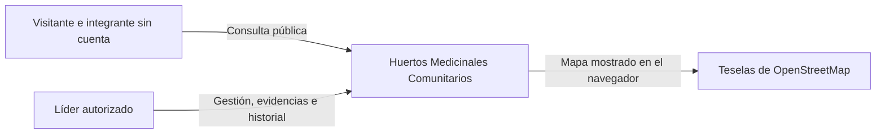
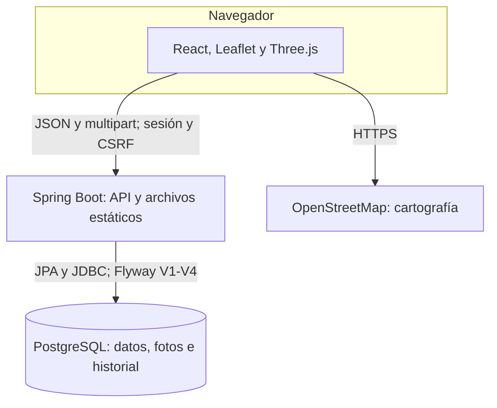
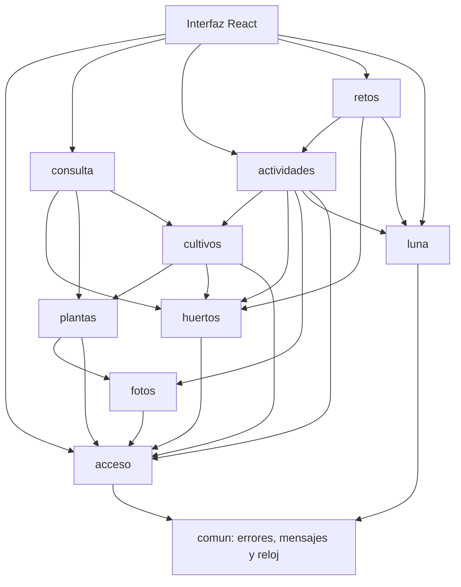
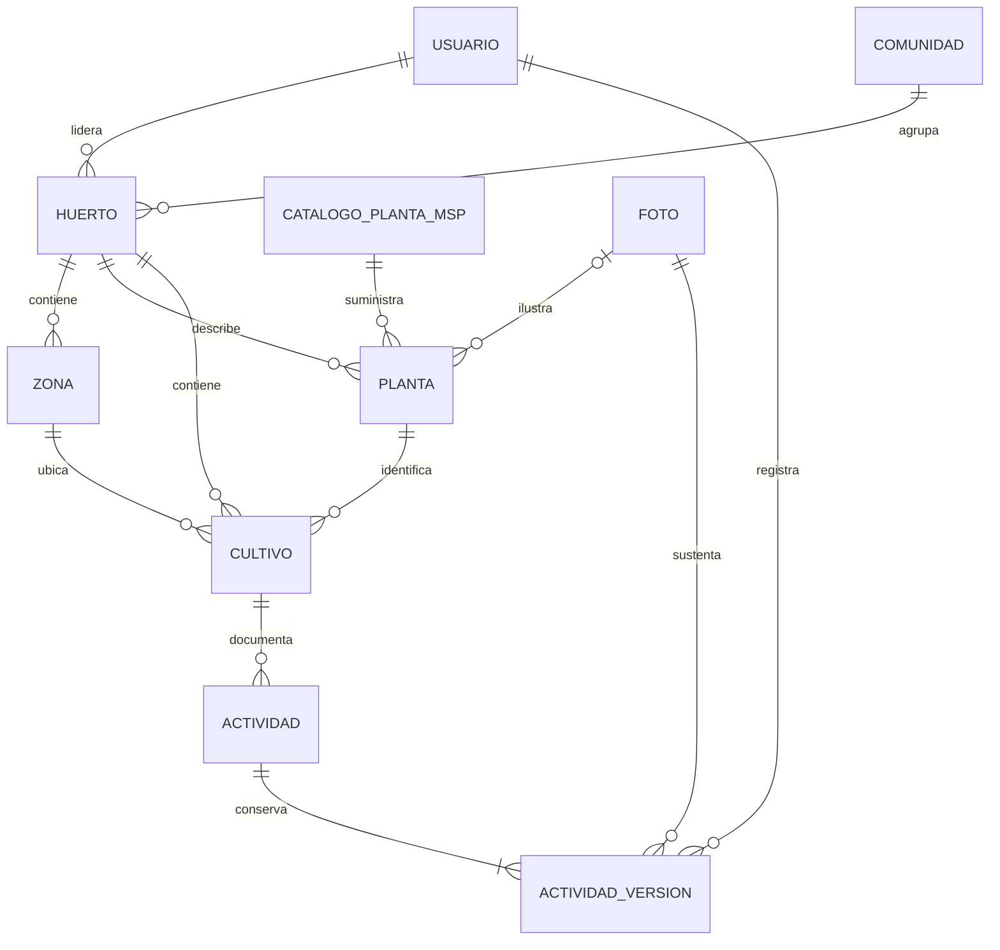
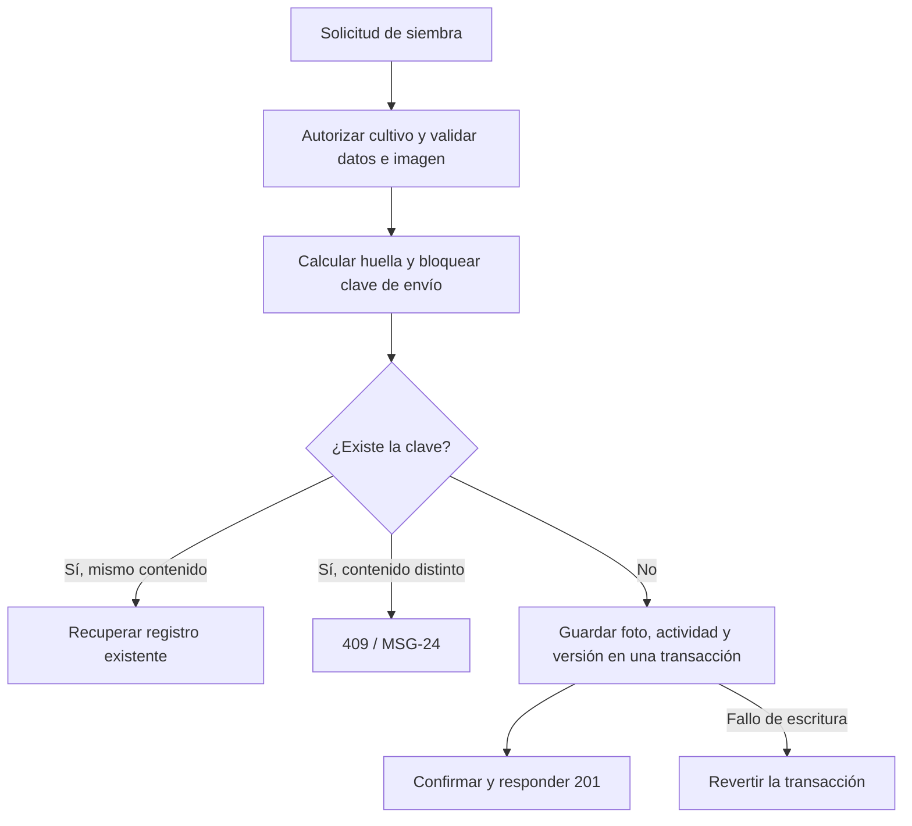
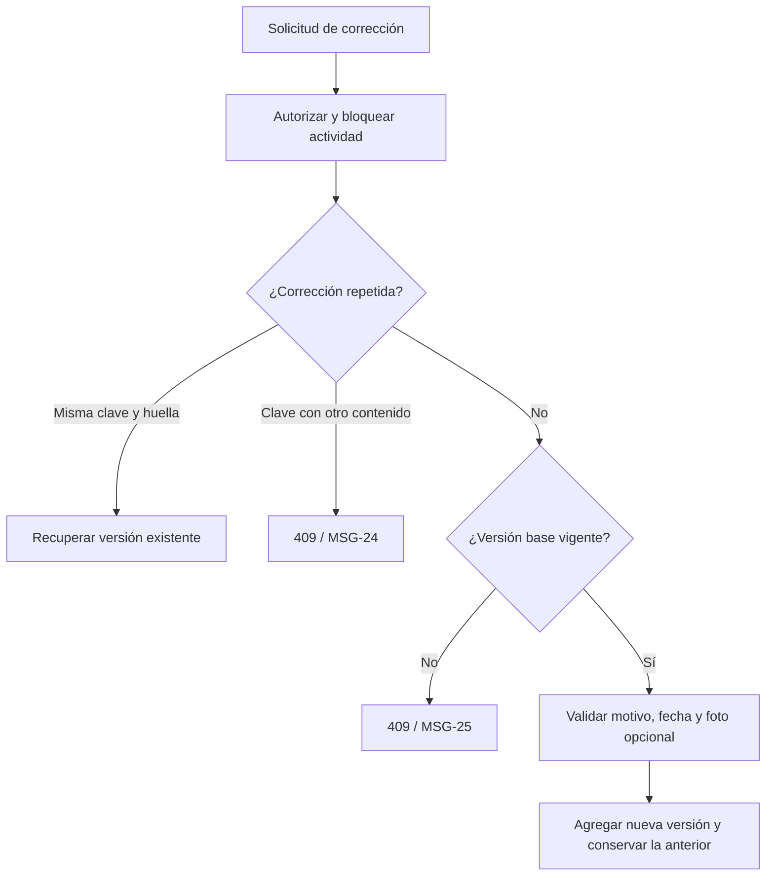

# Arquitectura y diseño del producto

**Proyecto:** Huertos Medicinales Comunitarios  
**Equipo:** techmOS  
**Integrantes:** Mauricio López · Dhalin Avila · Oscar Gualotuña · Christian Yanchatipan · Jean Espinosa · Gabriel Vinueza  
**Versión documental:** 2.2.1  
**Fecha de edición:** 12 de noviembre de 2026  
**Base de integración:** `develop`; candidato local de corrección  
**Commit base del candidato:** `78d87974152092c2d07125060021d0afdae9dac9`  
**Institución:** Escuela Politécnica Nacional · Ingeniería de Software · Calidad de Software (ISWD652) · GR2SW · Período 2026-B

La aplicación se implementa como un monolito modular con una interfaz React y una API REST Spring Boot. El backend sirve la interfaz compilada y consulta PostgreSQL. Los límites funcionales se expresan en diez paquetes de backend. Las vistas de este documento se derivan de los archivos del candidato verificado.

## 1 Identidad y decisiones de arquitectura

El candidato local parte del commit `78d87974152092c2d07125060021d0afdae9dac9` de develop. La auditoría base del 11/11 identificó siete incidencias; el candidato del 12/11 incorpora sus correcciones verificadas y el catálogo institucional. La integración remota de estos archivos todavía no se ha realizado.

| Decisión | Implementación |
|---|---|
| AD-01 Organización | Monolito modular por funcionalidad con los paquetes acceso, huertos, plantas, cultivos, fotos, actividades, luna, retos, consulta y comun. |
| AD-02 Despliegue | Spring Boot sirve la API y los archivos de React desde el mismo origen. Dockerfile multietapa para interfaz, JAR y ejecución. |
| AD-03 Sesión | Sesión de servidor, cookie HttpOnly y token CSRF en cookie XSRF-TOKEN leído por la SPA. |
| AD-04 Representación 3D | Geometría de zonas almacenada como JSONB. La escena se genera en Three.js y React Three Fiber. |
| AD-05 Fotografías | BYTEA en PostgreSQL para guardar evidencia y actividad dentro de una transacción. |
| AD-06 Luna | CalculadoraFase es la interfaz sustituible para clasificar instantes. FuenteFaseLunar suministra eventos astronómicos. El reloj es un Clock inyectado. |
| AD-07 Datos derivados | Condición lunar e insignia se calculan al consultar usando la versión vigente y la regla del código. |
| AD-08 Historial | ActividadVersion es inmutable. PostgreSQL impide UPDATE y DELETE mediante un trigger. |
| AD-09 Validación | Los controladores traducen errores con el catálogo MSG-01 a MSG-29. Los servicios autorizan y validan. |
| AD-10 Tiempo | TIMESTAMPTZ para instantes y zona por huerto. America/Guayaquil y Pacific/Galapagos. |
| AD-11 Dependencias | Las referencias entre entidades de paquetes distintos usan identificadores. consulta compone la ficha pública a través de servicios y consultas de lectura. |


## 2 Vistas de contexto y despliegue



Los lineamientos MSP y la referencia USNO son fuentes documentales de reglas y pruebas. El cálculo lunar de producción usa una biblioteca local; no consulta USNO por red durante cada evaluación. La petición de teselas se realiza desde el navegador.


El visitante consulta el mapa, la ficha, las zonas, el calendario y el reto. El líder autenticado mantiene la información y la bitácora de los huertos que tiene asignados. La información del representante gubernamental y el foro se conserva en el alcance global posterior a I1.



El producto de demostración utiliza HTTP local. HTTPS es una condición del entorno publicado y no se acredita con la ejecución local. En producción, el transporte y la cookie Secure se verifican en el dominio de entrega.


La imagen final contiene el JRE y el JAR. La base PostgreSQL se configura con DB_URL, DB_USER y DB_PASSWORD. En desarrollo Vite usa un proxy para /api. El navegador de la demostración local accede al JAR sin necesitar ese proxy.

## 3 Componentes y organización del código



La vista resume dependencias principales. La inspección de importaciones entre los diez paquetes no detectó ciclos; el registro completo está en `evidencias/estructura_y_trazas.json`.


| Paquete | Clases y tipos del código |
|---|---|
| acceso | AutorizacionHuerto, LiderSesion, SeguridadConfig, ServicioUsuarios, SesionController, Usuario, UsuarioActual, UsuarioRepositorio |
| actividades | Actividad, ActividadRepositorio, ActividadVersion, ActividadVersionRepositorio, HuellaEnvio, ServicioActividades, SiembraController, SiembraDtos, Tecnica |
| comun | ErrorNegocio, ManejadorErrores, Mensaje, RelojConfig, RespuestaError, RestauracionE2eController, SolicitudInvalida, SpaConfig |
| consulta | ConsultaPublicaController, FichaPublica, ResumenHuerto, ServicioConsultaPublica |
| cultivos | Cultivo, CultivoController, CultivoRepositorio, CultivoVista, EstadoCultivo, ServicioCultivos |
| fotos | Foto, FotoController, FotoRepositorio, ImagenValidada, ServicioFotos, ValidadorImagen |
| huertos | Comunidad, Huerto, HuertoDtos, HuertoGestionController, HuertoRepositorio, ServicioHuertos, Zona, ZonaRepositorio |
| luna | ActividadAgricola, ActividadesPorFase, CalculadoraFase, CalendarioControladoCalT, CalendarioController, CondicionLunar, ConfigCalTE2e, EfemeridesSuncalc, EventoFase, FaseLunar, FasePrincipal, FuenteFaseLunar, ReglaSiembra, ServicioCalendario, ServicioFaseLunar |
| plantas | Clasificacion, Planta, PlantaController, PlantaDtos, PlantaRepositorio, ServicioPlantas, CatalogoMsp |
| retos | ElegibilidadInsignia, RetoController, RetoVista, ServicioRetos |


El controlador recibe la solicitud y usa DTOs. El servicio coordina autorización, entidades y repositorios. JdbcClient se utiliza para consultas y operaciones específicas de PostgreSQL. Las clases de dominio representan datos y reglas del negocio. Esta organización permite ubicar cada cambio por funcionalidad y no exige un objeto controlador, servicio y repositorio por cada entidad.

consulta reúne la ficha pública mediante ServicioHuertos, ServicioPlantas y ServicioCultivos. La ficha se devuelve como FichaPublica, con listas de plantas, cultivos y zonas. El contacto del responsable de comunidad y las credenciales están excluidos de esa respuesta.

## 4 Modelo de datos implementado



Una cuenta y una comunidad pueden vincularse con varios huertos en el modelo. La demostración I1 utiliza una asignación por cuenta porque la interfaz todavía no contiene un selector multihuerto. Las claves foráneas compuestas impiden asociar planta o zona de otro huerto; el servicio valida además que la zona sea de tipo CULTIVO y rechaza BODEGA, CAMINO y CERCA con MSG-29.

### Tabla usuario

```sql
CREATE TABLE usuario (
    id              BIGSERIAL PRIMARY KEY,
    usuario         VARCHAR(60)  NOT NULL UNIQUE,
    hash_contrasena VARCHAR(100) NOT NULL,
    nombre          VARCHAR(120),
    activo          BOOLEAN      NOT NULL DEFAULT TRUE
);
```

### Tabla comunidad

```sql
CREATE TABLE comunidad (
    id                   BIGSERIAL PRIMARY KEY,
    nombre               VARCHAR(150) NOT NULL,
    contacto_responsable VARCHAR(200)          -- privado (RN-02)
);
```

### Tabla huerto

```sql
CREATE TABLE huerto (
    id            BIGSERIAL PRIMARY KEY,
    comunidad_id  BIGINT       NOT NULL REFERENCES comunidad (id),
    lider_id      BIGINT       NOT NULL REFERENCES usuario (id),
    nombre        VARCHAR(150),
    descripcion   VARCHAR(2000),
    provincia     VARCHAR(60),
    parroquia     VARCHAR(120),
    direccion     VARCHAR(250),
    latitud       NUMERIC(9, 6),
    longitud      NUMERIC(9, 6),
    zona_horaria  VARCHAR(40)  NOT NULL DEFAULT 'America/Guayaquil',
    superficie_m2 NUMERIC(10, 2),
    diseno        VARCHAR(80),
    tipo_cerca    VARCHAR(80),
    tipo_suelo    VARCHAR(80),
    fuente_agua   VARCHAR(80),
    tecnica_riego VARCHAR(80),
    tipo_abono    VARCHAR(80),
    publicado     BOOLEAN      NOT NULL DEFAULT FALSE,
    CONSTRAINT huerto_latitud_rango CHECK (latitud BETWEEN -90 AND 90),
    CONSTRAINT huerto_longitud_rango CHECK (longitud BETWEEN -180 AND 180),
    CONSTRAINT huerto_superficie_no_negativa CHECK (superficie_m2 >= 0),
    CONSTRAINT huerto_zona_horaria CHECK (zona_horaria IN ('America/Guayaquil', 'Pacific/Galapagos')),
    CONSTRAINT huerto_publicado_con_ubicacion
        CHECK (NOT publicado OR (nombre IS NOT NULL AND latitud IS NOT NULL AND longitud IS NOT NULL))
);
```

### Tabla zona

```sql
CREATE TABLE zona (
    id        BIGSERIAL PRIMARY KEY,
    huerto_id BIGINT      NOT NULL REFERENCES huerto (id),
    codigo    VARCHAR(20) NOT NULL,
    nombre    VARCHAR(120),
    tipo      VARCHAR(20) NOT NULL,
    geometria JSONB       NOT NULL,      -- {x, z, ancho, largo, alto} en metros
    CONSTRAINT zona_tipo CHECK (tipo IN ('CULTIVO', 'CAMINO', 'CERCA', 'BODEGA')),
    CONSTRAINT zona_codigo_unico UNIQUE (huerto_id, codigo),
    CONSTRAINT zona_id_huerto UNIQUE (id, huerto_id)
);
```

### Tabla foto

```sql
CREATE TABLE foto (
    id           BIGSERIAL PRIMARY KEY,
    contenido    BYTEA       NOT NULL,
    tipo_mime    VARCHAR(20) NOT NULL,
    tamano_bytes INTEGER     NOT NULL,
    sha256       VARCHAR(64) NOT NULL,
    creada_en    TIMESTAMPTZ NOT NULL DEFAULT now(),
    CONSTRAINT foto_tipo CHECK (tipo_mime IN ('image/jpeg', 'image/png')),
    CONSTRAINT foto_tamano CHECK (tamano_bytes > 0 AND tamano_bytes <= 5242880)
);
```

### Tabla planta

```sql
CREATE TABLE planta (
    id                BIGSERIAL PRIMARY KEY,
    huerto_id         BIGINT       NOT NULL REFERENCES huerto (id),
    nombre_comun      VARCHAR(120) NOT NULL,
    nombre_cientifico VARCHAR(150),
    familia           VARCHAR(120),
    fuente            VARCHAR(300) NOT NULL,
    otros_nombres     VARCHAR(300),
    descripcion       VARCHAR(2000),
    altitud           VARCHAR(120),
    distribucion      VARCHAR(500),
    ciclo             VARCHAR(10),
    clasificacion     VARCHAR(10),
    usos              VARCHAR(2000),
    foto_id           BIGINT REFERENCES foto (id),
    CONSTRAINT planta_clasificacion CHECK (clasificacion IN ('CALIENTE', 'FRIA')),
    CONSTRAINT planta_ciclo CHECK (ciclo IN ('CORTO', 'LARGO')),
    CONSTRAINT planta_id_huerto UNIQUE (id, huerto_id)
);
```

### Tabla cultivo

```sql
CREATE TABLE cultivo (
    id             BIGSERIAL PRIMARY KEY,
    huerto_id      BIGINT      NOT NULL REFERENCES huerto (id),
    planta_id      BIGINT      NOT NULL,
    zona_id        BIGINT      NOT NULL,
    estado         VARCHAR(20) NOT NULL DEFAULT 'SEMBRADO',
    registrado_en  TIMESTAMPTZ NOT NULL,
    actualizado_en TIMESTAMPTZ NOT NULL,
    CONSTRAINT cultivo_estado CHECK (estado IN ('SEMBRADO', 'EN_CRECIMIENTO', 'COSECHADO', 'PERDIDO')),
    CONSTRAINT cultivo_planta_mismo_huerto FOREIGN KEY (planta_id, huerto_id) REFERENCES planta (id, huerto_id),
    CONSTRAINT cultivo_zona_mismo_huerto FOREIGN KEY (zona_id, huerto_id) REFERENCES zona (id, huerto_id)
);
```

### Tabla actividad

```sql
CREATE TABLE actividad (
    id            BIGSERIAL PRIMARY KEY,
    cultivo_id    BIGINT      NOT NULL REFERENCES cultivo (id),
    tipo          VARCHAR(20) NOT NULL DEFAULT 'SIEMBRA',
    clave_envio   UUID        NOT NULL,
    autor_id      BIGINT      NOT NULL REFERENCES usuario (id),
    registrada_en TIMESTAMPTZ NOT NULL,
    CONSTRAINT actividad_tipo CHECK (tipo IN ('SIEMBRA')),
    CONSTRAINT actividad_clave_envio_unica UNIQUE (clave_envio)
);
```

### Tabla actividad_version

```sql
CREATE TABLE actividad_version (
    id           BIGSERIAL PRIMARY KEY,
    actividad_id BIGINT       NOT NULL REFERENCES actividad (id),
    numero       INTEGER      NOT NULL,
    fecha_hecho  TIMESTAMPTZ  NOT NULL,
    tecnica      VARCHAR(20)  NOT NULL,
    descripcion  VARCHAR(2000),
    foto_id      BIGINT       NOT NULL REFERENCES foto (id),
    motivo       VARCHAR(500),
    autor_id     BIGINT       NOT NULL REFERENCES usuario (id),
    creada_en    TIMESTAMPTZ  NOT NULL,
    CONSTRAINT actividad_version_numero_unico UNIQUE (actividad_id, numero),
    CONSTRAINT actividad_version_tecnica CHECK (tecnica IN ('SEMILLAS', 'ESTACAS', 'ESQUEJES', 'PLANTULAS')),
    CONSTRAINT actividad_version_motivo CHECK (numero = 1 OR (motivo IS NOT NULL AND length(trim(motivo)) > 0))
);
```

### Integridad de envíos y correcciones de V3

```sql
-- Los registros previos se conservan. Solo los envíos nuevos llevan huella.
ALTER TABLE actividad ADD COLUMN huella_envio VARCHAR(64);

ALTER TABLE actividad_version
    ADD COLUMN clave_correccion UUID,
    ADD COLUMN huella_correccion VARCHAR(64),
    ADD CONSTRAINT actividad_version_clave_correccion_unica
        UNIQUE (actividad_id, clave_correccion),
    ADD CONSTRAINT actividad_version_correccion_completa CHECK (
        (clave_correccion IS NULL AND huella_correccion IS NULL)
        OR (
            numero > 1
            AND clave_correccion IS NOT NULL
            AND huella_correccion IS NOT NULL
        )
    );
```

Las versiones de actividad están protegidas por el trigger de solo inserción definido en V1. V3 conserva las filas anteriores y añade huellas y claves de corrección. La tabla de fotos incluye SHA-256 y la del huerto incluye superficie_m2 NUMERIC(10, 2).

## 5 Contratos REST efectivos

| Método | Ruta | Acceso | Controlador |
|---|---|---|---|
| GET | /api/sesion | Sesión y CSRF según método | SesionController |
| POST | /api/sesion | Sesión y CSRF según método | SesionController |
| DELETE | /api/sesion | Sesión y CSRF según método | SesionController |
| POST | /api/cultivos/{id}/siembras | Líder autorizado | SiembraController |
| GET | /api/cultivos/{id}/bitacora | Líder autorizado | SiembraController |
| POST | /api/siembras/{id}/correcciones | Líder autorizado | SiembraController |
| GET | /api/siembras/{id}/historial | Líder autorizado | SiembraController |
| POST | /api/publico/e2e/restaurar | Prueba e2e aislada | RestauracionE2eController |
| GET | /api/publico/huertos | Público | ConsultaPublicaController |
| GET | /api/publico/huertos/{id} | Público | ConsultaPublicaController |
| GET | /api/huertos/{huertoId}/cultivos | Líder autorizado | CultivoController |
| POST | /api/huertos/{huertoId}/cultivos | Líder autorizado | CultivoController |
| PATCH | /api/cultivos/{id}/estado | Líder autorizado | CultivoController |
| GET | /api/fotos/{id} | Validación de visibilidad de foto | FotoController |
| GET | /api/huertos/{id} | Líder autorizado | HuertoGestionController |
| GET | /api/huertos/{id}/zonas | Líder autorizado | HuertoGestionController |
| PUT | /api/huertos/{id}/ubicacion | Líder autorizado | HuertoGestionController |
| PUT | /api/huertos/{id}/caracteristicas | Líder autorizado | HuertoGestionController |
| POST | /api/huertos/{id}/publicacion | Líder autorizado | HuertoGestionController |
| GET | /api/publico/calendario-lunar | Público | CalendarioController |
| GET | /api/huertos/{huertoId}/plantas | Líder autorizado | PlantaController |
| POST | /api/huertos/{huertoId}/plantas | Líder autorizado | PlantaController |
| PUT | /api/plantas/{id} | Líder autorizado | PlantaController |
| GET | /api/publico/huertos/{id}/reto | Público | RetoController |


Los métodos de modificación requieren token CSRF. Las consultas privadas validan la relación entre líder y huerto incluso si el huerto no está publicado. Las rutas de fotos consultan su propia regla de visibilidad. La existencia de una ruta GET pública para la foto no elimina esa validación.

## 6 Registro y corrección de siembras






### Alta y reenvío

ServicioActividades autoriza el cultivo y exige una clave UUID. Normaliza la fecha local, técnica y descripción y valida la fotografía. HuellaEnvio produce SHA-256 con campos delimitados por longitud. La huella incluye cultivo, fecha local canónica, técnica, descripción y hash de la foto.

La transacción toma un bloqueo consultivo de PostgreSQL por la clave antes de buscar el registro. Si existe la misma clave con igual autor, cultivo y huella, devuelve la versión inicial existente con HTTP 200. Si cambia el contenido, devuelve 409 / MSG-24. Una clave histórica sin huella se trata como conflicto para evitar afirmar una coincidencia que el sistema no puede comprobar.

Al crear, la foto, actividad y primera versión se guardan en una transacción y la respuesta es 201. Un fallo al guardar la foto usa MSG-11. Un fallo de escritura posterior a la foto usa MSG-27 y revierte la transacción. Un fallo inesperado al confirmar conserva el manejo general de error. Las pruebas verificaron la ausencia de foto, actividad o versión parcial en ambos escenarios.

### Corrección y recuperación

La solicitud de corrección agrega versionBase y claveEnvio. El servidor autoriza la actividad y toma un bloqueo de escritura sobre su fila. Primero busca una corrección repetida. Si coincide su huella y autor, devuelve la versión de ese envío con HTTP 200, incluso si otra corrección posterior ya existe.

Después compara la versión base con la vigente. Una base antigua recibe 409 / MSG-25. Una fecha futura recibe MSG-08. La corrección válida agrega la versión siguiente y su motivo, conserva técnica y descripción y mantiene la foto anterior si no se adjunta otra. El historial muestra la versión vigente primero y conserva las anteriores.

## 7 Seguridad y privacidad

GET /api/sesion entrega estado y token inicial. POST /api/sesion autentica, crea una sesión nueva y renueva el token. DELETE /api/sesion invalida la sesión y renueva el token. El cliente envía X-XSRF-TOKEN en modificaciones. Una sesión terminada produce 401 / MSG-02. Un token inválido con sesión válida produce 403 / MSG-26. La autorización de huerto se aplica dentro del servicio.

El líder puede consultar la evidencia de todas las versiones de sus actividades. El visitante puede consultar la foto de una planta o la foto vigente de una siembra si el huerto está publicado. Las fotografías sustituidas y los huertos privados responden 404 al visitante. La respuesta de foto usa Cache-Control: no-store.

En el perfil normal el endpoint de restauración e2e está ausente. La prueba del JAR comprobó ese rechazo. COOKIE_SECURE se activa para HTTPS en la imagen y se desactiva en el ensayo HTTP de localhost.

## 8 Luna e insignia

EfemeridesSuncalc usa Commons SunCalc 3.11 para obtener los eventos de fase. ServicioFaseLunar consulta una ventana de 20 días antes y 20 después del instante y clasifica mediante puntos medios. Cada intervalo incluye su inicio y excluye su fin. Un mismo instante conserva su fase al expresarse en Guayaquil o Galápagos.

El calendario público clasifica cada fecha a las 12:00 de America/Guayaquil y muestra eventos astronómicos. La condición de una siembra usa su instante real. CAL-T sustituye CalculadoraFase en los casos controlados. El perfil e2e lo aplica únicamente a 10–14/10/2026 y usa cálculo real fuera de ese tramo.

ReglaSiembra considera conformes creciente y llena y no conformes oscura y menguante. Si faltan eventos se informa pendiente de comprobación mediante MSG-17. La tabla de recomendaciones se encuentra en ActividadesPorFase. La regla tiene un texto identificable, pero no se almacena una versión cultural por evaluación ni existe un editor de variantes comunitarias en I1.

ServicioRetos calcula la insignia al consultar. Solo cuentan siembras vigentes conformes y con fotografía, procedentes de huertos publicados de la comunidad. Si cambia la única siembra elegible, la insignia cambia en la siguiente consulta.

## 9 Interfaz mapa y escena

React Router organiza las pantallas públicas y de gestión. Leaflet muestra marcadores y una lista pública de huertos. La escena de Three.js se carga bajo demanda y utiliza las zonas del DTO público. Representa cultivos, camino, cerca y bodega del croquis esquemático.

El panel de zona muestra planta, clasificación con texto, estado y fecha de actualización. La alternativa textual permite mantener la consulta si WebGL o la escena fallan. La geometría es esquemática y está preparada en datos. El líder modifica la información y el estado del cultivo. La edición geométrica pertenece a una etapa posterior.

## 10 Tecnologías y versiones

| Herramienta | Versión o configuración |
|---|---|
| Java y Spring Boot | Java 21.0.13.0.2 y Spring Boot 4.1.2 |
| Maven | Maven Wrapper 3.10.0 |
| PostgreSQL | 17.11 en las pruebas locales; postgres:17-alpine en Compose y Testcontainers |
| Flyway | Migraciones V1, V2 y V3, versión resuelta por Spring Boot |
| Node y npm | Node 22 y npm 10 en la revisión integrada; Node 22 en Dockerfile y CI |
| Interfaz | React 19.3.1, React Router 8.5.1, TypeScript 5.9.3 y Vite 8.3.5 |
| Mapa | Leaflet 1.9.4 y React Leaflet 5.0.0 |
| 3D | Three.js 0.187.0 y React Three Fiber 9.8.2 |
| Luna | Commons SunCalc 3.11 |
| Pruebas | JUnit, AssertJ y MockMvc; Playwright 1.64.1; Edge 157 en la revisión integrada de Windows |
| Cobertura | JaCoCo 0.8.13 |
| Automatización | GitHub Actions con trabajos backend, frontend, navegador e imagen |


## 11 Verificación y operación

Esta edición 2.2.1 documenta el candidato de corrección local preparado sobre develop `78d87974152092c2d07125060021d0afdae9dac9`. Incorpora la aclaración del cliente del 12/11/2026: la comunidad escoge al líder y el MSP lo autoriza; la información educativa de las plantas procede del catálogo institucional y el líder la selecciona para su huerto, sin editar contenido medicinal. Los resultados nuevos se registran en el documento 10. La integración en GitHub y su CI todavía no se han ejecutado para este candidato.

P-027 no cuenta con ejecución en Android físico y contraste con un croquis real aprobado. P-066, P-067 y P-068 carecen de medición formal de rendimiento y recuperación. P-063 conserva cobertura parcial del entorno HTTPS de entrega. No se dispone de evidencia de validación comunitaria de los intervalos lunares ni de alojamiento externo operativo. La construcción de la imagen Docker sí fue satisfactoria en GitHub Actions del último PR integrado.

Los cuatro trabajos del [CI del PR integrado](https://github.com/OscarGualo/ProyectoPlantasMedicinales/actions/runs/43140337802) finalizaron correctamente: backend, frontend, navegador e imagen Docker. El workflow actual ejecuta push a main y pull_request; no incluye push directo a develop.

## 12 Incidencias y límites de la implementación

| ID | Prioridad | Incidencia | Resultado observado | Prueba | Responsable técnico | Estado |
|---|---|---|---|---|---|---|
| INC-01 | Alta | Cierre de sesión interrumpido | La interfaz oculta la cuenta mientras la sesión del servidor sigue activa; reaparece al recargar. | P-071 | Christian Yanchatipan | Corregida en candidato local; pendiente de integración |
| INC-02 | Alta | Zona no cultivable | El servidor acepta cultivos en zonas de tipo BODEGA, CAMINO y CERCA con HTTP 201. | P-070 | Gabriel Vinueza | Corregida en candidato local; pendiente de integración |
| INC-03 | Alta | Orden de respuestas del filtro lunar | Una respuesta antigua puede reemplazar la última actividad seleccionada. | P-072 | Dhalin Avila | Corregida en candidato local; pendiente de integración |
| INC-04 | Media | Hora de actualización de cultivos en Galápagos | La pantalla de gestión usa America/Guayaquil aunque el huerto pertenece a Pacific/Galapagos. | P-074 | Oscar Gualotuña | Corregida en candidato local; pendiente de integración |
| INC-05 | Media | Campos públicos de plantas | Altitud y distribución se guardan y se devuelven en la API, pero se omiten en la ficha pública. | P-073 | Oscar Gualotuña | Corregida en candidato local; pendiente de integración |
| INC-06 | Media | Longitud de nombre común | Un nombre común de 121 caracteres produce HTTP 500; la columna admite 120. | P-075 | Mauricio López | Corregida en candidato local; pendiente de integración |
| INC-07 | Media | Fallo de cartografía | La lista continúa disponible, pero no se informa que las teselas del mapa no pudieron cargarse. | P-076 | Oscar Gualotuña | Corregida en candidato local; pendiente de integración |

El acceso por huerto se comprueba en servidor. La desactivación de una cuenta no invalida una sesión ya existente. La geometría se prepara como dato de demostración y su edición pertenece a otro incremento. La condición lunar y la insignia se calculan con la regla actual; no existe una versión cultural persistida por evaluación ni un historial independiente de reconocimientos.

## 13 Correspondencia con el diseño inicial

Se mantienen el monolito modular, la SPA y API en un mismo origen, las fotografías en PostgreSQL y las actividades versionadas. Los ajustes de autorización, CSRF, huellas de envío y bloqueos precisan ese diseño. Las incidencias identificadas requieren correcciones locales y pruebas de regresión; no fundamentan un cambio de estilo arquitectónico.

[Índice de documentación](README.md)

## 15. Cambio de autoridad y procedencia del contenido

AD-12: catálogo institucional de lectura en el paquete plantas. CatalogoMsp consulta catalogo_planta_msp mediante JdbcClient. El líder transmite el código seleccionado; ServicioPlantas obtiene sus datos en el servidor y conserva la referencia y la fuente en la ficha del huerto. Los DTO de solicitud no aceptan contenido educativo. Los controladores rechazan parámetros medicinales adicionales con MSG-28. La fotografía permanece por huerto y el catálogo no tiene endpoint de escritura.

La migración V4 se aplica después de V1, V2 y V3, sin cambiar sus checksums. Añade catalogo_codigo como clave foránea a planta; permite que nombre científico y familia estén ausentes cuando no constan en la fuente; relaciona las cuatro especies iniciales por su nombre común exacto normalizado. Es una correspondencia limitada para los datos de demostración existentes y no un identificador taxonómico automático. Un registro sin correspondencia conserva sus identificadores y queda fuera de las consultas públicas; su conciliación institucional requiere una revisión posterior antes de publicar.

El modelo mantiene las instantáneas educativas en planta; el catálogo es común. No se afirma propagación automática en tiempo real de una futura revisión institucional: una revisión futura requiere migración explícita de las instantáneas y control de versión. La interfaz incorpora enlaces al PDF de referencia incluido como recurso estático. V4 es nueva; no se reescriben V1 a V3.

### Esquema incremental ejecutable V4

```sql
-- Catálogo institucional de lectura. No se incorporan dosis ni indicaciones terapéuticas.
CREATE TABLE catalogo_planta_msp (
 codigo VARCHAR(40) PRIMARY KEY, nombre_comun VARCHAR(120) NOT NULL,
 nombre_cientifico VARCHAR(150), familia VARCHAR(120), fuente VARCHAR(300) NOT NULL,
 descripcion VARCHAR(2000), clasificacion VARCHAR(10) CHECK (clasificacion IN ('CALIENTE','FRIA')),
 usos VARCHAR(2000), version VARCHAR(60) NOT NULL, activo BOOLEAN NOT NULL DEFAULT TRUE
);
INSERT INTO catalogo_planta_msp
 (codigo,nombre_comun,nombre_cientifico,familia,fuente,descripcion,clasificacion,version)
VALUES
 ('MSP-MANZANILLA','Manzanilla',NULL,NULL,
  'MSP (2017), Lineamientos de huertos medicinales, anexos 3 y 5; páginas impresas 66 y 74.',
  'Incluida en el anexo 3. El anexo 5 la clasifica como planta caliente según la medicina andina.',
  'CALIENTE','MSP-2017-I1-1'),
 ('MSP-TORONJIL','Toronjil',NULL,NULL,
  'MSP (2017), Lineamientos de huertos medicinales, anexos 3 y 5; páginas impresas 66 y 74.',
  'Incluida en el anexo 3. El anexo 5 la clasifica como planta caliente según la medicina andina.',
  'CALIENTE','MSP-2017-I1-1'),
 ('MSP-RUDA','Ruda',NULL,NULL,
  'MSP (2017), Lineamientos de huertos medicinales, anexo 5; página impresa 74.',
  'Incluida en el listado de plantas calientes del anexo 5. La clasificación se atribuye a esa fuente.',
  'CALIENTE','MSP-2017-I1-1'),
 ('MSP-HIERBA-LUISA','Hierba luisa','Cymbopogon citratus','Poaceae',
  'MSP (2017), Lineamientos de huertos medicinales, anexo 2.1; página impresa 63.',
  'Incluida en el anexo 2.1. Esta ficha incorpora su identificación y referencia documental.',
  NULL,'MSP-2017-I1-1');
ALTER TABLE planta ADD COLUMN catalogo_codigo VARCHAR(40) REFERENCES catalogo_planta_msp(codigo);
ALTER TABLE planta ALTER COLUMN nombre_cientifico DROP NOT NULL;
ALTER TABLE planta ALTER COLUMN familia DROP NOT NULL;
-- Conserva los identificadores de plantas, cultivos, siembras, fotos e historial.
UPDATE planta p SET catalogo_codigo=c.codigo,nombre_comun=c.nombre_comun,
 nombre_cientifico=c.nombre_cientifico,familia=c.familia,fuente=c.fuente,
 descripcion=c.descripcion,clasificacion=c.clasificacion,usos=c.usos,
 otros_nombres=NULL,altitud=NULL,distribucion=NULL,ciclo=NULL
FROM catalogo_planta_msp c WHERE lower(trim(p.nombre_comun))=lower(c.nombre_comun);
CREATE INDEX planta_catalogo_idx ON planta(catalogo_codigo);

```

## 16. Correspondencia entre calendario y cálculo lunar

El calendario organiza por fechas los datos de fase y las actividades de la regla documentada para apoyar la planificación de la siembra. El módulo luna calcula las fases; no constituye por sí solo una agenda ni un modelo del crecimiento del cultivo. El registro conserva la fecha y hora del hecho y la comprobación usa ese instante. Esta aclaración no introduce componentes, tablas, servicios, dependencias ni algoritmos nuevos.
